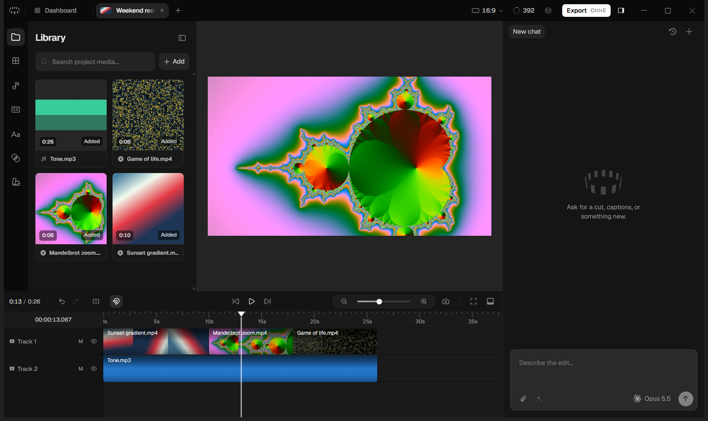

# cardboard-showcase

Created in [T3 Code](https://t3.codes).

## Cardboard 1.4.0 (macOS) on Windows

Cardboard only ships an Apple Silicon Mac build. This folder repackages that build's app code
(`app.asar`) onto the Windows build of the same Electron version (43.7.0), with Windows
replacements for its bundled macOS binaries.



Run it from the `Cardboard` shortcut (Desktop or Start Menu), or `Cardboard-win\Cardboard.exe`.
If you launch it from a terminal that has `ELECTRON_RUN_AS_NODE=1` set (some Electron-based IDEs
set this), unset that variable first.

Only `scripts\`, `tools\package*.json`, `README.md` and `assets\` are tracked by git. The app,
the downloads and Cardboard's unpacked code are ignored (see `.gitignore`): they are large, and
they are Cardboard's software, not ours to redistribute.

### Layout

- `Cardboard-win\` — the runnable app. Only this folder is needed to run Cardboard.
  - `resources\app.asar` — Cardboard's code, with the patches below.
  - `resources\bin\` — ffmpeg, ffprobe 8.1 (BtbN win64 gpl build), uv 0.13.6. Stay on 8.1:
    the 9.0 and nightly builds need NVIDIA driver 610+ for NVENC, and this laptop has 581.
  - `resources\director\claude.exe` — Claude Code 2.1.309 for win32-x64, the version the Mac build bundles.
  - `resources\cli\` — the `cardboard`/`cb` CLI, patched.
- `dl\`, `extracted\`, `asar-src\` — downloads and unpacked sources, kept for rebuilding.
- `main.orig.js`, `library-worker.orig.js`, `cardboard.orig.mjs`, `tabs.orig.js`, `index.orig.js`, `EditorRoute.orig.js`, `installErrorTelemetry.orig.js` — unpatched bundles the patch scripts start from.
- `scripts\` — patch and helper scripts.
- `tools\` — 7-Zip, `@electron/asar`, rcedit and the generated `Cardboard.ico`.

### Patches

`scripts\patch-main.js` (applied to `asar-src\dist\main.js`):
1. Use `.exe` names for the bundled ffmpeg, ffprobe, uv and claude.
2. Allow Desktop Director (the local Claude Code agent) on Windows; it was gated to darwin-arm64.
3. Replace the Director's tool setup (symlinks and `/bin/sh` wrappers) with shims that work
   from Git Bash, cmd and PowerShell. Python 3.12 with numpy, OpenCV, Pillow and SciPy goes in
   `%APPDATA%\ai.cardboard.desktop\director-python`. The folder with the real `ffmpeg.exe` and
   `ffprobe.exe` (`resources\bin`, which also has `uv.exe`) goes on the agent's PATH after the shims.
   Windows starts a bare `ffmpeg` only as an `.exe`, so agent code such as Python's
   `subprocess.run(["ffmpeg", …])` failed with "file not found". On macOS the shims are symlinks to the
   binaries, so the same code works there.
4. Run the control socket on a named pipe, since Windows can't listen on a socket file.
5. "Install agent tools" writes `cardboard`/`cb` shims to `%USERPROFILE%\.local\bin` and adds that folder to the user PATH.
   The `.cmd` shims keep `ELECTRON_RUN_AS_NODE` to themselves (`setlocal`). Before, one `cb` command left it
   set in the console, and every Electron app started from there (Cardboard, VS Code…) then ran as plain
   Node, with no window. On start, shims an earlier build installed for this exe are brought up to date
   (not while a `cb` command runs, since cmd would go on reading the batch file it is in the middle of).
   The folder goes on the user Path in the registry as it is: `%USERPROFILE%\…` entries stay unexpanded and
   the value stays `REG_EXPAND_SZ`. `[Environment]::SetEnvironmentVariable`, used before, wrote it back
   expanded, as a plain string. Paths with non-ASCII characters (`C:\Users\José\…`) are written into
   `.cmd` files as `%LOCALAPPDATA%`, `%APPDATA%` or `%USERPROFILE%` plus the rest, since cmd reads a batch
   file in the console's code page, not UTF-8. That goes for the Director's tool shims (patch 3) too.
   Cardboard also writes `cb`/`cardboard` shims for your own agents (Settings → Agents) in
   `%APPDATA%\ai.cardboard.desktop\agent-bin`, first on their PATH. On Windows it wrote only `.cmd` files,
   which Git Bash (Claude Code's shell) can't run by name, so unless agent tools were installed, Claude Code
   got `cb: command not found`. Now that folder gets the sh shim too, as on macOS.
6. Find your own Claude Code and Codex (Settings → Agents). On Windows Cardboard only looked for
   `claude.cmd`/`codex.cmd` on PATH, so it missed `codex.exe`. It also failed to start an npm
   `claude.cmd`, because Node won't run a `.cmd` directly. Now it takes `.exe` files on PATH,
   follows npm `.cmd` shims to the `.exe` they run, and also checks `%USERPROFILE%\.local\bin\claude.exe`
   and `%LOCALAPPDATA%\Programs\OpenAI\Codex\bin\codex.exe`. npm's shim for a JavaScript package runs
   the `node.exe` next to it when there is one (nvm-windows, fnm, a prefix in Node's folder). That is
   Node, not the agent, and it passes the `--version` check, so those shims are skipped.
   It also fixes the environment agents are found and started with. Cardboard copied it and read
   `PATH`, but started from the Start Menu or Explorer, Windows names that variable `Path`. So the
   PATH search found nothing, and agents were started with only Cardboard's own shim folder on PATH.
7. Make notifications show (for example when an agent asks you something while the window is in
   the background). Windows only shows notifications from an app with an AppUserModelID that
   its Start Menu shortcut also carries. Cardboard set none. On start it now sets
   `ai.cardboard.desktop` and writes that ID into the Cardboard shortcuts (Start Menu, Desktop,
   taskbar pin) that point to this exe. It also creates the Start Menu one if it's missing. It
   flashes the taskbar button where macOS bounces the Dock icon.
8. Fewer animations in Cardboard only. Cardboard has no setting for this. It follows the system's
   reduced-motion preference, and the `force-prefers-reduced-motion` switch turns that on for
   Cardboard alone, leaving Windows' "Animation effects" setting as it is. Some fades remain. To
   bring the animations back, delete this replacement and rebuild.
9. Cardboard's tab strip is the title bar, as on macOS. The window asked for macOS's `hiddenInset`
   title bar, which Windows ignores, so Windows drew its own title bar and a File/Edit/… menu bar
   above the strip. Now the window has no native title bar. Minimize, maximize and close stay native
   (Snap Layouts, the red close hover), drawn over the strip's right end on a clear background with
   neutral-400 glyphs. The empty parts of the strip drag the window, double-click maximizes and
   right-click opens the window menu. The app menu moves into the strip (see `patch-strip.js`): main
   describes `Menu.getApplicationMenu()` to the strip and runs the item picked, so the strip's menu
   is always the real one, and the menu's shortcuts still work. Alt pressed and released on its own,
   or F10, opens the menu from anywhere in the window, as a menu bar would. A click or another key
   while Alt is down cancels that (Alt+drag duplicates clips, Shift+F10 opens the timeline's context
   menu). So does Alt pressed with a mouse button held: Alt in the middle of a drag, let go after the
   drop, even with a scroll or another button on the way. And so does any key let go while Alt is down,
   even one whose press Windows keeps for itself (Alt+PrintScreen). The About window loses its title bar and menu bar too: its page already has a drag region,
   and its fixed size had cut off the copyright line under them.
10. File → Import Folder… (Ctrl+Shift+I) imports the video, audio and image files in a folder and its
    subfolders into the open project, in path order (`clip 2` before `clip 10`). The folder picker runs
    in the editor, which gets the files through the event its own Import button uses, so the usual
    checks and progress apply. A folder with no media says so. File pickers only open from a user
    gesture, which a menu click doesn't give the page, so this one runs with a gesture. Import Media…
    from a menu now does too: it pressed Cardboard's own Ctrl+I in the page, whose picker only opened
    if the editor had been clicked in the last few seconds. Dropped folders are `patch-renderer.js`.
11. An activity log, for looking back at how an editing session went (see [Activity log](#activity-log)).
    Main writes it. Menu items say whether they ran from the strip's menu or their accelerator, agent
    answers say how long their question waited, Ctrl+Tab (which main handles itself) and Alt/F10 are
    logged, and main's own warnings and errors and the library worker's output go in too. Before, those
    only reached a console nobody sees when Cardboard starts from the Start Menu. It also says which GPU
    draws the app, and when a GPU or page process dies.
12. Windows wording where main names the Mac: "this PC" for "this Mac" in the sign-out and quit dialogs
    and when an agent isn't installed, and File Explorer for Finder in the agent's reveal step.
13. On a laptop with two GPUs, Cardboard draws on the fast one when the PC is plugged in. Windows gives
    an app the power-saving GPU unless the app asks for the other, so on a laptop with an RTX 3050
    everything Cardboard draws (preview, timeline, graphics) and its own video decoding ran on the
    integrated Intel GPU, which borrows system RAM, while the RTX sat idle. Started on battery it stays on
    the default GPU: the RTX, powered off otherwise, draws 3.3 W while Cardboard idles on it and about 9 W
    while a graphic plays. The choice is made when Cardboard starts, from the
    power state then; plugging in or out while it runs takes effect at the next start. An NVIDIA
    GPU is powered off when idle, and waiting for it to power up made startup slower, so `nvidia-smi -L`
    (installed with the driver) starts waking it as Cardboard starts. To keep Cardboard on the
    power-saving GPU, choose "Power saving" for it in Windows Settings → System → Display → Graphics;
    that wins over Cardboard's request (checked). Left out of `--baseline`. Measured in
    [Benchmarks](#benchmarks).
14. The "[telemetry] sentry delivery failed" warning says why: Cardboard's own message for the failed upload,
    an HTTP status or a network error ("Telemetry relay failed (429)", "fetch failed"). Cardboard reports
    its own problems, and a failed analytics upload is one, to cardboard.ai; when that report can't be sent
    either, main warned without the reason (145 times in an hour of test exports, from both builds and from
    a normal session, so not from these changes).
15. The window opens at the size it was closed at. Cardboard saves the window's size when it closes and
    opens the next one at that size. Without the native title bar (patch 9), Electron on Windows makes a
    window slightly bigger than asked, so each launch saved a bigger size and opened bigger still. On the
    test laptop (125% scaling) it went 1440 → 1446 → 1452 → 1458 points wide over three launches, and
    would go on until the screen's width, where Cardboard caps it. The default window is as tall as the
    screen, so only its width grew. A window dragged smaller, or quit maximized, grew both ways. Now main
    notes how much bigger the window came out when it was made, and takes that off the size it saves.
    Over repeated launches, a resize, and quitting maximized then restoring down, the window kept its
    size. How much bigger Windows makes it depends on the size and position. So the first launch after a
    resize can open it a few pixels off the size it was dragged to, and it keeps that size afterwards.
16. Cardboard no longer leaves copies of its own files in `%TEMP%` (`scripts\asar-assets.js`). Every launch left
    57 files, about 9 MB, named `<uuid>.tmp.js` (and `.tmp.css`, `.tmp.woff2`…), and they stayed after a clean quit:
    200 test launches left 11,634 of them, about 1.7 GB. They were copies of the pages' code, styles, fonts and
    images. These are packed in `app.asar`, and Cardboard serves them (`app://cardboard/…`) by streaming each file.
    Electron can stream a file packed in an archive only by copying it out to a temp file first, and it never
    deletes that copy. macOS empties its temp folder; Windows keeps `%TEMP%` unless Storage Sense is on. On Windows
    such a file is now read straight from the archive, with no copy. The answer is the same: the status, every
    header and the bytes (tested against Cardboard's own handler, and on the real Electron 43.7.0, where the old
    handler left one copy per file served and the new one leaves none). It isn't slower either. Measured in a test
    app around Cardboard's own handler, on Electron 43.7.0 for Linux, 57 of Cardboard's files (9.1 MB), 20 alternated
    rounds: fetching them all took 123 ms instead of 170 (medians), the handler's time for the first request
    (`index.html`) 10 ms instead of 18, and the page load was the same (264 ms). Files outside the archive, such as your
    media, the library and preview copies, are served as before (that is a different handler, which this
    doesn't touch). macOS is unchanged.
    The copies earlier builds left are deleted in the background, a few seconds after the window shows. Only files
    named `<uuid>.tmp` or `<uuid>.tmp.<ext>` that are byte for byte a file in this `app.asar`, with the same size and
    extension, are deleted, and only if they were made before Windows last started. Electron keeps reopening its
    copies, so an older Cardboard that's still running would lose a file it uses; no program still running was
    started before Windows was. Nothing else in `%TEMP%` is read beyond its name, size and date. Copies of a file an
    earlier build had patched differently (a few of the 57) don't match, so they stay. It stops after 20 seconds,
    and it gives way to the app between files. When nothing it should delete is left, `temp-sweep.json` in
    Cardboard's user data folder records that it's done, and it doesn't run again. A copy from since Windows started,
    one it couldn't delete (in use) or a stop at 20 seconds leave it for the next start, for at most 20 starts. The
    activity log says how many files went.
17. A naming call whose binary has gone no longer shows an error dialog. Cardboard names a new chat and a new project
    (and, with Carton, an agent's turn) by running your Claude Code or Codex once. If the binary it found was removed
    before the call (an update swapping it, an uninstall), the process failed to start with an error nothing caught,
    which in the main process shows Electron's error dialog, and the error carried your words. Now the call just ends
    with no name: the chat keeps its first words, the project its file names, the turn your message. Nothing is
    logged.

`scripts\patch-worker.js` (applied to `asar-src\dist\library-worker.js`) uses the NVIDIA GPU
(NVENC) for converting imported media and making preview copies, where macOS uses VideoToolbox.
It test-encodes a few frames once to check that NVENC works. If NVENC fails on that test or on a
particular file, Cardboard's existing fallback re-encodes in software (libx264/libx265).

It also makes imports finish much sooner. After a drop, Cardboard makes a timeline filmstrip and a
waveform for every clip, and a proxy for anything over 1920 px. It decoded every frame on the CPU for
both, so a 4K HEVC clip took about as long as it runs, twice. Now:
- Proxies decode on the GPU (NVDEC) and scale there (`scale_cuda`). Rotated sources (phone footage)
  decode on the GPU and scale on the CPU, since ffmpeg only applies the rotation to frames in system
  memory. If the GPU run fails, the NVENC run with CPU decoding follows, then libx264.
- Proxies are encoded at constant quality (NVENC CQ 30, capped at Cardboard's 12 Mb/s) and scaled with
  lanczos. Cardboard asks for a fixed 12 Mb/s, which VideoToolbox needs, and `scale_cuda`'s default
  scaler is softer than the CPU's. With both, proxies were 5 to 14 times the size of the CPU path's and
  looked worse. Scored against the 4K source (each proxy scaled back up, VMAF 4K model):

  | Proxy of | CPU path, libx264 CRF 20 (stock) | NVENC 12 Mb/s (before) | NVENC CQ 30, lanczos (now) |
  | --- | --- | --- | --- |
  | 40 s 4K HEVC phone clip | 10.7 MB, VMAF 92.4, 17.3 s | 54.8 MB, VMAF 85.5, 6.8 s | **5.8 MB, VMAF 95.3, 4.7 s** |
  | 20 s 4K60 H.264 clip | 1.9 MB, VMAF 91.1, 9.4 s | 27.7 MB, VMAF 82.8, 8.6 s | **1.6 MB, VMAF 94.9, 6.9 s** |
- Filmstrips decode only keyframes when, in the first 30 s, they come at least every 2 s. Otherwise
  every frame is decoded, on the GPU when there is one. ffmpeg's `fps` filter fills each slot with the
  last frame nearest to it, so even decoding every frame, Cardboard's thumbnails were up to half a slot
  late (0.25 s for half-second slots, 0.5 s for one-second slots). From keyframes about 1 s apart they
  land up to 0.57 s off for half-second slots and 0.07 s for one-second slots (measured on three
  clips). `eof_action=pass` keeps the last keyframe, which the filter otherwise dropped at the end.

Four clips from a 4K HEVC and phone footage folder (54 s and 9 s 4K, 20 s and 78 s 1080p) went from
73.5 s to 11.9 s until every filmstrip, waveform and proxy was ready. The clips themselves show up in
under a second either way.

It also fixes Cardboard staying alive with no window. Main waits for every import to be done before it
quits, and the worker said an import was done only if all of its background work succeeded. When one
background save failed (see [Saves on Windows](#saves-on-windows-scriptsrename-retryjs)), the worker never
said so, and main waited forever: closing the window left the process running with no window, until it
was ended in Task Manager. Now a clip whose background work fails gets Cardboard's usual "Could not import"
for that clip, and the import counts as done either way. The CLI's copy has the same change; there the
failure ended a recipe install with an unhandled rejection.

It also fixes clips left without a filmstrip when Cardboard quits during an import. Cardboard writes a
clip's poster first and, on reopening a project, counted any thumbnail as a finished filmstrip. Now a
video needs its filmstrip thumbnails to count as done.

The helpers both media patches add are in `scripts\media-helpers.js`. In the app's library worker they
also note in the activity log whether NVENC and CUDA work, and every fall back from the GPU to the CPU,
which was silent before. The CLI's copy stays quiet, since the agent reads what it prints.

`scripts\patch-strip.js` (applied to `asar-src\dist\renderer\assets\tabs-DV5oCzuF.js`, the tab strip)
finishes the title bar from patch 9. Cardboard's logomark sits at the strip's leading edge, where macOS
has its traffic lights, and opens the app menu: File, Edit, Playback, View, Window and Help, each with
its items in a submenu. The menu is drawn the way Cardboard draws its own menus (the timeline's context
menu): the same raised surface, 30 px rows, separators, shortcut keycaps (`Ctrl+Shift+E`, as Cardboard
writes shortcuts on Windows) and open animation, using classes already in Cardboard's stylesheet. It
works from the keyboard: arrows, Enter, Escape, and a letter to jump to an item. While it is open, a
click outside it only closes it, and closing it returns the keyboard to the editor. The strip also
leaves room for the window controls on the right, except in full screen, where Windows hides them, as
macOS's strip does for the traffic lights on the left. The menu's code is in `scripts\strip-titlebar.js`.

`scripts\patch-renderer.js` (applied to `asar-src\dist\renderer\assets\index-DufLJgUU.js`, the renderer's
main bundle, `EditorRoute-CuIqwZKP.js`, the editor's, and `installErrorTelemetry-DxKId8tA.js`, which holds
the editor's state) does the rest of the renderer's changes.

It imports the media in a dropped folder and its subfolders: dropped on the editor (the media panel or
anywhere else) it goes into the project, and dropped on the Dashboard (its prompt box, or anywhere else
on it) its media is attached to the prompt, as dropped files are. The prompt box has its own drop target,
which took a dropped folder as one attachment named after the folder. Checked with real drags from File
Explorer. Dropping a
folder imported nothing. Chromium lists a dropped folder as one file with no type, which the media filter
threw away. Cardboard has a folder walker, but read the drop's folders only after an `await`, when
Chromium has already emptied them. Now they are read while the drop is still being handled. Non-media
files in the folder are skipped, files already in the project too, and plain file drops work as before.
On the Dashboard a folder without media still gets the "files were not added" note. The Report an Issue
attachments and other drop targets don't take folders.

It also fixes the keyboard on Windows, found by pressing every shortcut in the running app
(`scripts\test-shortcuts.js`, below):
- Recording a shortcut in Settings → Shortcuts stored Ctrl as `ctrl`, while every built-in Ctrl shortcut
  is stored as `meta` (Cardboard's Cmd/Ctrl). The conflict check told the two apart, so Ctrl+D for Split
  at Playhead was saved without a word although Duplicate has Ctrl+D, and Ctrl+D then split with nothing
  selected and duplicated with clips selected. Now Ctrl is recorded as `meta`, and shortcuts recorded
  before are compared as `meta` too. On a Mac the same recording said "already used by Duplicate".
- The Shortcuts page drew a Mac keyboard: ⌃ ⌥ ⌘ along the bottom, ⇧, ⌫, Return, and ⇧/⌘/⇧⌘ layers. Now
  it draws Ctrl, Win, Alt, Shift, Backspace and Enter, and Ctrl, Shift and Ctrl+Shift layers.
- Ctrl+Y redoes, as everywhere on Windows (Ctrl+Shift+Z still does). Only while Redo keeps its default
  and nothing else is set to Ctrl+Y.
- Answering the agent from the keyboard: Enter on a question's option that is already picked sends the
  answer. Clicking an option leaves the keyboard on it, and Enter clicked it again, which un-picked it,
  so "click an option, press Enter" sent nothing. Enter on an option not picked yet still picks it
  (Enter, Enter from the keyboard), and Space still toggles. A generation ("Generate this sound effect?
  0.27 credits") is approved with Ctrl+Enter and skipped with Esc, as the card's keycaps say, from the
  reply box or anywhere else; plain Enter doesn't spend credits. That is Cardboard's design (⌘↵ on a Mac)
  and is unchanged.
- The pages' part of the activity log: shortcuts, keys nothing handled, how each agent question was
  answered (a key or a click), page errors and error toasts.

The timeline and playback, found by playing real projects in a separate copy of the app and measuring:
- Previous/next frame (← →) keep the playhead in view. Jump to start/end scrolled the timeline to the
  playhead; the frame steps did not, so holding ← walked it off the edge, out of sight.
- Dragging the playhead, or scrubbing the ruler, past the edge of the timeline scrolls it, faster the
  further out, as in other editors. It only followed the pointer within the visible part, so a point off
  screen could only be reached by scrolling first. Rightward it stops once the project's end is in view.
- The timeline redraws when the GPU hands its canvases back. The ruler and the tracks are drawn on opaque
  canvases; when the GPU drops them (a driver reset, the GPU process restarting, memory running short)
  Chromium gives them back blank, which shows as black, and says so with a `contextrestored` event nothing
  listened to. They stayed black until something else redrew them: still 99% black 10 s after the GPU
  process restarted, against redrawn within 1.5 s now.
- A clip's name shows once on the timeline. Scrolled so that a clip started just off the left edge,
  Cardboard drew its name twice, overlapping: once at the clip's start, cut by the edge ("…verie (light
  score)"), and once stuck at the edge ("Arctic Reverie (light score)"). That is Cardboard's own drawing,
  on a Mac too, at any display scale, and still in 1.4.1. The names are drawn on two canvases: one scrolls
  with the clips and covers up to three screens' width around the view, the other stays at the view's edge.
  A clip that started off screen but inside that wide canvas had its name on both. Now the edge canvas
  shows a clip's name only once the clip's own name has left the view. Until then that name scrolls off
  with its clip, cut by the edge; then it reappears at the edge. The scrolling canvas is Cardboard's,
  untouched. The edge canvas, already redrawn on every scroll, only leaves out the names still in view, so
  the timeline's redraws do no more work than before and nothing extra is kept in memory. Drags, marquees
  and export draw as Cardboard does. Cardboard's wheel and touchpad scrolling also redrew the names a frame
  after the view moved. Each wheel notch showed one frame with the edge names of the old place: Cardboard's
  own edge names hid it, but at the switch it showed as a frame with no name, or two. The wheel's frame now
  redraws them, and the redraw the scroll event asks for next is skipped, so they are redrawn as often as
  before. `scripts/carton/test/browser/timeline-labels.js` checks it in Cardboard's real pages, at scales
  1, 1.25 and 2:
  - every scrolling frame, and with real wheel notches;
  - against a full redraw at the same place;
  - drags, a marquee, a moved keyframe, jumps and export, pixel for pixel against pristine 1.4.0;
  - and that pristine 1.4.0 shows the overlap.
- Play waits only for audio that will be heard. After a seek, Play holds ("Loading audio...", up to 8 s)
  until the sound of the clips ahead is loaded, and that included clips on muted tracks and muted,
  hidden or reversed clips, which are never played. With a slow disk (every extracted-audio read 3 s
  late): Play with the B-roll track muted started in 0.18–0.22 s, against 4.0–4.1 s.
- A second Play while it says "Loading audio..." plays at once, the sound joining as it loads (as after
  the 8 s limit). Pressing again did nothing, so it looked like Space didn't work: 0.82–0.83 s to playing
  with a second press at 0.6 s, against 3.9–4.1 s. Each audio load is numbered, and only the newest one
  may start playback when it ends, so a load overtaken by a pause, a seek and another Play can't start
  playback before the new spot's audio is in.
- A graphic (a `<code>` clip) is rebuilt only when its page stops answering. The preview asked a graphic's
  page for a frame with a 10 s timer that also covered fetching the frames of the videos inside it, so a
  slow video decode made Cardboard rebuild the page, which stays invisible until it draws: the preview
  went black for as long as that took. The page's timer now starts when the frame is sent. A slow fetch
  is waited for and its frame used when it comes; only one that hasn't answered in 30 s gets the old
  rebuild, so a hung decode still ends in Cardboard's "couldn't render" note.
- While playing, a graphic draws with the newest frame of its videos that is ready instead of waiting for
  the frame of that exact moment. Every frame of a graphic waited for its videos' frames, even with the
  video off screen, before the next could start, so a graphic with a video inside played at 26–41 frames/s
  on the test laptop (4–14 while it was busy) and froze for seconds when a decode was slow. Paused, scrubbing, and the first frame after Play still
  wait for the exact frame. Left out of `--baseline`.
- An open editor no longer wakes up on every screen refresh while nothing moves. Everything drawn over the
  preview (selection handles, a playing graphic, background removal, pending generations) is placed from where
  the preview's canvas is on screen, and Cardboard measured that on every refresh (up to 144 times a second on
  a 144 Hz screen) for as long as a project was open. Background project tabs did it too: they're stacked
  behind the front one, not hidden. Now it measures when something could have moved the canvas (the window or
  a panel resizing, a divider dragged, the preview zoomed, panned or given another aspect ratio, a scroll or
  transition around it, the pointer pressed or dragged), keeps measuring every frame while the canvas moves,
  and rests half a second after it stops. A check once a second catches anything else. On the test laptop an
  idle editor took about a fifth of a CPU core with one project open and about two thirds with four; now about
  1% and 2% (see "An idle editor" under Benchmarks). Left out of `--baseline`.
- Graphics stay on the picture in full screen. With the preview zoomed in or out (Ctrl+scroll or a pinch over it,
  undone by its "Reset" button), full screen drew a graphic (a `<code>` clip) scaled by one over the zoom from the
  frame's top-left corner, while the video under it was right: zoomed out to 90%, 1.11 times too large and cut off
  at its right and bottom; zoomed in to 110%, too small, its right and bottom edges inside the picture. At the
  preview's own zoom it was right. The background-removal shimmer, a pending item's placeholder and a clip's proxy
  progress ring were off the same way. They were scaled by the zoom setting, but full screen shows the preview on
  its own, without the zoom; now they're scaled by the size the preview is actually drawn at. This is Cardboard's
  own bug, on a Mac too and at any display scale, and Cardboard 1.4.1 still has it. The normal view, exports and
  frame renders were right. `scripts\carton\test\browser\fullscreen-graphic.js` checks it in Cardboard's editor.
- The activity log notes the waits: Play waiting on audio over half a second, a second press forcing it,
  slow video frames for a graphic, graphics rebuilt, canvases given back.
- Clicking the timeline, or a clip in the preview, takes the keyboard from the agent's prompt box (or any other
  field outside them), as a click anywhere else in the editor already did. Both cancel the click's default
  action so a drag doesn't select text, and that also left the keyboard where it was: with the prompt box
  focused, Space after clicking a clip typed a space into the prompt instead of playing, and Delete, S and the
  arrows edited the prompt instead of the timeline. Checked by clicking the ruler, a clip, empty track space,
  a track header and a selected clip in the preview: before, Space typed into the prompt box after each of the
  five; now it plays after each. A click on the tracks, the ruler or the track headers also takes the keyboard
  from the timeline's own controls: after the zoom slider was used, → and ← zoomed the timeline as well as
  stepping the playhead, and now they only step it. The preview's text editing keeps its own behaviour.
- The editor's left rail (Library, Layout, Audio, Captions, Text, Transitions, Effects) shows each icon's name
  in a tooltip. Cardboard wraps every icon in its tooltip, but the rail's button dropped what the tooltip
  hands it (its hover and focus handlers), so none ever opened.

Badges in the agent's prompt box (a clip or media file mentioned with @, an attached file, a pasted link, a
skill) are one unit, and a click on one opens it. A badge is text in the box with a chip drawn over it, and
the caret could go inside it: a click on a badge put the caret between its letters (or, on its icon, between
the two spaces it starts with), and typing there broke the badge into loose text (`clip-a.mxp4`). Now a click
on a badge opens what it stands for, the way a link does, and the caret and the text stay as they were, also
while the button is down:
- a clip: selected on the timeline, the playhead at its start and the timeline scrolled to it, as a click on
  the clip there would; the keyboard goes to the editor, so Space plays it;
- a media file: Cardboard's own Media preview of it (the one its tile's Preview opens in the Library), found by
  the file's id, so it works for a file scrolled out of the Library, hidden by a Library search, or sharing its
  name with another. What the left panel shows stays as it is (a collapsed panel opens), and a selected clip
  stays selected;
- a sound effect from Audio, which the Library doesn't list: its clip on the timeline, or the Audio panel;
- an attached file or a skill: its file, in the app that opens it (Cardboard's Preview for attachments);
- a link: the browser.

A clip deleted since it was mentioned says it isn't on the timeline anymore. Escape closes a Media preview
opened this way and nothing else (it also cleared the timeline's selection, and with it a selected clip's
reference in the prompt). Over a badge the pointer is a
hand. From the keyboard a badge is one character wide: ← and → step over it, Shift+←/→ select it whole,
Ctrl+← and Ctrl+→ (Option on a Mac) take it as one word, ↑ and ↓ stop at its edge, and the caret never passes
through it on the way (the word moves went into it before being put right); a drag that ends on it takes it
whole, and Ctrl+Backspace and Ctrl+Delete (Option on a Mac) remove it whole as
Backspace and Delete already did, where they used to leave part of its name behind. The same goes for the link
badges in Report an Issue, whose Backspace took a link apart a letter at a time. Typing anywhere else, and the
arrows and deletes in plain text, work as before. On a caret move by the mouse or another
key only the characters around the caret are looked at; the prompt's badges are found when the caret is next
to one, and on a word move, or ↑ ↓ with badges in the prompt.

And Windows wording where Cardboard names the Mac: "this PC" for "this Mac" (Settings → Library, Agents,
the plans note, the library drive error) and File Explorer for Finder (Show in File Explorer, the project's reveal button, the
agent's reveal step). Cardboard words some text per platform already ("Show in Folder", Ctrl for ⌘); these
it missed. Each text is chosen when it's shown, so the same bundle still reads right on a Mac.

`scripts\patch-cli.js` (applied to `resources\cli\cardboard.mjs`) connects the CLI to that named pipe.

### Saves on Windows (`scripts\rename-retry.js`)

Imports lost clips on Windows. Cardboard saves `project.json` by writing a temp file and renaming it over
the old one. Windows refuses to replace a file that anything has open (`EPERM`), where macOS just replaces
it. Cardboard's library worker reads `project.json` back after every save, to tell its own writes from
outside edits. During an import the worker saves in bursts, so a save often landed while the previous one
was being read, and that clip's import failed. The clip got no filmstrip or waveform, or a "Could not
import" dialog appeared, or after reopening, a "Missing Media Files" prompt asked for a file that was still
in place. The faster imports made it more likely: 3 of 5 nine-file imports lost one or two clips. The `cb`
CLI, the Director, antivirus, the search indexer or cloud sync reading `project.json` can cause the same.

Main retries its own writes on Windows (4 tries, 50 ms apart); the library worker and the CLI didn't.
Now the rename behind every save in the worker and the CLI retries on `EPERM`, `EBUSY` and `EACCES` for up
to about 1.3 s (10, 20, 40 … 320 ms), as graceful-fs does. It goes into the library worker
(`patch-worker.js`) and the CLI (`patch-cli.js`). The CLI imports `rename` as an ES module binding,
which only follows the change once `syncBuiltinESMExports()` runs. Main is left as it is, since the retry
would multiply its own.

Open Project (a folder or a `.cbproj`) can fail the same way. Cardboard copies the project into a staging folder
(`.opening-…` in the library), moves it into place, then removes the staging folder. On Windows a file that
anything holds open can't be moved or removed, and a removal that fails fails the whole Open Project. In CI's
Windows run with Carton on, Carton itself held the staged project's history open (`EBUSY` on its `carton.db`); it
now closes everything it opened there before Cardboard moves it (see "Carton: live sync and sharing"). Defender or
the search indexer scanning a file the import has just written can hold one briefly too. The move is a rename, so
it was already retried; the removal now retries the same way (adding `ENOTEMPTY`), in the worker
(`patch-worker.js` 6) and the CLI (`patch-cli-media.js` 6).

**With Carton off** (see "Carton" below), every Carton hook runs Cardboard's own code, except for three changes that
apply whether Carton is on or off:
- The staging folder's removal retries on Windows, as above.
- Open Project of a `.cbproj` removes only what Carton itself wrote from the staged copy, before Cardboard reads it:
  the `.carton\` folder, where Carton keeps a project's history, and Carton's view files in `.scratch\views\`. A view
  file is Carton's when its name is a view's and its content is Carton's: a `.tsx` whose `// cardboard:rev` line has
  the form only Carton writes (`main@3~5e1f0c2a b:…`; Cardboard's own is a bare number), or a `.status` file in
  Carton's format. Anything else under `.scratch\views\`, a person's or an agent's own files, stays. It only acts on
  archives that contain Carton's data, so a stock `.cbproj` opens exactly as before. It stops someone else's
  `carton.db` and views from landing silently in a Carton-off library and surfacing as foreign history if Carton is
  switched on later. The `.cbproj` itself is untouched, so nothing is lost. Opening a project folder is never
  scrubbed: it is your own project, and keeps its history and every file. (`scripts\carton\sync\patches\cbproj.js`)
- Save As of a `.cbproj` leaves the same files out, so a file never carries this computer's history database (local
  paths, this device's pins) or Carton's view files. Everything else in `.scratch\views\` goes in, as in Cardboard
  1.4.0. (`scripts\carton\store-bridge.js`)

`scripts\patch-cli-media.js` (applied to `resources\cli\chunks\chunk-LL26E55H.mjs`) makes the same
media changes in the CLI's own copy of Cardboard's media code. `cb media add`, `cb media proxy` and
the Director's imports run that copy in the CLI process, not in the app. Unpatched, it encoded
proxies in software (libx264), since its hardware check only knew VideoToolbox. The same four clips
took 57.7 s with `cb media add` before, 16.4 s after.

`scripts\mac-scan.js` lists the macOS-specific calls in a bundle, for checking a new Cardboard version.

### Activity log

`%APPDATA%\ai.cardboard.desktop\logs\activity-<date>.jsonl`, one JSON object per line, kept 14 days. It
holds what the Director's transcripts (`<project>.cardboard\agent\chats\*.jsonl`) don't, and never text
typed into a field. Every line has `t` (local time) and `ev`; lines from a project have `project`.

| `ev` | What | Fields |
| --- | --- | --- |
| `app.start`, `app.quit` | Cardboard started or quit | `version`, `electron`, `os`, `displays` |
| `shortcut` | A shortcut ran | `id` (`split-at-playhead`, `next-tab`…), `combo`, `n` when pressed again and again |
| `menu` | A menu item ran | `item` (`File > New Project`), `via` (`accelerator` or `strip`), `combo` |
| `menu.open` | Alt or F10 opened the menu | `via` |
| `key` | A key with Ctrl/Alt/Win anywhere, or any key outside a text field, that ran no shortcut or menu item | `combo`, `handled` (`false`: nothing took it; `native`: it pressed a focused button, named in `on`), `field` (see below) |
| `director.answer` | An agent question was answered | `kind` (`generation`, `question`, `clone`), `outcome` (`approved`, `skipped`, `replied`, `answered`), `waitMs`, `via` (`key:Ctrl+Enter`, `pointer`…), `credits` |
| `toast` | An error or warning toast | `kind`, `msg`, `detail` |
| `error` | An uncaught error in a page; with Carton, also one its side panel, Share dialog or stage layer caught (the editor stays: the panel or dialog says so), and a teammate's presence the Share dialog skipped | `msg`, `src`, `rejection`, `panel` |
| `main.warn`, `main.error` | Main's warnings and errors (`[desktop] …`) | `msg` |
| `worker` | The library worker's output, with `[media]` notes on NVENC, CUDA and CPU fallbacks, and with Carton a `[carton] a cb write waited … ms for timeline.tsx` line for each `cb` write the app took 500 ms or more to show (where the time went: the look at the history, the wait behind the app's other work and its longest tasks, the rewrite, what answered it) | `msg` |
| `gpu` | Which GPU draws the app, 15 s after start | `vendor` (PCI id: `0x10de` NVIDIA, `0x8086` Intel, `0x1002` AMD), `device`, `gpus` (how many), `asked` (`high-performance` or `default`, see patch 13) |
| `process.gone` | A GPU, utility or page process died | `type`, `reason`, `exitCode` |
| `canvas.restored` | The GPU gave the timeline's canvases back blank and they were redrawn | `what` (`ruler`, `tracks`) |
| `playback.wait` | Play waited over half a second for audio | `ms`, `timedOut` (the 8 s limit), `started` |
| `playback.forced` | A second Play started playback without waiting for audio | |
| `preview.slow` | A graphic's video frames took over a second (at most one line per 10 s) | `kind`, `ms` |
| `preview.rebuild` | A graphic's page stopped answering and was rebuilt | `reason` |
| `badge.open` | A badge in a prompt box was clicked open | `kind` (`item`, `media`, `attachment`, `skill`, `link`) |

`on` and `field` name a control by one of the fixed labels written into Cardboard's code ("Play", "Add media
files"), else by its analytics id (`director-question-option`), else by its role or tag (`button`,
`textarea`). They never use its text or a label made at run time, since those can hold what the user typed
("Steer the turn with: <the prompt>", "Rename <project>").

Each kind is capped at 120 lines a minute (`log.dropped` counts the rest). Lines are written in batches
once a second, off the main thread. The page's key listener costs 0.3 to 0.5 µs a keystroke (measured in
the editor), plus a 0.7 µs `setTimeout` for the keys it checks after the page has handled them.

### Testing the keyboard

`scripts\test-shortcuts.js` presses the shortcuts in a running Cardboard and checks each one did what it
should: the playhead, panels, dialogs and tabs over the DevTools protocol (`scripts\cdp.js`), edits in the
saved timeline through the CLI. Run it against a throwaway profile and library, not your own:

```sh
set CARDBOARD_USER_DATA=%TEMP%\cb-kbtest\userdata
set CARDBOARD_HOME=%TEMP%\cb-kbtest\home
Cardboard-win\Cardboard.exe --remote-debugging-port=9334
:: open a project whose timeline has two clips on one track, as the second tab, then:
node scripts/test-shortcuts.js <project-id> <that timeline as a .tsx file>
node scripts/test-shortcuts.js <project-id> <timeline.tsx> --os
```

Keys sent over DevTools go through Electron's `before-input-event` and the page as a keyboard's do, but
not the window menu's accelerators. Those tests (`--os`) press real keys with `scripts\sendkeys.ps1`,
which brings the window to the front and stops if another window takes it. On the build before the
keyboard changes, 20 of the 25 page tests passed. The five failures were Ctrl+Y, the Mac keyboard, the
missed Ctrl+D conflict, and the activity log, which didn't exist yet. With them, all 25 pass, and all 9
accelerator tests.

### Carton: version history for a project (on by default; `CARDBOARD_CARTON=0` turns it off)

Carton gives a Cardboard project permanent history with authors, cuts (variants) you can fold into each other, undo
by actor, and, later, live collaboration. Its code is in `carton\`; how it hooks into Cardboard is in
`carton\docs\INTEGRATION-1.4.0.md`. The build includes it, and it is **on** by default: the cut you're on, History and
Share are in the title bar and every `cb` goes through it, with no setup. To turn it off, start Cardboard with `CARDBOARD_CARTON=0`
(`false`, `off` and `no` work too; for every start, `setx CARDBOARD_CARTON 0` and restart Cardboard). With it off,
every hook below runs Cardboard's own code, and the app and `cb` read the same variable, so they always agree.
`build-windows.js --no-carton` leaves Carton out of the build altogether.

What changes with it on:
- **No lost edits.** The app and every `cb` agent used to read `project.json`, change it, and rename a new one over it.
  Two of them at once could lose one's edit, even on different clips (seen with 1.4.0's own `cb` here). A GUI save
  wrote the whole timeline and could revert an agent's clip. Now each change is committed to `.carton\carton.db`
  against the exact version it was made on. A stale one is merged in, and a clash becomes a conflict card. Nothing is
  overwritten. Two quick edits of yours never clash with each other: a save sent before the previous one's answer came
  back builds on that save, and a save that landed past an agent's change on another clip brings that change into the
  editor (it used to stay out of the editor, and your next save undid it).
- **History** keeps every version, not the last 20, with who made it, down to the Director's turn and subagent.
  `cb history` shows who made each version, and each turn of an agent in the app (the Director, your own Claude Code,
  Codex, the others) is named from what you typed ("Make the intro tighter"), then from a short title of what it did
  (below); its hold on `timeline.tsx` ends with the
  turn (an agent without Claude Code's hooks, such as Codex, holds it until a minute after its last `cb` call). Your
  own Claude Code's edits are credited to "Claude Code" (they used to read "Director (chat …)", and its turns went
  unnamed). `cb undo <rev>` reaches any version, and `cb undo --turn <id>` undoes one agent turn.
- **History's words and Play, from the laptop (2026-11-05).**
  - **A turn is titled with what you typed.** After a message that never reached an agent (a stopped or failed turn),
    a switch of agent or a fresh agent session, Cardboard sends the agent your message behind a preamble and the earlier
    conversation ("[Earlier messages in this conversation did not reach an agent…"). History used to title the turn
    with that preamble. Now the Working row and the version take your own message. Versions already named that way show
    in their default words ("Claude Code · 1 change") in History, `cb history`, Find, landmarks and Undo's words. The
    stored name stays, so one turn's run of versions still ends where it did.
  - **Then a short title of what was done.** Once a turn that changed the edit ends, its version is titled in a few
    words ("Split audio for J/L cuts"). Cardboard names its chats the same way: one call to your own signed-in Claude
    Code (else Codex), with the cheap model, no tools, no hooks and no session kept. The call is built from your request
    and the turn's changes as History words them, so the title says what actually changed. Nothing waits for it. Until
    it comes, and whenever it doesn't (offline, not signed in, a failure, no answer in 12 s, an answer that isn't a
    title), your words stay. A version you renamed meanwhile keeps your name, and a turn that changed nothing isn't
    titled. The open card shows what you asked in one quiet line ("You asked: “…”", whole on hover), and Find still
    finds the turn by your words. Titles are kept on this computer; they reach a teammate with the cut when you share
    it, as other names do. Neither your message nor the title is logged.
  - **Program code is never quoted.** A change to a code graphic's code read "Changed the code of “Cardboard on
    Windows” to “export default function Graphic({ tim…”". It now reads "Changed the code of code graphic “Cardboard on
    Windows” (3 lines)": what holds the code, and how many lines changed (counted in one pass, from the first changed
    line to the last). The same goes for a shader's code and a code graphic's code kept on its clip, in History, its
    cards, Compare, the Fold dialog and `cb history`.
  - **A change to a clip's own part plays where the clip is.** A code graphic's code and a title's text entry are
    their clip's own media entries, which had no place in the edit: the row's time read "—" and Play all lit it for a
    moment and did nothing. Such a change now takes its clip's place (the earliest, if several clips share it), so its
    row shows the time, ▶ plays it and Play all plays it with the rest. When nothing in a version has a place (an
    aspect ratio or frame rate change alone), Play all is off and its tooltip says "Nothing to play: these changes
    aren't on the timeline", and those rows have no ▶.
  - **Play plays with sound.** History's Play used to move Cardboard's playhead up to 10 times a second from a clock of
    its own, so nothing was heard and the picture stepped. Play, ▶ and Play all now play each stretch through
    Cardboard's own playback, as Space does, with the sound and at full frame rate, and follow its clock. There is no
    seek per frame. Between stretches Play stops, jumps and plays on (back-to-back stretches play straight through),
    and at the end it stops. Like Space, it waits for the sound where it starts to load, and it never asks again while
    it loads (a second Play forces playback before the sound is in; that stays yours to press). Pause and Space still
    pause and go on. Pausing in the editor itself pauses Play too, but Cardboard's own stop at the end of the timeline
    doesn't count as a pause. Pause, Esc, a row's ✕ and closing the card or the panel stop what Play started, a start
    still waiting for its sound included, so nothing starts playing afterwards. Holding Before on an older version
    that ends sooner waits at its end, and the rest plays once you let go. Play only ever stops playback it started: if
    the editor is already playing when you press Play, Play replaces it with its own (as pressing Play anywhere would),
    and playback you start yourself afterwards is never stopped by Play. A viewed version plays its
    own timeline, so clips only it has (an agent's detached "1.mp4 audio") play from the project's media. A media file
    deleted from the project since is neither seen nor heard in a viewed version, as before: the editor takes media
    from the project as it is now.
  - **A group's Play keeps its Pause (laptop check, 2026-11-06).** An edit of yours that joined the group whose Play
    all was playing (or still loading its sound) put the card back on "Play all" with no row lit, while the play went
    on with no control: Cardboard played to the end, and a start still loading began once its sound came in. The play
    now belongs to its card. It carries on over the changes it started with, with its Pause and its lit row; Pause and
    Space stop it, and Play all after a pause goes on from there. Once it ends, Play all plays the new change too. That
    holds only while edits are added to the group. When a version leaves it (naming a version in the middle splits
    the group, and the card keeps the older part) or its start changes, the play ends: Cardboard stops, a start still
    waiting for its sound is called off, and Play all plays what the card shows now. A paused play is let go the same
    way. (The build the laptop checked also kept a paused play's Before on a card it no longer matched, and let a play
    run on with no control when the group's newest version was named.) A single version that an edit turns into a
    group gets the group's card, and its play ends as before. An undo is a version of its own, never in a group, so the
    group keeps its versions and its play goes on.
  - **Play all's "Nothing to play" tooltip reads clearly.** A button that is off is drawn faded, and its tooltip was
    faded with it, so the next row's words showed through it. A button that is off and has a tooltip is now faded by
    its icon, words and background, and its tooltip is drawn solid.
- **Finding a version, and bringing back one clip** (Carton UX v2). Every change is a version, so a long history
  needs finding, by you or your agent:
  - `cb history <project> --find <words>` finds versions by a clip's name (before or after the change), title and
    caption text they set, an agent's request, a version's name, a person or a day. Every word matches the start of
    a word, in any order ("intr cap" finds "Add captions to the intro").
  - `cb history <project> --landmarks` lists the versions people remember: exported, sent (a link made), named,
    agent turns, how it was when you opened the project, and just before a restore. Start and Before are yours only.
  - `cb restore <project> <version> --clip <name>` brings back one clip as it was, and nothing else changes (Ctrl+Z
    takes it back). A clip deleted since comes back; one that wasn't there then is taken out only with `--remove`.
    It never lands on top of another clip: if its place is taken now it goes on a new track just above, at the same
    time. A clip deleted with a ripple comes back with the rest of its track moved back; one added with a ripple,
    taken out, moves the rest earlier. The History panel's confirmation is refused if the clip changed again meanwhile.
  - `cb compare <project> <left> [right] --show` opens the comparison in your editor, also between two cuts.
  - In place of a version you can write `sent`, `exported`, `today`, `now`, a version's name or a cut's name.
  - The agents' instructions say when to use these ("go back to the version I sent the client", "bring back the old
    intro", "show me what changed"). The History panel gets the same through its view model (`find`, `landmarks`,
    `restoreClip`, the Bring back choices, `align`).
  - The search index is built the first time you search, then kept and extended; nothing is added to saving or opening.
    Exported and Sent landmarks stay on this computer until the sync server carries them.
- **The History panel** (Ctrl+Shift+H) reads as a list of what happened, by day: each row says who (an agent's own
  mark), what (an agent's prompt in quotes, a version's name, or the change itself: "Moved “Interview B” 2 s later")
  and when (always with am/pm; the newest says **Now**). Your run of edits is one row ("You · 6 changes ›"), an agent
  at work shows as a live row ("Keep editing. Director sees your changes when its turn ends."), and the cut's start is
  one row at the bottom. A click opens the version's card under it: how far your edit has moved on since ("Your edit has
  7 changes since this · See them"), where each change is in the edit (0:12) and on what kind of clip, Play all, and
  **Go back…** (on the newest agent turn, Undo this turn). Go back… shows the four ways back side by side, smallest
  first, each saying what it will do before anything happens: **Bring back one clip** (pick a clip that changed, was
  deleted or wasn't there yet; only it goes back, "Brought back “B-roll pier” as it was at 10:20 am." [Undo]), **Undo
  Director's turn** (an agent's turn only), **Restore the whole edit**, and **Start a new cut from here**. With a clip
  selected on the timeline, Bring back is picked for it. A click never changes what the editor shows; only Play does,
  and the row then says "Viewing ✕"; **press and hold** a row (or hold V) to peek at it on the stage, and let go to
  come back. The versions people remember are marked on their own, as **landmarks**: Exported, Sent, Named, an agent's
  turn, the day's Start, and Before (kept just before a restore, only for you), with a small picture of the version,
  and a folded day keeps them in view. **Find a clip, a word, a person…** above the list finds versions by clip names,
  title and caption text, agents' requests, names and people, newest first, each saying why it matched. **⇆ Compare**
  answers "what changed since the version I sent / the last export / this morning / in another cut", and a row's ⋯ →
  **Compare with…** picks any second version (or another cut) to compare with. A filter (the icon by the cut) shows
  landmarks, named versions, agent turns, your changes, or only the versions that touched the clip selected on the
  timeline, with that clip's credits.
- **A teammate's change stands out as it arrives.** On a shared project, when a teammate's change (or their agent's)
  comes in while History is open, its row fades in with a ring in that person's colour, the colour of their avatar,
  and a soft glow; after a few seconds it settles into a faint edge of that colour, which stays while History is open.
  So with your own Claude Code adding rows as it works, "Leo's Claude Code · Added title “Summer launch”" reads at a
  glance as someone else. Your own changes and your agents' never get it, nor what was there when you opened History,
  nor a cut you switch to. When a teammate's edit joins their row of edits, or their agent's turn goes on, that row
  glows again for it. With Windows' animation effects off (reduced motion), the ring and then the edge show without
  fading. A screen reader hears "Leo made a change", and nothing more from that person until they have been quiet for a
  minute. A teammate's change that arrived live also reads by name now: History used to say "Teammate" for their edits
  and "Claude Code" for their Claude Code, the same as yours, until History was loaded again; it now says "Leo" and
  "Leo's Claude Code", in Leo's colour, from the moment the row appears, with no flash of another name first, also
  when two people's Cardboards share one computer.
- **Undo (Ctrl+Z)** undoes your edits and the agent turns you started, never someone else's change. A change from
  an agent or a teammate arrives in the editor without an undo step and without dropping your unsaved edit. Undo and
  redo step back and forward in the order you made the edits, as Cardboard's own do: split a clip, drag a piece, and
  Ctrl+Z twice gives the one clip back; Ctrl+Shift+Z gives the split back, and Ctrl+Y the drag. (Carton used to record
  the drag's undo as if it closed a gap on the track, so the split's undo then clashed with it and did nothing.) With
  live sync, that undo also leaves alone a clip a teammate or an agent put later on the same track meanwhile, whether
  the undo was made offline or the other edit was: Carton used to slide that clip back by the length of the drag,
  on every machine, without a card. An undo that does clash with a later change, such as a terminal agent's `cb` edit
  of one of the pieces, changes nothing and says why in a conflict card.
- **One action is one version, and one undo.** Deleting a title (or a code graphic) also removes its own media entry
  ("Text: W6"), which Cardboard saves on its own, a moment before or after the timeline. Carton made two versions of
  it ("Deleted title 'W6'", then "Deleted media 'Text: W6'"), and one Ctrl+Z took back only one of them: the title
  stayed gone, or came back without its entry. Adding a title did the same. Now the title and its entry are saved
  together, as one version that reads "Deleted title 'W6'", and one Ctrl+Z, Ctrl+Shift+Z or `cb undo` takes back the
  whole action, as Cardboard's own undo does, on a shared project too. Versions saved before this stay as they are.
- **A timeline printed from a version that's gone** is refused ("print it again") where 1.4.0 silently merged
  against the current timeline and reverted newer edits. An edit of an older print merges against the version it was
  printed from, whether its header is Cardboard's number or Carton's version.
- **The cut you're on, in the title bar**: on every project tab, before Cardboard's own "16:9 ⌄", a chip names the cut
  the editor shows: "✂ Main cut ⌄", or a colour dot and the name for any other cut ("● 30s Instagram cut ⌄"; a long
  name is cut off at 220 px, 150 px in a window under 1180 px wide, and shown whole in its tooltip). It follows every
  switch, the cuts menu's or a `cb cut switch` from a terminal, as soon as the editor hears of it. A click opens History
  with its cuts menu open, the keyboard in it (arrows, Enter, Esc). While the editor shows something other than your
  own edit (an earlier version opened, a teammate's cut), the chip grows a second part saying what ("👁 The version
  from 2:14 PM (Codex) ✕"), and its ✕ brings your edit back. In a narrow window the chip is what gives way, never the
  window's own buttons: the editor controls beside the tabs may shrink now (they kept their full width and could push
  the minimise, maximise and close buttons out at 960 px), the chip's name and label shorten first, and under 1000 px
  while viewing the cut shows as its dot or scissors alone, its name in the tooltip, and while comparing the second part
  says "⇆ Comparing ✕". With Carton off there is no chip, and nothing else in that row shrinks. The project tabs keep
  room for one tab whole (its ✕) and the New project "+" after it, so the chip gives way before they do; with more tabs
  than fit, the tab list scrolls with "+" at its end (Cardboard let the tabs run on under "+", whose click then started
  a new project where you meant to close a tab: it did at 960 px while comparing). "+" is the 28 px button its class
  asks for; Cardboard's stylesheet made it as wide as the tab list, so a click anywhere after the tabs made a project.
- **History and Share** icons in the title bar, beside "Report an issue", on a project tab. History opens a
  full-height panel beside the agent's chat, in the chat's look (drag its edge to resize), with two tabs, History and
  Comments; the same icon closes it, and shows as pressed while it is open. Share opens a dialog (below). Ctrl+Shift+H opens and closes History from the keyboard (H is free in Cardboard's
  keymap). The preview, the timeline, Ctrl+Z and the chat keep working while it is open.
  History: versions, compare with current and play the changes, restore, cuts, fold in (from the cut's own menu
  too: "Fold “X” in here"). Every change reads as one sentence in the editor's words, the same in History, Compare and
  the Fold dialog: verb first, the clip by its name, positions as the timeline shows them ("Trimmed “Intro”, now ends at
  0:05", "Moved “W6” 2 s later (now starts at 0:09)", "Restored the 12:41 pm version", "Folded in “30s cut”"), and
  times of day always with am/pm. A click, Enter or a double-click on a row opens its card and never changes the
  preview. Only a deliberate step shows something other than your edit ("viewing"): Play on a version that isn't the
  newest, a conflict side's See it, a comment's "See it as it was", a teammate's cut. There is no banner over the
  picture: three quiet marks say it, with one label ("Director's “Add captions…”"): the title bar's chip, a thin blue
  frame round the preview and the timeline (the timeline's clips muted), and the row in History ("👁 Viewing ✕"). When
  History's list isn't on screen to show the row (the panel closed, Comments, a conflict's side), the frame carries the
  label itself in a small tab on its top-left corner, with ✕. The marks follow what the preview actually shows: a
  version Play or Before puts on the preview at once is framed at once (its label follows a moment later), and your
  edit asked for is unframed at once. Esc, any of those ✕, closing the panel or switching its
  tab brings your edit back (a conflict side stays until its card or Esc leaves it). Undo and Redo look unavailable
  meanwhile; an Esc the editor uses first, such as deselecting a clip or skipping an agent's question, stays the
  editor's, whichever was selected first, and with focus in the History panel the first Esc returns to your edit and
  the next closes the panel. Play and See it never select a clip, so the first Esc is always viewing's. An edit tried
  while viewing (a drag, a trim, Delete, Ctrl+Z, Enter or a double-click on a title) changes nothing: the frame pulses
  once and one line says "You're looking at Director's “Add captions…”. [Back to my edit] Esc", in place of
  Cardboard's own refusal note, from the same guard, so every edit Cardboard refuses there is still refused (the
  stage's text editor doesn't open there either, and a selected title or caption shows no text toolbar: nothing in it
  looks editable); with Carton off Cardboard's own note is unchanged. Export opened while viewing (Ctrl+E, the title
  bar's Export, or an agent's export) goes back to your edit first ("Back to your edit to export it.") and exports
  that, never what you were looking at. On a cut other than Main, the timeline's toolbar shows the cut's name and colour
  dot beside the zoom. The keys the History list uses (arrows, Enter) stay the list's. A version shorter than the
  playhead shows from its end, and the playhead goes back where it was on return, unless you moved it. Playing the
  changes moves the preview's playhead with it, so the frames are the real ones. Viewing and the return are each
  announced once to a screen reader.
  **Compare** takes over the editor to show two versions, or two cuts, at once. Every way into it opens it: a card's
  See them, a row's Compare with your edit, Shift+click on a second row, another cut's Compare in the cuts menu, or an
  agent asked in the chat (`cb compare … --show`).
  - **The stage** has three modes:
    - Side by side: the other version in a second player on the left, Cardboard's own preview on the right;
    - Wipe: one picture with a line you drag, or move with ← →;
    - Flip: hold B, or press the pill, to see the other side.
    Play both plays them in step by shot: the two sides' clips are matched by identity, so a trimmed or moved clip is
    still the same shot (the shorter side waits), a clip only one side has gets a slate on the other, and one moved past
    others says where it is ("“Drone shot” is later in your edit now"). Which side Flip shows is said under the
    picture, never over it. Side by side needs a stage 682 px wide, and the Library steps aside for it.
    Narrower than that, Compare shows Flip with Side by side greyed. If closing History would make the room (a laptop
    with History and the chat open), a click on Side by side closes History and shows it; otherwise its tooltip says
    what to close (History, the chat, the Library) or to widen the window. Without a second player it shows only Flip.
    If the second player doesn't start within 2 s, Compare shows Flip and says so once; Side by side and Wipe stay
    greyed, and picking one tries again. The 2 s count only while the window is on screen and the other side shows a
    picture, so a minimised window, or a comparison with the start of History (a slate on the left), doesn't fall back
    to Flip. Under 360 px Compare is Flip only, but Side by side is still offered when closing History alone makes the
    room. Play both run to its end plays again from 0:00 with one click.
  - **The timeline** shows your edit with marks on its clips: green for added, a red dashed ghost where a removed clip
    left a gap (a seam where the rest moved up), amber with "←4 s" for moved, and amber for trimmed or changed. Above the
    tracks is a strip of the other version on its own time, its clips in the same colours (a gap left plain).
  - **History** becomes the list of changes ("differences" between two cuts). A click jumps both players and the
    timeline there, and ▶ or Enter plays that spot on both sides. Its footer offers Restore your edit to it… (asked
    first) or, between cuts, Fold in changes from it….
  - **The title bar's chip** says "⇆ Comparing “Sent to client” with your edit now ✕"; each side has one name
    everywhere in Compare. Esc, its ✕, Done comparing and ← History all go back to your edit, where the playhead stays
    at the change. Esc does so even with a clip selected (clicking one while comparing selects it), and deselects it;
    the keyboard is then in History, so the next Esc closes it.
  - **History can close while comparing**, for a bigger picture: its icon, Ctrl+Shift+H or the panel's ✕ keep Compare
    on and give the stage the room. The frame then shows its own label, "⇆ Comparing “Sent to client” with your edit now
    · 7 changes ✕": a click on its words opens History on the list again, and its ✕ ends Compare. The marks, Play both
    and Flip work as before. History that an agent opened for its comparison closes again when Compare ends, unless you
    closed it yourself.
  - **Nothing can be edited while comparing.** An edit tried gives one line, "You're comparing … [Done comparing] Esc",
    and Export goes back to your edit first.
  - **An agent's request** opens Compare only when you're idle. Mid-edit it waits up to 8 s; while you're viewing,
    playing or in a dialog it offers a note with Open instead. Either way it tells `cb` which it did. A `cb compare
    --show` you type in a terminal is yours ("You opened a comparison."). `cb` says "No editor window has this project
    open" only when no app has it; an app busy for a moment is asked again for up to 4 s (one ask in three said no
    window on the laptop).
  - **The second player** is Cardboard's own preview engine on a canvas of its own, muted. It exists only while Side
    by side or Wipe shows: Flip and closing Compare free it, and paused it draws nothing between seeks.
  Restore ("Restored your edit from 12:41 pm. Later changes are in History."), Fold in ("Folded 3 changes from “30s
  cut” into Main cut.", the count the Fold dialog's button gave), Fold in the rest, a conflict card's pick, Undo this
  turn ("Took out Claude Code's “Tighten the intro…” (4 changes).") and a new cut ("You're on “30s Instagram cut”,
  made from Director's “Add captions…”. Main cut is unchanged.") each end with a short confirmation over the preview,
  and so does switching cuts ("You're on “30s Instagram cut” now."). Each offers the next step: **Undo** (with Fold
  in, also the cut it went into when you're not on it; with a cut, Switch back). Undo takes back exactly what that
  action made, the same way Ctrl+Z does (the whole fold, both parts of a fold that brought in an earlier fold's rest),
  then offers Redo ("Restore undone." [Redo]); if anything landed on top meanwhile it changes nothing and says so. A
  pick of the side already in the timeline changes nothing, so it has no Undo. Ctrl+Z of a restore or a fold says so
  too ("Fold undone." [Redo]). A confirmation stays while the pointer is on it or the keyboard is in it, else 6 s. A History that spans days is grouped by day ("Today", "Yesterday", "Sat, Oct 31"),
  each with its count; a day folds to its named versions with a click or Enter, and with more than 150 versions every
  day but today starts folded. The reader keeps their place as versions arrive. In a narrow window the panel never takes the preview's room: it narrows (down to
  300 px) so the preview keeps at least 320 px, and when even that won't fit it floats over the chat as a drawer, as
  wide as the chat column (a chat narrower than 300 px: 300 px, ending above the timeline, so the timeline and its
  toolbar stay clear). Wherever the timeline's toolbar runs on under the drawer (at 960 px with the chat open it reaches
  under the chat column), the drawer ends above it too, so it never covers Fullscreen or Hide timeline.
  Every layer takes the keyboard: focus moves into a menu, card or dialog as it opens
  and back where it came from as it closes, and Esc closes the innermost one only.
  Comments: notes pinned at the playhead, with replies; a timecode moves the playhead there. The box says where a note
  goes before you write it ("Add a note at 0:13…", "At the playhead · 0:13"), following the playhead until you start;
  times read as the editor's (0:06), a note on the whole video "Whole video". A note whose moment changed since says
  so ("That moment changed since.") with **See it as it was**, which shows the version it was written on, as History's
  Play does (Esc or ✕ comes back). Open, Resolved and All show once a note is resolved. The comment box grows
  with its text up to about eight lines, then scrolls, and has no resize grip.
- **Conflict cards** sit in the preview's bottom-right corner, one at a time: your own edits that clashed, and an
  agent's view edit that clashed with yours (see "An agent's edit and yours at once" below). A card says in words what
  each side did to which clip: "“Interview B”: you and Claude Code both moved it", then "Yours · 2 min ago: Moved it to
  start at 0:18" and "Claude Code's · just now: Moved it to start at 0:20" ("Made it bigger (font size 120)", "Set its
  opacity to 50%", "Removed it"; a clip by its name or file, never an id), and which side the timeline shows until you
  pick ("Until you pick, yours is in the timeline."). The sides are radio buttons that only pick, starting on the side
  shown; the one main button names the pick ("Keep yours", "Keep Claude Code's", "Keep both") and Enter presses it.
  **See it** on a side shows that side on the preview, with the clip in view and the frame's label naming the side
  ("Claude Code's move of “Interview B”"; "Seeing it"; again, Esc, or deciding brings your edit back); "On timeline"
  selects the clip and moves the playhead to it. "Keep Director's" puts
  the agent's in as your own version (Ctrl+Z takes it back), and the confirmation names it ("Kept Claude Code's move
  of “Interview B”."). Two changes of your own read "Your earlier change · 10:04 am" and "Your later change", with
  "Keep earlier" and "Keep later". While the agent is still working, the card says so; if it changes the same thing
  again, a pick you made on the old values is dropped ("Claude Code changed it again. Pick again."). "1/2 ›" steps
  through the cards; "Not now" folds them into a "2 conflicts to pick" pill and sends that card to the back, deciding
  nothing. While History is open or you're looking at another version, the cards wait as the pill, whose click brings
  your edit back and opens them.
- **Who made each version** reads as you'd say it: "You" (a `cb` you typed included), a teammate's name, "Director",
  "Claude Code", "Codex", and a teammate's agent as theirs ("Leo's Director"). A subagent shows as the agent that
  started it; its type and the model are in the tooltip. The project's import reads "Imported the project" by you;
  the cut's start names no one. A clip without a name is named by its media's file name. What you do in the History
  panel is yours too, however the app was started: Fold in (and "Fold in the rest"), New cut from here, Name this
  version, Restore, Undo, a conflict card's "Keep yours" and a comment are you in History and `person` in
  `cb history` (a fold made in the panel was "Terminal", or "Claude Code" when the app was started from its shell). A
  new cut's first version, "Made this cut", names who made it (it named no one; `cb history` said `unknown`). Who made a
  cut is kept beside the cut, not in it, so a Cardboard with an earlier Carton still edits and renames that cut; it
  travels with a `.cbproj` that includes history and with a shared cut to a teammate who joins it, and a maker that
  isn't a well-formed name shows as no one.
- **What each version did** (UI audit, 2026-11-02): a version of several changes reads as one line ("Moved
  'clip.mp4', changed 'W1' and 'W2'"), and "3 changes" beside it opens the full list. A fold reads "Folded 'Client
  review' into 'Main cut': 3 changes", a restore "Restored an earlier version". No version shows an id or a hash:
  sharing footage reads "Linked 'clip.mp4' for sharing" (it read `Set 'clip.mp4' content to "8291f1d9…"`), and a clip
  dragged onto a new track names that track. **Fold in some of it** is one version, "Folded 'Client review' into 'Main
  cut': 2 of 3 changes", by whoever folded, holding exactly the changes taken (it showed the fold, then a change nobody
  made: the undoing of what was left out); `cb history` lists it as a `merge` with what it left out. Changes are
  counted one way everywhere (laptop re-check, 2026-11-02): a change per clip or field, a split one change, so the
  Fold dialog's "2 changes", History's "1 of 2 changes" and `cb history`'s "merge (1 left out)" agree (they read 2, "1
  of 4" and "3 left out"), as do Compare's and Watch the changes' counts (Watch's counter now steps through
  "Section 1 of 2", the stretches of the edit that differ), and a watch link's "N newer versions" counts a fold-some
  once. A split of a clip with auto reframe reads "Split 'clip.mp4' at 1.5 s" (it went on "…, cleared auto reframe on
  its left part, … on its right part": the editor's save drops it from the new parts). Titles are titles: "Added 2
  tracks, video 'clip.mp4', 6 titles and media 'clip.mp4'" (it read "7 clips and 6 media files", counting each
  title's own media entry), and Compare's clips read "1 clip, 6 titles". A title's own media entry ("Text: W1") is the
  title's in the counts and lists too: that setup version counts and lists its tracks, clip and titles, with no "Added
  media 'Text: W1'" lines (each title counted twice before), a restore's list names the titles only, and in the Fold dialog a new title and its entry are one
  row, left out together. The Fold dialog names a track the same fold adds ("Moved 'W1' to track 'Text 1'", as
  History's row says it; it read "to track another track"). Every undo or redo of a restore says so ("Undid the
  restore", "Redid the restore"), also the second and later ones (they read as fresh edits), and the undo of a fold or
  of "Folded the rest…" reads "Undid the fold of 'Alt' into 'Main cut'". **Fold in some of it is one undo**
  (laptop P2-1): after "Fold in 2 of 3" and then the rest, Ctrl+Z takes back the rest, and the next Ctrl+Z the whole
  partial fold, leaving Main as it was before it. The second press used to bring the rest back in (the two presses
  flipped between the same two states, the second misnamed) and a third undid the fold; a partial fold on its own
  undid to the rest brought in. Redo walks forward the same way, and `cb undo`, `cb undo --turn` and History's Undo
  do the same, also on a shared cut with a teammate's edits in between. `cb history` lists "Folded the rest" as
  `merge (the rest)` (it read `revert`), and a redo as `redo` (it read `revert` too), as an undo reads `undo`. **You can fold in the rest later** is true now: the next Fold in lists what
  was left out ("Left out earlier") beside anything new, instead of "Nothing to fold in"; what one fold left out comes
  in, or stays out, together. The filter "Agent turns" (it was "Director turns", and empty for agents with no turn
  recorded) lists every agent's turns: a Director turn, and a run of your Claude Code's or Codex's versions up to the
  one its turn's end names. A conflict card's "Preview" of the agent's side shows the agent's edit (it showed yours,
  and yours showed the agent's). After Restore or "Fold in the rest", Undo offers that version at once.
- **`cb`**: `cut`, `fold`, `credits`, `restore`, `compare`, `conflicts`, `resolve` and `publish`, and the MCP tools
  `timeline_cuts`, `timeline_fold`, `timeline_credits` and `timeline_publish`.
- **A project is never left unreadable.** History's oldest row, "Started the cut", is where the history of a project
  Carton took in begins, before the project itself (the next version): it has nothing to preview, restore or make a
  cut from, so History doesn't offer those, and `cb restore`, `cb cut new --from` and `cb publish` refuse it, naming
  the version that holds the project. (Restoring it used to write a `project.json` with no name and nothing in it, and
  the project vanished from the library.) No writer turns a `project.json` Cardboard reads into one it can't, or
  removes a project's name: the old file stays, and the refusal is logged in the bundle's `.carton\refused.log`.
  History never starts from a file Cardboard can't read. When History or `cb` would have written such a file, they
  say the project file wasn't changed.
  A project the earlier build broke that way is listed again under its name, found by `cb history` and `cb cut list`,
  and opens with its History: Restore of a version from before brings back its name, timeline and media library.
  `cb` mentions a project it can't read only in a command that names that project, not in every command on the
  library.
- **Restore keeps each clip's details.** What Cardboard knows about a media file and history doesn't version (its size,
  duration and dimensions, where it plays from, its thumbnails and waveform, when it was added) is kept in the
  bundle's `.carton\media.json` whenever a write removes the clip from `project.json` (a restore to a version
  without it, a fold, an undo, a deletion). A restore or fold that brings the clip back writes those details with it.
  Before, Restore of `main@1` and then of the newest version brought `clip.mp4` back without its duration, size or
  thumbnail, `cb media list` showed "-" for them, and the clip played black until Cardboard restarted. When nothing
  kept them (a project an earlier build left like that, or one the root restore broke), Cardboard's own probe reads
  the file again, as its import does, and the app makes its thumbnails and waveform again (from its cache when it has
  them). So a recovered project's clip plays at once. A restore also moves the project's "Updated" time in the library. And `cb undo <project> 0` reads 0 as the
  version to restore, `main@0`, which it refuses as empty, where it used to undo your newest change without a word.
  (`carton\packages\cardboard\src\node\media-details.ts`, `scripts\carton\carton-node.js`)
- **A recovered project saves your edits.** A project brought back through History, from the state the earlier build's
  bug left it in, came back with media entries that had no "created" and "added" dates. History doesn't keep those
  dates, and nothing else had kept them, since the bug came before Restore kept clips' details. Cardboard's editor
  writes both dates back at every save, so every edit on such a project failed ("Invalid time value" in the console),
  with nothing said, and a later `cb source apply` reloaded the editor without it. Now every entry Carton writes has
  both: the clip's own when the file or `.carton\media.json` has them, else the project's own date (no clip is older
  than its project); a title also gets what Cardboard's own titles have. A project already saved that way (one an
  earlier build recovered) gets them as Cardboard reads it, and its next save writes them. If a save still fails in
  the editor, Carton says so over the stage, with a warning sign (it used to show a confirmation's green check), and
  says what to do: "Your last change wasn't saved. Do it again, or reopen the project." A refused undo says so the same way.
- **Undo never empties a project.** Ctrl+Z (or `cb undo`) right after recovering such a project undid the Restore,
  back into the state the bug left (a name, and no aspect ratio, tracks, clips or media), and the open tab crashed
  ("This tab hit a snag"). Now an undo, redo or revert that would leave the project with nothing in it is refused
  before anything is saved, with "Can't undo that: the project would be left empty", and nothing else runs instead.
  Restore and "New cut from here" refuse such a version too. Their message used to say "the history starts there",
  which is true only of the first row: a later emptied version says "nothing of the project is in it", and `cb`
  names it ("main@4 holds nothing of the project"). The editor also never takes a project without an aspect ratio
  from History without Cardboard's own default (16:9), so a tab can't crash on one. In a shared project, an undo
  made offline that a teammate's edit would turn into one is refused when it is sent, and you're told. And an earlier
  copy of the project file that Carton itself wrote, found again on disk, is no longer taken for someone else's edit
  that puts the old version back over your undo.
- **`cb restore` lists the clip's file again.** After `cb restore` to a version without a clip and back, the project's
  list of where its media files are stayed empty, and every `cb` command printed "Recovered 1 unlisted media path(s)"
  until the next real save. The restore now lists the clip's file, as the app's own restore did.
  (`carton\packages\cardboard\src\host.ts`, `carton\packages\core\src\history\history.ts`,
  `scripts\carton\store-bridge.js`, `scripts\carton\renderer-bridge.js`, `scripts\carton\carton-node.js`)

The words, with git's (the app and `cb` use Carton's; git's work as `cb` aliases):

| Carton | git |
| --- | --- |
| Version | commit |
| Cut | branch |
| Fold in | merge |
| History | log |
| Credits | blame |
| Restore | revert |
| Compare | diff |
| Publish | tag |
| Undo turn | revert by author |

**Where it's still incomplete (2026-10-31).** History, cuts, fold, credits and `undo --turn` work in `cb` on real
Carton. Live sync and sharing, media for shared projects, `cb`'s cloud mode and `.cbproj` with "Bring in their
changes" work in the app's real library worker, and so do per-agent views, the `timeline.tsx` freeze during an
agent's turn and the agent prompt that describes them (a Director turn end to end: `director-turn.test.js`). All of it
is tested on Linux with Cardboard's own bundles. Not wired yet:
- Carton's merge in an apply's preview (the preview is Cardboard's own; the commit that follows merges with Carton);
- the engine thread (the worker commits on its own thread).

The editor's side, the History tab and main's agent hooks have only been tested on stand-ins: they need the Windows
run below.

`scripts\patch-carton.js` (after the Windows patches; `scripts\carton\` holds what it injects):
1. The project store, both copies (the app's library worker and the CLI's own): one Carton change per edit, against
   the version it was made on; the save into `project.json` and `timeline.tsx` displaces whatever is there and links
   the new file in, so a write by anything else is kept and imported, never overwritten (`.carton\displaced\`). The
   store hands that install the document it just wrote, so after a GUI save Carton's print of `timeline.tsx` takes it
   from there instead of reading `project.json` back.
2. History and undo read Carton's versions first, then the old `.revs`; an apply's base is the exact version its
   header names; Carton's merge replaces Cardboard's. The header can be Cardboard's (`// cardboard:rev <number>`) or
   Carton's (`// cardboard:rev Main cut@12~3f9a1c0e b:… p:… by …`, as Carton's own prints of the timeline write it);
   only the first such line counts. For Carton's, the edit merges against that exact version and is saved as made on
   it; a version Carton can't rebuild exactly is refused with "print it again". With Carton on, `cb source print` and
   the timeline file always carry Carton's header, so agents editing at once never merge against the wrong version (a
   number names one exactly too; before, the newest version "at or before" it was taken, and with several writers that
   could be a newer one, so an agent's edit put back another's older values). (Cardboard alone reads only a number
   there, so it took Carton's header for none and merged against the current timeline, reverting newer edits.)
3. A `.cbproj` never carries `.carton\` or Carton's view files in `.scratch\views\` (on or off: the database holds
   local paths); anything else in `.scratch\views\` goes in.
4. `cb`: the commands, WHO in `cb history`, `undo --turn`, the MCP tools, `cb source print --view <name>` (an agent's
   own view, below), and a `cb carton-hook` command a Claude Code started as a process runs for its hooks (which also
   tell the app what the agent reads and writes, below; the app's own agents run theirs inside the app, item 5). Its
   hooks on Read, Write and Edit run only for `timeline.tsx` and `project.json`
   (Claude Code's `if` conditions, checked inside Claude Code): a call on any other file starts no process, so an
   agent's ordinary reads cost nothing extra. A Claude Code too old for `if` runs them on every call, with the same
   answers.
5. Main: every agent gets `CARDBOARD_ACTOR`; the Director's Bash hook names its turn and subagent (and so does a hook
   on Claude Code's PowerShell tool, which Cardboard's hooks don't cover: `$env:CARDBOARD_ACTOR` there, left out of a
   script that must open with `using` or `param(...)`; `cb` is found in any case and as a quoted path); `Stop` and
   `SubagentStop` hand a late conflict back to the agent once (then the cards it left are the person's); the
   Director's Read, Write and Edit calls and its turn's end reach the app's timeline (below). Cardboard 1.4.0 runs your
   own Claude Code the way it runs the Director (its Agent SDK, with the same hooks inside the app; it never starts it
   as a process with `--settings`), so those hooks tell the two apart: your Claude Code's `cb` calls and reads of
   `timeline.tsx` are `claude-code/<session>` ("Claude Code"), and its turn's end lets go of exactly those and names its
   last version from your message (the chat's own record of what you typed, never the prompt Cardboard composes with its
   preamble), then from a short title made by Cardboard's own naming call (`UKt`'s `hke`, handed to `main-bridge.js` by
   `patch-carton.js`; the worker's `retitleTurn` keeps a name given meanwhile). That id is the same in every turn of a session, so the turn's end draws the line: a
   hook still waiting when you stop a turn (its `Stop`, a credit question) does nothing once it's answered, rather than
   letting go of the next turn's hold on `timeline.tsx`; and a turn is named only from a version made between its start
   and its end, never the next turn's, however late the naming runs. Codex, which Cardboard does start as a process, is
   `codex/<chat>`. The GUI save's base
   reaches the worker; `carton:call` for the pages. With Carton on, every agent's instructions (its system prompt and
   the `AGENTS.md` Cardboard writes into each bundle) describe the per-agent view; with Carton off they are
   Cardboard's, word for word.
6. The editor: the save names the version it was made on; a change from elsewhere is adopted without an undo step
   (a pending save goes first); Ctrl+Z goes to Carton; ripple and split deletes record what they moved; the History tab,
   whose writes (fold, a new cut, restore, undo, naming a version, a card's pick) are recorded as the person's, never as
   the worker's own identity; "Fold in the rest" reaches the editor as a fold does. What the worker writes into
   `project.json` from history (a panel write, a teammate's change) goes in only if history's newest version is still
   the one it was made from when Cardboard's store gets to it: an editor save made meanwhile goes first, and the write
   is made again from the version that save made, so it never puts the older timeline back over the save.
7. Cardboard's own `timeline.tsx` printer and parser, in both copies, for Carton's prints of the timeline (per-agent
   views, the shared file during an agent's turn): the print is exactly what `cb source print` shows, with Carton's
   header on its rev line; the parse is exactly what `cb source apply` would save for the file, without saving or
   importing anything. What only the apply can do (a path to a new clip, a LUT file outside `luts\`, a color match) is
   refused there, as is a half-written file. Each of Cardboard's functions it calls is checked at build time where
   Cardboard's own apply calls it.
8. Agents and the person editing at once (H8): the library worker runs Carton's materializer for each project it
   opens. It writes `timeline.tsx` from Carton's history (with that printer, under Carton's header) in place of
   Cardboard's own regeneration, and Cardboard's watcher hands it what others save there. While an agent works,
   `timeline.tsx` holds back other people's changes, so it doesn't change under the agent: a turn of the Director or of
   your own Claude Code in the app from its first `cb` call or read of the file until its turn ends, whatever runs in
   between: a `cb source print` holds it as a write does, `cb` in Claude Code's PowerShell tool as in Bash, and a long
   call that isn't `cb` (a ping, a render, a command the agent left running in the background) doesn't end it. Before,
   a real turn on the laptop let the person's mute into the file mid-turn: its first print and a 30 s ping ran in
   PowerShell, which the app's hooks didn't cover, so nothing held the file until a later Bash command; and the worker
   let go of an agent it hadn't heard from for a minute, so any longer call would have done the same. Now, while the
   turn runs, the app tells the worker so every 20 s; the turn's Stop or end lets go at once, and if the app goes away
   the worker lets go a minute after the last word, so no hold outlives its turn. Anyone without hooks
   (Codex, a Claude Code in a terminal without Carton's hooks, a `cb` you type) holds it until a minute after their last
   `cb` edit. The person's edits go on in the editor and `project.json` meanwhile, and reach the file when that ends. An agent can also print its own copy, `cb source print <project> --view
   <name>` (`.scratch\views\<name>.tsx`): each save of it is applied as that agent's change, and
   `.scratch\views\<name>.status` says how it landed. A clash keeps what is there and is a card on both sides: the
   agent's (`cb conflicts`, the Stop hook) and the person's (History). That worker is also the project's one lease
   holder, so `cb`'s writes and hook events reach it. A `timeline.tsx` printed by Cardboard 1.4.0 (a numbered header)
   still applies as an edit of the version it shows. **A `cb` write is in `timeline.tsx` by the time `cb` answers**,
   freeze or not (read-your-writes): `cb source apply`, MCP's `apply_timeline` and the Carton writes (`cb undo`, `cb
   fold`, `cb restore`…) ask the app to show it and wait for that print, at most 2 s, and the result says how it went
   (`timeline` in JSON: `shown`, or why not, with a line in the text: held for an agent's turn, or "will show this in a
   moment"). A wait of 500 ms or more is noted in the activity log with where the time went (on the laptop about 4 %
   of agents' round trips with Carton on took 2 s or 4 s longer, which no Linux run reproduced: the note names the
   cause in the app). During a freeze only the writer's own change goes in, never the person's edits made meanwhile. Before, the
   app noticed a `cb` commit at its next look at the history (it looks every 250 ms) and rewrote the file a moment
   later, so a read right after `cb` answered could miss the write; in a real turn on the laptop the agent read the old
   value and told the user the file showed its turn's start. A `cb` you type in a terminal holds the file as a
   windowless agent does, and now sees its own write in it (it was held back from it for a minute). An app that quit
   or crashed without letting go of the project leaves `timeline.tsx` to `cb` at once (its socket refuses), where `cb`
   skipped the file for the few seconds its lease still looked live. An agent that writes or edits `project.json`
   directly is refused and pointed to its own view. The views are checked for saves by reading their size and time a few times a
   second, not by a file watcher: on Windows an open watch inside the bundle could stop Cardboard renaming the
   project or moving it to the trash. Where the materializer writes `timeline.tsx`, Cardboard's own regeneration of it
   after each save is skipped (it printed the whole timeline, wrote it to a temp file and deleted it unread, on every
   save). Your Ctrl+Z shows in `timeline.tsx` at once, as your edits do: it is yours, not an agent's, so it doesn't
   freeze the file (it used to, for a minute, hiding the undo and your next edits from any agent that read it). The
   worker undoes it in its own process when it holds the project's sync lease, without a round trip through its own
   control socket. When another process holds the lease for a moment (a helper that took over while the app was
   busy) and saves your edit or your undo, the app still knows the change as yours and freezes nothing.

9. The bundle loader, both copies: a `project.json` Cardboard's reader refuses, for a project whose history this
   computer keeps (in `.carton\carton.db`, or in app data for a synced folder), is read through that history (the
   file with the project's last name), so the library lists it again and `cb` finds it. Another project's or another
   computer's history is never used. Cardboard's reader still decides, and a project it reads costs nothing more.

`scripts\carton\build.js` bundles it: `resources\carton\carton-node.cjs` (for the worker, main and `cb`), its engine
thread and helper beside it, and `carton-ui.js` beside the editor's code. **A `cb` call with Carton on starts faster**
(perf/apply-latency): it used to compile all of `carton-node.cjs` from source on every call, twice per agent's print
and apply; Node's compile cache (in `%TEMP%\node-compile-cache`, checked against the file's contents) now keeps that
work between calls. And a `cb` call no longer runs a checkpoint of the project's `carton.db` log when it opens it (it
copied and synced the log, even for a read-only `cb source print`): while the log is small, the app's worker does it
on its own timer; a log past 4 MiB is still checkpointed by whoever opens it. `build-windows.js --no-carton` leaves Carton
out entirely, and `--baseline` does too.

#### Testing Carton

On any machine (Linux here), against Cardboard's own unpacked bundles: `CARDBOARD_PRISTINE` is a folder with
`app-asar\` (`npx asar extract …\app.asar`) and `cli\` from the macOS installer.

```sh
cd carton && npm ci && cd ..
set CARDBOARD_PRISTINE=C:\cb-pristine
node --test --test-concurrency=1 "scripts/carton/test/*.test.js"
```

They check that with Carton off `cb`'s output and files equal this build's without Carton, that `.cbproj` leaves out
`.carton\` and Carton's view files and keeps the rest of `.scratch\views\`, that with Carton on every hook reaches
Carton with the right arguments (a recording stand-in), that the real library worker runs patched (on Node, standing
in for Electron's port), and the editor's and main's bridges on stand-ins, with the methods each answers itself, and
that a read catching `project.json` in the middle of an install waits for it instead of reporting the project removed,
and that the staging folder's removal is retried. `codec.test.js`: Cardboard's own printer and parser as Carton uses
them, in `cb` and the worker (the print equals `cb source print` but for the rev line, the parse equals what
`cb source apply` saves, a half-written file is refused), and an apply under Carton's header merging against that
exact version, or refused when it's gone; with Carton off, the same file applies as in this build without Carton.
38 tests. `asar-assets.test.js` (main's patch 16): `app://` gives the same status, headers and bytes for every
request as Cardboard's own handler, on Windows and macOS. The sweep deletes the byte copies and keeps everything
else (a byte changed, another extension or name, a prefix, an empty file, a folder, a link), keeps copies made since
Windows started, and is done once nothing it should delete is left.

On the Windows laptop (on mains power, with a throwaway profile and library, never your own):

```sh
cd tools && npm ci && cd ..\carton && npm ci && cd ..
node scripts/build-windows.js
set CARDBOARD_USER_DATA=%TEMP%\cb-carton\userdata
set CARDBOARD_HOME=%TEMP%\cb-carton\home
set CB=out\Cardboard-win\resources\cli\cardboard.mjs
```

The build's last step checks that `carton-node.cjs` loads in Cardboard's own Node.

1. **No regression, Carton off.** Start `out\Cardboard-win\Cardboard.exe --remote-debugging-port=9334` with
   `CARDBOARD_CARTON=0` and run `scripts\test-shortcuts.js` (both forms, see "Testing the keyboard"). Expect 25 and 9
   passes, as before Carton. Repeat without the variable (Carton on, the default): the same.
2. **The lost update (B1), Carton off then on.** A signed-in app keeps its projects in its account's library,
   `%CARDBOARD_HOME%\accounts\<64 hex>` (made at the first sign-in), not in `%CARDBOARD_HOME%` itself, so the writers
   use that folder, or the app never shows their project: sign in once, then
   `for /d %A in ("%CARDBOARD_HOME%\accounts\*") do set LIB=%A` (`%%A` in a .cmd file). With the app closed:
   `node scripts/carton/writers.js setup "%CB%" "%LIB%" bench-media\<a clip>.mp4`, then
   `node scripts/carton/writers.js run "%CB%" "%LIB%" --writers 4 --rate 1 --seconds 120`. (`%CB%` runs with
   this Node; `cb` through `Cardboard.exe` works too. Steps 3 and 4 use the same `%LIB%`.) Each failed apply prints why after the table (`failed: W2 edit 41 apply, exit 1: <its message>`); `--out` keeps them in `failures`, and every edit in `samples`: its print's and apply's own times (`print`, `apply`) and how the apply's write showed in the app's `timeline.tsx` (`timeline`: `later` when it took longer than `cb`'s 2 s wait). Off, some writers can lose their last edit. On, none may, once
   history is in.
3. **Gate G2: GUI saves under 4 agents** (§6.2). Start the app with `CARDBOARD_CARTON=0` and
   `CARDBOARD_CARTON_TIMING=%TEMP%\g2-off.jsonl`, open
   "Carton gates", start the 4 writers (`run … --seconds 300`), and edit for 3 minutes in the editor: move, trim,
   split, a change every second or two. Every save's round trip to the library worker lands in the file. Then the same
   without `CARDBOARD_CARTON` (Carton on) and `g2-on.jsonl`. Alternate three runs of each. Pass: the p99 of `ms` with Carton on is
   no worse than off. Report medians and every run.
4. **Gate G1: 3 writers at 1/s for 10 minutes** (§16; `run … --writers 3 --rate 1 --seconds 600`), Carton on, while
   you edit the clip on track "Mine" (split it, move the pieces). Then:
   - none of your edits is missing: the pieces you made are all there;
   - none of the writers' changes is saved under your name: in `cb history "Carton gates"`, every version with WHO
     `person` changes only "Mine"'s clips (`cb compare "Carton gates" <the rev before> <its rev>`);
   - Ctrl+Z, as many times as you made edits, undoes only yours: the W1–W3 sizes keep the writers' last values;
   - playback frame times within noise of Carton off (DevTools Performance, the same 30 s of playback in each).
5. **The NTFS race** (§6.4, P10): `powershell -File carton\bench\race\run-windows.ps1` on the laptop's NTFS volume.
   Atomic writers must lose 0 writes. Then Claude Code's own fallback: Claude Code writes a file by temp and rename,
   and in place when the rename fails (Cardboard or Defender holding it). Run a Claude Code session that edits
   `timeline.tsx` in a loop while `writers.js` runs, and count the edits it reports against those in `cb history`;
   in-place writers may very rarely lose one (L19), never silently in a per-agent view.

#### Carton: live sync and sharing

With Carton on, a project can be shared through a Carton host (`carton\apps\server-node`, or the Cloudflare Worker),
so two people, each with their own agents, edit it at once. Nothing here runs for a project that isn't shared, and
with Carton off none of it runs at all.

- **Share** (the "Share" icon in the title bar; in a window under 1180 px wide, the Share button in the History panel's
  head) opens a dialog over the editor, "Share “Weekend reel”" (it was a tab of the side panel). Not shared yet: the
  sharing server is already filled in, shown as one line with Change: this build's own server
  (`cardboard-showcase.vikasmaur10.workers.dev`, open to anyone, so nobody has to know an address). Change takes
  another (as people say it, "share.example.com" is enough; once used it is remembered and shown the same way). Then
  your name (asked once, then shown as "Teammates see you as …" with Change), then Share
  project; Enter in a field does the same. A host with open creation (the free web demo's) needs nothing else:
  you become the project's owner. Any other host asks for the invite you were given (the host's owner gets one with its
  admin token); the form shows that "Invite code" field only when the host asks for it. An address that can't be
  reached is said so at the address field, and every failure is a sentence that says what to do (can't reach the
  server, invalid or expired invite, server busy, its daily limit reached), never a raw "fetch failed".
  The project goes up with its whole history and authors. Its clips go up too: each clip's
  content id, and a 720p "collab proxy" (Cardboard's own proxy when it suits, else NVENC → QSV → AMF → x264) as ~2 s
  segments that upload as they are made. Video originals stay on your computer; audio and still images (which have no
  proxy) go up as they are, up to 200 MB and 50 MB.
- **Shared**: the dialog shows the status by its title ("Up to date", "Sending 3 changes", "Offline"), then People:
  You (drawn as History draws you, "Y", with the name teammates see and your role), and everyone here now with what
  they're doing ("Here now · editing captions"; someone idle is faded) and what they may do ("Can edit", "Can comment":
  each app tells its own role with its presence; an older app's teammate shows none). A teammate's agent (or a
  subagent it started) is listed under them as theirs, with its own mark: "Leo's Director · Working on “Add a title
  card”". Offline, an amber line
  says your changes are kept here and sent when you're back; when sync can't go on for another reason, that one line
  says why instead ("Can't sync: the sharing server needs an update. Your changes are saved here."), the server's own
  message only in its tooltip.
- **Invite** (the owner): who can do what ("Can edit", "Can comment", "Can watch", from a menu), the link, and Copy
  link. The link for the role picked is made as the dialog opens and shown in its field, and kept for the next
  openings while it surely works (an hour at most, and never past a minute before the invite expires; one whose expiry
  the server's token doesn't say is made anew); "Anyone with this link can join and edit." Links expire; none can be
  made offline, and it says so.
  **Join** from the Dashboard: a "Join a shared project" tile beside "New project" (Carton on only) opens a dialog with
  the invite link, "You'll join as Leo. Change" (or your name, the first time), and one button, Join and open: the
  project arrives in the library with its history, opens in a tab of its own, and the dialog closes; its clips play
  from the host. If the tab can't open, the dialog says the project is in your library, with Open to try again. An
  empty library (a new user's first screen, "Make your first video") has a "Join a shared project" button beside
  "Start a blank project" instead. The dialog lives through the library's first project arriving (it used to close by
  itself there), and joining the first project keeps the home page where you were (it jumped back to the Dashboard's
  top as the library's empty view gave way to the grid) and brings the new tile into view.
- **Live**: each save goes to the host change by change. A teammate's change appears in your editor without an undo
  step and without dropping your unsaved edit, and two people changing different fields of one clip both keep theirs.
  The Share dialog shows the status and who is in the project, with what they are doing. The title bar shows it too,
  with nothing open: a dot on the Share icon (amber offline, white
  while edits are sending) and the people here as small avatars, the words in its tooltip; a chip over the preview
  says "Offline · 3 changes not sent yet" (or "Sending 2 changes") while changes wait (a click opens Share). Someone with the project open but idle stays
  listed, faded. In a narrow window the title bar keeps only the History icon (Share is in the History panel's head),
  with the dot on it. Offline you keep working; your changes go out when the host is back. When sync can't go on, the
  dialog says why instead of "Syncing" for ever: a host older than the app ("it needs an update", the host's own
  message in the tooltip), access refused, the host out of reach.
- **Who made it**: your edits in the editor show as yours ("You" in History) on your computer and under the name you
  chose when sharing or joining on your teammates', in History, credits and presence, including the edits you made
  before you shared. (Cardboard records every editor save as "the person"; Carton tells each one by the computer that
  made it, which the host knows, so nothing in the history is rewritten.)
- **A teammate's clips** play from the host by range (each 1 MiB verified against its content id, cached in app data)
  through Cardboard's own `cardboard-media://`, even while the proxy is still uploading. The agent's ffmpeg tools
  (`grab_frame`, `filmstrip`, `probe_media`…) read it from a loopback URL. Each clip's content id and shared record go
  into the project itself, as a version by whoever shared it.
- **Opening a project you joined**: its clips were never on your computer, so 1.4.0's loader would stop at "Missing
  Media Files", whose only way on is a red "Remove and Open" (which, live, would remove the clips for everyone). With
  Carton on, the loader asks the library worker about each clip it found no file for: a teammate's clip whose preview
  is on the host plays from it; one not sent yet shows as Cardboard's own "Offline" placeholder and is never offered for
  removal; a notice over the preview says so in a title line ("2 clips are still on their way from your teammate"),
  then which ones, by name ("“interview-b.mp4” and “broll-03.mp4” show as Offline until they arrive. Nothing was
  removed."), and later that they have arrived. The dialog still
  appears for footage that was on this computer and is gone (moved, a drive unplugged). If the worker can't tell whose
  a clip is (it fails, or doesn't answer within 6 s), the clips go Offline too, never to the dialog, and the notice says
  to reopen the project to check again.
- **Agents**: `cb` on a shared project hands its edit to the app's library worker, which holds the project's sync
  connection. With the app closed, `cb` starts a headless helper that syncs for a minute after its last call. In `cb`'s
  cloud mode (`CARDBOARD_CLOUD_PROJECTS=1`) a shared project is pulled through Carton before each tool call (the helper
  catches up and the newest state goes into `project.json`) and is never PUT as a whole file afterwards.
- **An agent's edit and yours at once**: an agent edits its own view of the timeline (`.scratch\views\`). When its
  save clashes with an edit you made meanwhile, your value is kept, the rest of its edit goes in, and you both get a
  conflict card. The agent's is in `cb conflicts` (and its view's `.status`). Yours is in History, open now or opened
  later, naming the agent: "Keep yours" changes nothing; "Keep Director's" makes the agent's value a version of yours.
  An agent Carton knows only by its environment (Claude Code run from a terminal with no Carton hook, Codex, Gemini)
  is still named in History and on the card ("Claude Code"), never "You".
  Choosing on either side closes the card on both: your choice removes the agent's, and the agent's `cb resolve`
  removes yours (a pick you make before it goes still holds). Whatever the agent leaves unresolved when its turn ends
  stays in History for you.
- **"Bring in their changes"**: opening a `.cbproj` of a project you already have, with history, merges their versions
  in instead of 1.4.0's "This project ID already exists". Where you both changed the same thing, theirs goes in and
  yours is kept on a conflict card (`cb conflicts`; `cb resolve <n> --keep mine` puts yours back; the History panel).
  Clips they added come with their files. Opening one of a project you don't have starts its history from theirs
  (its `timeline.tsx`, printed under their version, opens as that version: the same state starts your history); their
  cuts show as read-only, and as "<name> (their copy)" where one would share a name with yours; whatever Carton opens in Cardboard's staged copy is closed before Cardboard moves it into the library (Windows can't
  move or remove an open file). A `.carton\` folder or Carton's view files inside a `.cbproj` are never kept: Open
  Project removes them, even with Carton off, and keeps anything else in `.scratch\views\` (see "Saves on Windows",
  With Carton off). **Include history**:
  Cardboard's Save As dialog has no switch for it, so set `CARTON_CBPROJ_HISTORY=1` in the environment of the app or
  of `cb` before saving. The file then also carries every version, with its author and name, and whoever opens it sees
  them on a read-only cut. History never includes your local data (pins, notices, sync settings). Saved while edits to
  a shared project are still waiting to sync (offline; Carton counts them for whichever process saves, the app or
  `cb`), the file has no Carton history at all, only what you see (as in 1.4.0), and the log says so. Save again once
  synced. An agent's or a teammate's edit arriving during a Save As can't break it: the files Carton rewrites
  (`timeline.tsx`, `project.json`, the views) go into the file as they were when the save began. (Cardboard's zip
  writer reads a file only when its turn comes; a file rewritten before then stopped the library worker.)

Where it lives: `scripts\carton\sync\` (bundled into `carton-node.cjs` and `carton-ui.js`; `factory.js`, the helper's
engine, is copied beside them) and `scripts\patch-carton-sync.js`, which runs after `patch-carton.js` and applies
`scripts\carton\sync\patches\*.js`: presence in the editor (`ui.js`; Share opens from the title bar), `cardboard-media://` for clips
that live on the host (`media.js`), the agent's media tools (`tools.js`), `cb`'s cloud mode (`cloud.js`) and `.cbproj`
(`cbproj.js`). Sessions and tokens are in app data (`%LOCALAPPDATA%\Carton\sync\`, owner-only), never in the project.

Tests (Linux, Cardboard's own bundles; two libraries, each with its own app data and its own real library worker,
syncing through a real host on 127.0.0.1): share with history, invite and join, concurrent edits, who made each edit
(each side's GUI edits under their name at the other's, before and after the share, "You" for your own), presence, media by
range, by URL and through the agent's `grab_frame`, media while it uploads, offline and rejoin, `cb` with the app open
(from a print one version behind), and with it closed in cloud mode, another program's save and an offline restore
with the app closed, a host too old for the app; `.cbproj` Save As, Open and "Bring in their changes" in both copies,
with history, and saved offline (`cbproj-offline.test.js`); which files in `.scratch\views\` are Carton's, against
the files Carton's own materializer writes (`views.test.js`); the save path's merges, and the hand-over of the
`project.json` a GUI save wrote (`facade.test.js`); an agent's
view-save cards on both sides, through the worker's History panel (`view-cards.test.js`, needs no Cardboard bundles);
the panel's words when sync fails (`ui.test.js`); and what a GUI save costs the worker, counted rather than timed so
a busy machine can't hide it: no print of `timeline.tsx` made and thrown away, the editor's save projection run only
for the items that changed, a bound on file system calls per save (each one a trip through NTFS on Windows), no
second read of `project.json` to print `timeline.tsx` (the facade hands Carton the file the save just wrote), and
Ctrl+Z showing in `timeline.tsx` at once (`save-cost.test.js`). The timings are `save-bench.js`'s, a measurement and
not a test: a GUI save's round trip to the worker and how soon `timeline.tsx` shows it, Carton off and on alternated
round by round (run it alone, on a quiet machine, on mains power).

```sh
set CARDBOARD_PRISTINE=C:\cb-pristine
node --test --test-concurrency=1 scripts/carton/test/sync/live.test.js scripts/carton/test/sync/cbproj.test.js scripts/carton/test/sync/cbproj-offline.test.js scripts/carton/test/sync/views.test.js scripts/carton/test/sync/facade.test.js scripts/carton/test/sync/view-cards.test.js scripts/carton/test/sync/ui.test.js scripts/carton/test/sync/save-cost.test.js
```

Still to check on the Windows laptop: the Share panel in the real editor, a teammate's clip playing in the preview
(Electron's protocol handler and the media element), NVENC/QSV/AMF proxies, the helper under named pipes, and renames
under Defender.

### Benchmarks

`scripts\bench\` measures builds against each other on one machine, the way someone uses Cardboard. It runs the real
app with a fresh profile and library each run, drives it over DevTools, and times the `cb` CLI that agents use.

To show what this port's speed changes do, it compares two builds:
- **baseline**: Cardboard's own pipeline, as it runs on a Mac. It has only what Windows needs to run it, and leaves
  out the speed changes in the media patches. `build-windows.js --baseline` builds it (`CB_BASELINE=1`). In it:
  - decoding happens on the CPU;
  - filmstrips decode every frame;
  - proxies are made one at a time, by the hardware encoder at Cardboard's fixed 12 Mb/s, as VideoToolbox makes them
    on a Mac.
- **ours**: the normal build.

The workflow publishes both: `Cardboard-1.4.0-windows-x64-baseline.exe` unpacks into `Cardboard-baseline\`. The
bugs the patches fix stay fixed in both.

```sh
node scripts/bench/media.js bench-media --ffmpeg Cardboard\resources\bin\ffmpeg.exe
node scripts/bench/run.js --build baseline=Cardboard-baseline --build ours=Cardboard
```

`media.js` makes six clips. They're synthetic, but they have what decides how much work an import is:
- 4K HEVC 10-bit from a phone, in landscape and in portrait (rotated);
- 4K60 H.264 from an action camera;
- a 1080p screen recording with a keyframe every 10 s;
- 1080p HEVC 10-bit;
- a WAV.

`run.js` runs 5 counted runs per build after a warm-up, alternating between the builds. It writes every run and the
medians to `bench-results\<date>\results.md` and `results.json`, together with the machine and the clips.
- **import** drops the clips on a new project, through the event the editor's Import Media sends. It waits until
  nothing has been written to the bundle's `media\`, `cache\`, `proxies\` and `converted\` folders for 15 s. It
  reports when the clips were listed, when the first thumbnail and the last file were written, and what was made.
  What was made must be the same for both builds.
- **cli** times `cb --help`, `project create`, `project list`, `source print` and `source apply` with the app closed.
- **cli-import** imports the same clips through `cb media add`. That runs the CLI's own copy of the import pipeline,
  patched as the app's is, and exits once every thumbnail, waveform and proxy is made. It needs no window and no
  sign-in.

Nothing the benchmarks do spends credits: no generation, transcription, captions, voices, mattes or footage search.
Every profile shares the stored sign-in (`%APPDATA%\ai.cardboard\account.json`), so sign in to Cardboard once
beforehand. Close Cardboard and plug the laptop in first: on battery, Windows slows the CPU and GPU.

#### Playback, the timeline and the GPU

Measured on one laptop (i5-12450HX, Intel UHD + RTX 3050 6 GB, Windows 11, on mains), the build before these
changes against the build after, each run in its own isolated instance, alternating builds, every run listed.
The graphic is a 20 s `<code>` clip with a video inside it (a real project's), played from the start for 19 s.

| | Before | After |
| --- | --- | --- |
| Graphic, frames drawn per second | 29.8, 37.2, 26.2 | 87.7, 77.7, 80.7 |
| Its wait for video frames, median per frame | 24, 20, 25 ms | 5, 4, 5 ms |
| Editor frames, slowest 5% | 27.7, 20.8, 20.9 ms | 7.6, 7.3, 7.6 ms |
| Editor frames over 50 ms (19 s) | 20, 20, 17 | 6, 6, 4 |
| Black preview frames | 0, 0, 0 | 0, 0, 0 |
| Memory (working set, all processes) | 3113, 3153, 3708 MB | 2800, 2796, 2842 MB |
| System RAM taken as GPU memory | 902, 603, 1031 MB | 36 MB (the RTX's own ~870 MB) |
| CPU while playing | 1.37, 1.56, 1.87 cores | 2.20, 2.23, 2.26 cores |

The CPU goes into drawing about 2.7 times as many frames: per frame drawn it is about 55% less. Split, with the
after build kept on the Intel GPU (Windows' per-app "Power saving"): the graphic alone went from 41.3, 39.8 to
72.4, 74.2 frames/s (+0.15 core), the editor's frame times did not change. The RTX gives the editor's smoothness
and the memory.

- Timeline after the GPU process restarts: 99.4% black at 1.5, 4 and 10 s before; redrawn by 1.5 s after.
- ← / → across the edge of the view and dragging the playhead past either edge: the playhead left the view in
  all four before; stays in view in all four after.
- Play right after a seek into a clip whose sound is extracted audio, every such read answered 3 s late: one press
  3.9–4.2 s before, 4.0–4.3 s after (the audio must load); a second press at 0.6 s, 3.9–4.1 s before, 0.81–0.83 s
  after; the clip's track muted, 4.0–4.1 s before, 0.18–0.22 s after. Without the delay, about 0.2 s in both.
- A pause, a seek and Play again while an earlier audio load still runs (reads 6 s late): without the load
  numbering playback started 1.5 s before the new spot's audio was in, with it after.
- Startup to the Dashboard on mains, 7 launches each, medians: first paint 2505 → 2589 ms, prompt box ready
  2354 → 2310 ms, largest paint 2891 → 3081 ms, working set 1123 → 1082 MB, private 810 → 1013 MB (the NVIDIA
  driver), idle CPU the same. The slowest launches were 0.6–0.8 s slower, when the RTX wakes late. Without the
  early wake, first paint was 260 ms slower at the median.
- Export at 1080p, on mains: the 60 s media timeline (4K HEVC and H.264 clips) took 159.2, 164.5, 160.8,
  158.4 s before and 156.4, 155.1, 150.7 s after, plus one run of 357.0 s while Windows Update installed a
  Windows Security platform update (in the System log at the same minutes). The 20 s graphic: 81.4, 117.5 s
  before, 68.0, 135.7 s after (as noisy in both). Outputs the same size and length.
- The 25 page tests of `scripts\test-shortcuts.js` pass on the after build.

#### An idle editor

The same laptop on mains, with a 144 Hz screen. The build before the preview's position loop rested is compared with
the build after, alternating, 5 runs each. Each run is a fresh isolated instance with fresh two-clip projects. It is
left untouched for 20 s, then measured for 60 s. CPU is the instance's processes together, as a share of one core.

| | Before | After |
| --- | --- | --- |
| One project tab: frame callbacks per second | 144.2, 144.2, 144.2, 144.2, 144.4 | 0 in every run |
| One project tab: CPU | 11.2, 21.5, 21.2, 19.0, 20.3% (median 20.3%) | 0.9, 0.4, 0.7, 1.1, 0.7% (median 0.7%) |
| … of which the GPU process | 3.0, 6.3, 5.9, 5.9, 6.5% | 0.2, 0.1, 0.3, 0.2, 0.2% |
| Four project tabs: frame callbacks per second | 578.8, 581.4, 538.2, 536.0, 542.8 | 0 in every run |
| Four project tabs: CPU | 68.7, 64.8, 66.4, 53.0, 52.5% (median 64.8%) | 1.6, 0.9, 2.9, 2.0, 3.2% (median 2.0%) |

A separate re-run measured with a Chromium trace and Windows' CPU counters instead, with the window pinned in
front, 3 runs per build, and got the same medians:
- one tab: 144.1 → 0 callbacks per second, 19.9% → 0.9% of a core;
- four tabs: 576.3 → 0 callbacks per second, 68.3% → 1.6% of a core.

Playing the 56 s timeline with the window in front, nothing changed: 143.5, 143.3, 143.3, 142.8 frames/s and
1.13, 1.13, 1.14, 1.12 cores before, against 143.1, 143.2, 136.7, 142.3 frames/s and 1.10, 1.14, 1.13, 1.11 cores
after. After the change, the position loop ran 0 times during playback.

These figures are for a window that is on screen. Normally Windows Chromium treats a completely covered window as
hidden, and a hidden window gets no frame callbacks, in either build. The runs above turn that detection off, so
that a window left behind others still counts as visible.

### Not ported

- The auto-updater (Squirrel.Mac) is still macOS-only, so updates won't install themselves.
- Gemini Argon downloads a macOS-only harness, so it stays unavailable.
- Cardboard's own Install button for Claude Code and Codex runs their macOS/Linux install scripts.
  Install them yourself on Windows, then click "Check again" in Settings → Agents.

### Rebuild

The patches match strings in minified code, so a new Cardboard version probably needs them
updated. Each `replace()` fails loudly if its target is missing.

From scratch, on Windows: `cd tools && npm ci`, then `node scripts/build-windows.js`. It downloads into
`dl\` what the app is made from, from where each is published: Cardboard 1.4.0 for Mac
(`assets.cardboard.ai`), Electron 43.7.0 for Windows, ffmpeg 8.1 (BtbN's win64 GPL build), uv 0.13.6 and
Claude Code 2.1.309 for Windows (npm). It then builds `out\Cardboard-win` and checks the versions of what it
bundles. It needs 7-Zip. The result is byte for byte the same as the `Cardboard-win\` built step by step, plus a
`build-info.json` that says which build it is (`--baseline` builds the benchmarks' baseline, see
[Benchmarks](#benchmarks)).
On GitHub, the same build runs by hand: Actions → Build Windows app → Run workflow
(`.github/workflows/build-windows.yml`). It publishes the app as the release `windows-latest`, replacing the
previous build: `Cardboard-1.4.0-windows-x64.exe` (with the baseline beside it), about 306 MB, which unpacks the app into a folder on
Windows 10 or 11 with nothing installed (7-Zip's LZMA2 behind its self-extractor; a zip would be about
500 MB). It isn't code-signed, so Windows may warn before running it.

Step by step, into the `Cardboard-win\` that is already there:

```sh
node scripts/patch-main.js asar-src/dist/main.js
node scripts/patch-worker.js asar-src/dist/library-worker.js
node scripts/patch-strip.js asar-src/dist/renderer/assets/tabs-DV5oCzuF.js
node scripts/patch-renderer.js asar-src/dist/renderer/assets/index-DufLJgUU.js asar-src/dist/renderer/assets/EditorRoute-CuIqwZKP.js asar-src/dist/renderer/assets/installErrorTelemetry-DxKId8tA.js
node tools/node_modules/@electron/asar/bin/asar.mjs pack asar-src Cardboard-win/resources/app.asar
node scripts/patch-cli.js Cardboard-win/resources/cli/cardboard.mjs cardboard.orig.mjs
node scripts/patch-cli-media.js Cardboard-win/resources/cli/chunks/chunk-LL26E55H.mjs cli-media.orig.mjs
```
