# Carton UI audit: what's there now (2026-11-03)

**Scope:** every Carton region and flow in Cardboard's editor, as built on `origin/main` (`fe3ed9ae`, Carton on by
default). The question for each one: is it intuitive for a video editor who works with agents?

**Evidence:**
- **`before/real/`**: Windows-laptop screenshots from the earlier audits. They come from three builds: the 2026-11-02 UI
  audit (`26aaf6e`), its regress re-check (`1282627`) and the final candidate (`0cc587f1`). Their pixel size is 1.25×
  CSS px. A shot from an older build is marked *older build* where the UI has changed since; the current look of that
  region is then in `before/gallery/`.
- **`before/gallery/`**: today's components and today's `scripts/carton/ui.js` composition, rendered on Linux in headless
  Chromium with Cardboard's real CSS and fonts, on mock data, at 384 and 300 px. The rig (`capture-rig.patch`) is in this
  folder, and it re-runs with one command.
- **The user's own screenshots**: `before/real/user-watch-the-changes.png` and `before/real/user-preview-card.png`.

**Severity:**
- **P1:** misleads, blocks understanding, or is what the user complained about.
- **P2:** noticeable friction.
- **P3:** polish.

Scores are out of 10, for a video editor using the region today.

## Summary

| Region | Score | Worst problem |
|---|---|---|
| Watch the changes | **2** | Coloured blocks and "Section 1 of 4". It never says in words what changed or where (P1) |
| Preview banner (read-only) | **2** | It covers the picture, says "Read-only", and appears after clicks that never asked for it (P1) |
| Compare card | **3** | A spec sheet (When / Who / Clips / Length) in place of an answer, and it squeezes History to three rows (P1) |
| Where am I (cut, working version) | **3** | The cut's name is only inside the History panel; with it closed there's no sign of the cut (P1) |
| Agent turn holding your edits | **1** | Invisible: nothing says your edits wait until the turn ends (P1) |
| History list | **5** | Every row reads like a change log ("Changed 'W5' font size 108 → 64"). There's no "you are here", and system rows add noise (P2) |
| Row menu and actions | **5** | Restore runs at once, without saying what it undoes. New cut from here silently switches the editor to an older state (P1) |
| Cuts menu | **4** | It lives only in History. "Fold into" / "Fold “X” in here" grow with the cut count. Nothing shows who works on which cut (P2) |
| Fold in dialog | **6** | Solid, but no clip kinds or places in the edit, one fixed direction, conflicts as nested cards (P2) |
| Conflict cards | **5** | Two equal buttons; "Preview" swaps the editor and brings the banner; "Showing now" and "1 conflict card waiting" are engineer phrasing (P2) |
| Toasts | **5** | No Undo on any of them; switching or making a cut says nothing (P2) |
| Share (panel tab) | **5** | A setup form in a narrow side tab; the people and the invite are below a "Live" heading (P2) |
| Join (Dashboard) | **6** | Works; the Open/Done that vanished (N1) is fixed in code since (P3) |
| Stage status (offline chip, footage notice) | **6** | Clear words; the notice is a paragraph over the picture (P3) |
| Title-bar icons | **6** | Good icons and live dot. They don't show the cut, and Share disappears below 1180 px (P2) |
| Comments | **6** | Fine; a second "Comments" heading, and a timecode chip in mono (P3) |
| Credits, Undo turn, Published, teammates' drag ghosts | **0** | Built in `@carton/react` but **not mounted in the app** (P2) |
| **Overall** | **≈4** | |

## 1. Watch the changes: 2/10

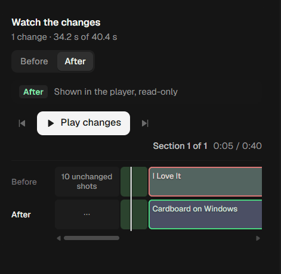
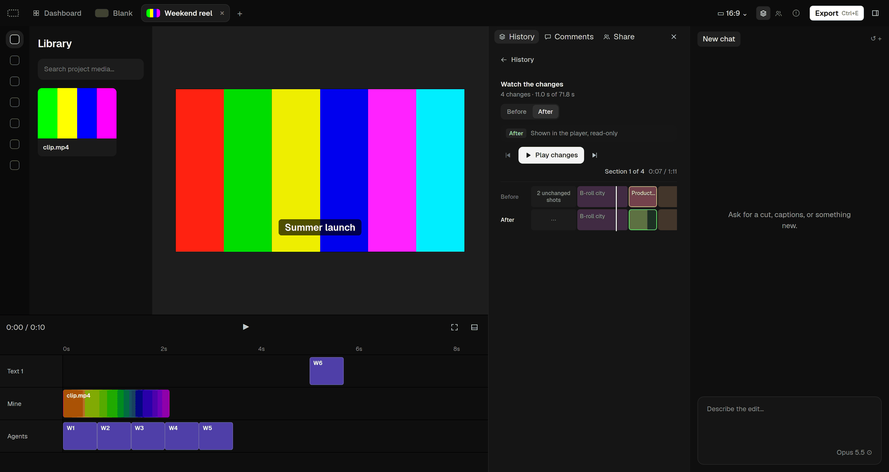

*The user's screenshot, and today's composition at 384 px: the editor's preview shows the side, and the panel holds
the switch, the strips and the counter.* More shots: `before/real/p3-watch.png`, `before/gallery/watch-initial-300.png`,
`watch-playing-384.png`, `watch-before-384.png`.

| # | Sev | Problem |
|---|---|---|
| W1 | P1 | **No words for what changed.** The panel shows blocks of colour ("B-roll city", "Product…") and a count, but never a sentence like "Removed “B-roll 3” at 0:22". The person has to work out the change by watching. |
| W2 | P1 | **Before/After is said four times**: the switch, the "After" pill with "Shown in the player, read-only", and the strip labels "Before" and "After". The pill's note is the read-only banner's twin. |
| W3 | P1 | **Opening it swaps the editor at once** into the read-only preview of the side shown (After, unless After is current). Nothing asked for that, and the banner appears over the stage. |
| W4 | P1 | **Engineer words:** "Section 1 of 4" beside "4 changes" (two counts that don't agree), "2 unchanged shots", "11.0 s of 71.8 s". |
| W5 | P2 | The strips are two lanes of tinted rectangles, 22–88 px wide, with a 1 px playhead. At 300 px they scroll sideways, and the labels shorten to "Product…". |
| W6 | P2 | "Play changes" is the panel's only white button: the eye goes there before it knows what will play. |
| W7 | P3 | The timecode beside the counter ("0:07 / 1:11") is the side's length, not the edit's position. |

## 2. Preview banner and read-only: 2/10

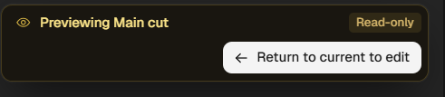
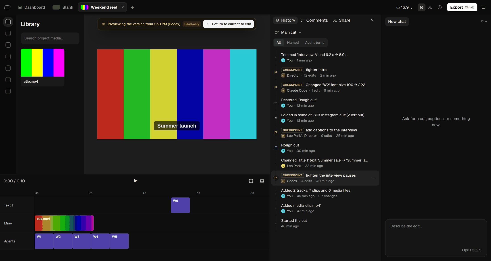

More shots: `before/real/p3-preview.png` (laptop, the 300 px panel), `before/gallery/stage-preview-version.png`,
`stage-preview-long.png`, `stage-preview-blocked.png`.

| # | Sev | Problem |
|---|---|---|
| B1 | P1 | **It comes when it wasn't asked for.** Five ways in: Enter or a double-click on a History row, the row menu's Preview, every Watch side that isn't current, a conflict card's "Preview", and a teammate's read-only cut. Only the menu item says "Preview". |
| B2 | P1 | **It covers the picture.** A card with a yellow warning look, two rows high at the default width, at the top of the stage over the video. |
| B3 | P1 | **"Read-only" doesn't explain.** People don't know why their edit is locked, or that their work is safe. "Return to current to edit" names an engineering state ("current"). |
| B4 | P2 | It names the thing badly: "Previewing the version fr…" is cut off at 300 px, and "Previewing Main cut" reads as if the cut itself were a preview. |
| B5 | P2 | An edit tried meanwhile is refused by Cardboard's own toast over the timeline ("Previewing an earlier version. Return to current to edit."), far from the banner. |
| B6 | P2 | The state shows only on the stage: the title bar, the cut and History don't say the editor shows something else. |

## 3. Compare card: 3/10

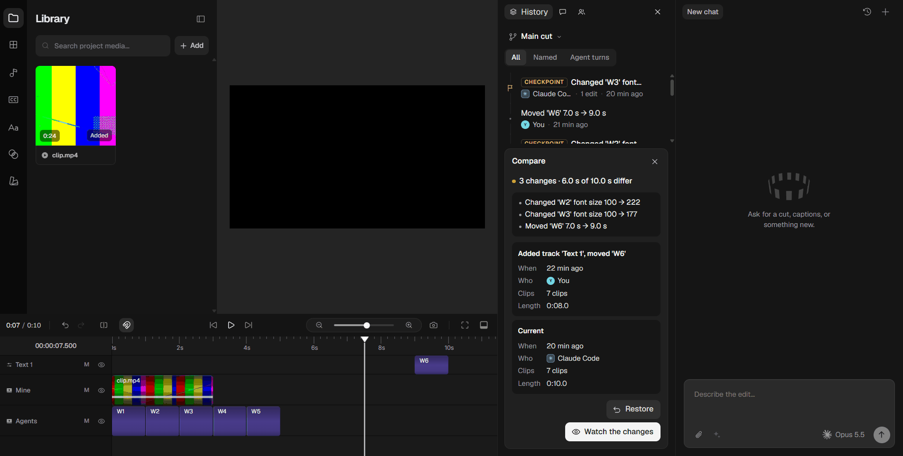

Today's version is `before/gallery/history-compare-384.png`.

| # | Sev | Problem |
|---|---|---|
| C1 | P1 | It answers "what changed" with a spec sheet for each side (When / Who / Clips / Length). The list of changes is three engineer strings ("Changed 'W2' font size 100 → 222"). |
| C2 | P1 | It opens under the list and squeezes History to about three rows; the compared row is barely marked. |
| C3 | P2 | "Current" is the engineer's name for the person's own edit. |
| C4 | P2 | Two big buttons stacked, Restore and Watch the changes, with no word on what Restore will undo. |

## 4. Where am I (the cut, and whether it's your edit): 3/10

Today's title bar is `before/gallery/titlebar-normal.png`, `titlebar-history-pressed.png` and `titlebar-narrow.png`.

| # | Sev | Problem |
|---|---|---|
| P1a | P1 | **The cut is named only in the History panel's switcher.** Close the panel and nothing says you're on "30s cut". Agents' `cb` commands follow the same current cut, so this matters twice. |
| P1b | P1 | Whether you see your own edit is said only by the stage banner (see 2). |
| P1c | P2 | Making a cut from an older version ("New cut from here") switches to it at once. The editor now shows the older state as your edit, and only the panel's switcher name changes. |

## 5. History list: 5/10

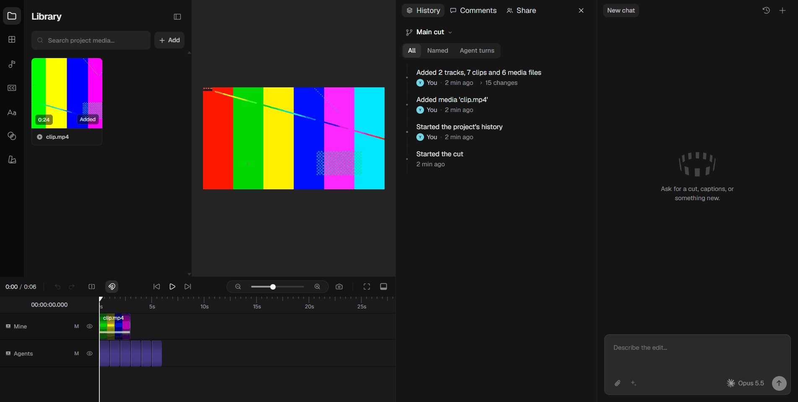 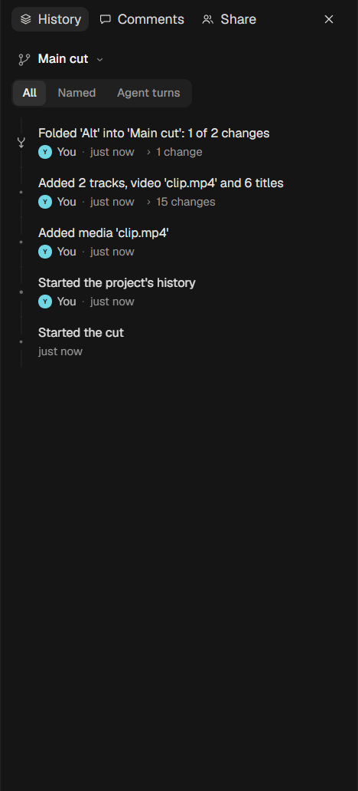
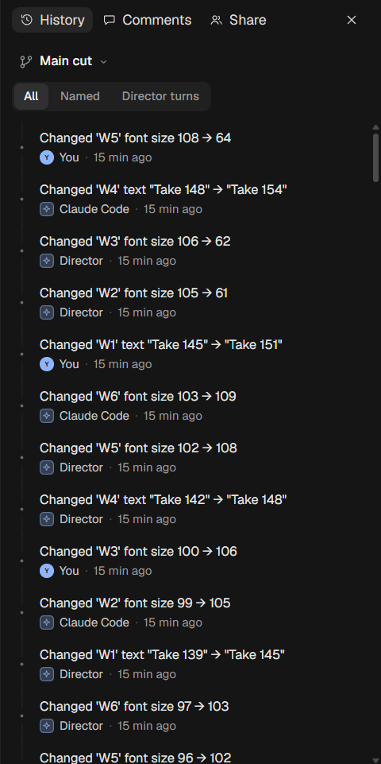

More shots: `before/gallery/history-few-384.png`, `history-few-300.png`, `history-many-384.png`,
`history-many-scrolled-384.png`, `history-provisional-384.png`, `history-start-384.png`, `history-none-384.png`.

| # | Sev | Problem |
|---|---|---|
| H1 | P2 | **Every row reads like a change log**: "Changed 'W5' font size 108 → 64", "Changed 'W4' text "Take 148" → "Take 154"". With 150+ of them, the rows all look alike. The day groups help (now built), but there's no grouping by session: twelve drags by you are twelve rows. |
| H2 | P2 | **There's no "you are here".** The newest row looks like the others; nothing marks it as what the editor shows. |
| H3 | P2 | **"CHECKPOINT"** is an engineer's badge, in amber caps, on agent turns. The turn's prompt (its best title) is often missing, so the row reads "Changed 'W3' font…". |
| H4 | P2 | **System rows add noise:** "Started the cut", "Started the project's history", "Imported the project" (on a project that was created), with "Added media 'clip.mp4'" and "Added 2 tracks, 7 clips and 6 media files". |
| H5 | P2 | **A click does nothing visible** except select. Enter or a double-click opens the read-only preview (B1). The "› 2 changes" toggle is a 10 px chevron in grey text. |
| H6 | P2 | The filter bar (All / Named / Agent turns) costs a 40 px row for something used rarely, and Agent turns is often empty (`before/gallery/history-filter-turns-empty-384.png`). |
| H7 | P3 | Quotes are mixed ('W6' and "Hello"). A restore and an undo share the ↺ icon. A fold of the rest uses ↺ (`before/real/p3-fold-icons.png`). |
| H8 | P3 | "Waiting to sync" rows look like the others apart from a grey pill. Their menu disables every item with the same tooltip (`before/gallery/history-provisional-menu-384.png`). |

## 6. Row menu and actions: 5/10

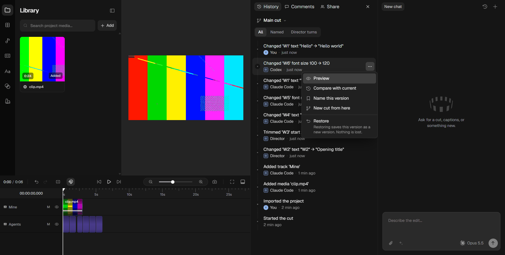

More shots: `before/gallery/history-menu-384.png`, `history-menu-bottom-384.png`, `history-menu-foldrest-384.png`,
`history-naming-384.png`, `history-naming-cut-384.png`.

| # | Sev | Problem |
|---|---|---|
| A1 | P1 | **Restore runs at once.** The grey line under it ("Restoring saves this version as a new version. Nothing is lost.") is true, but it doesn't say what will change: how many later edits are undone. |
| A2 | P1 | **New cut from here** asks for a name inline, then switches the editor to the new cut, made from that older version, without a word (P1c). |
| A3 | P2 | "Compare with current" opens the Compare card (3). "Preview" opens the banner (2). Both are the hard way to answer "what did this do?". |
| A4 | P3 | Undo after a restore is unnamed: the tooltip says "Undo Ctrl+Z" and nothing confirms it (`before/real/p3-undo-after-restore-tooltip.png`). |

## 7. Cuts menu: 4/10

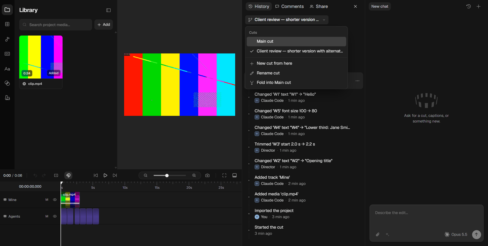

More shots: `before/gallery/cuts-open-several-384.png`, `cuts-open-long-300.png`, `cuts-new-form-384.png`,
`cuts-rename-form-384.png`, `cuts-closed-long-300.png`.

| # | Sev | Problem |
|---|---|---|
| K1 | P1 | It is reachable only from inside History (see P1a). |
| K2 | P2 | Each cut is a bare name. Nothing says who changed it or when, or that an agent is working there. |
| K3 | P2 | The menu grows a "Fold “X” in here" line for every other cut, beside "Fold into Main cut". Both directions are in one list, worded differently. |
| K4 | P2 | **Agents work on the current cut**, and the menu never says so. Switching cuts mid-turn moves the agent's next edits. |
| K5 | P3 | A teammate's read-only cut is marked only by a 12 px lock and a tooltip. |

## 8. Fold in: 6/10

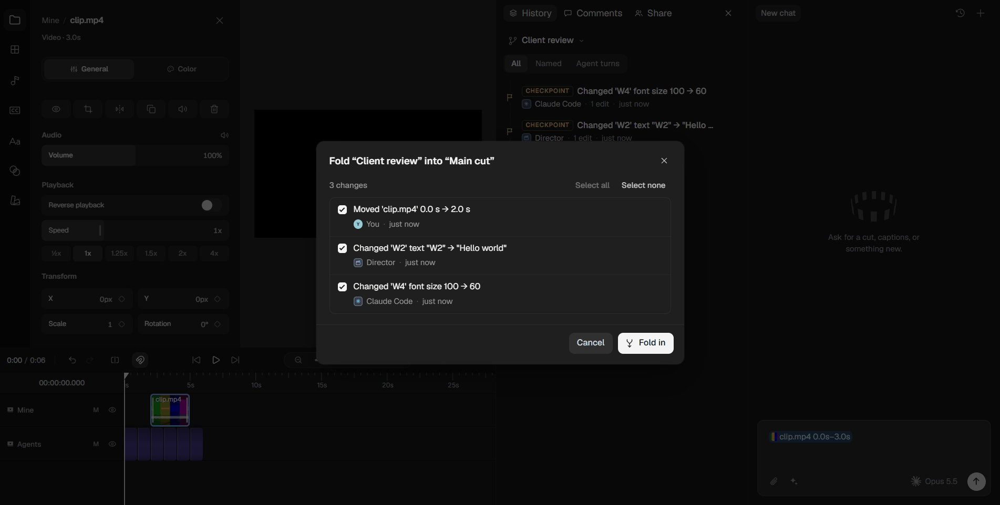 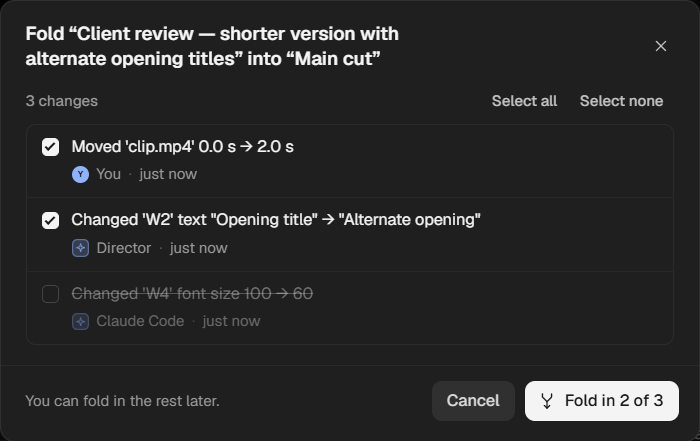

More shots: `before/gallery/fold-all-384.png`, `fold-some-384.png`, `fold-conflict-384.png`,
`fold-conflict-picked-384.png`, `fold-leftout-384.png`, `fold-nothing-384.png`.

| # | Sev | Problem |
|---|---|---|
| F1 | P2 | The rows are plain sentences with author and time, but nothing shows *where* in the edit or *what kind* of clip. |
| F2 | P2 | Conflicts appear as full conflict cards nested in the dialog, a second design language. |
| F3 | P2 | The direction is fixed by where it was opened from, and can't be changed in the dialog. |
| F4 | P3 | The dialog opens with focus on ✕ (older build). Its border differs from Cardboard's Export. |
| F5 | P3 | The left-out case is now fixed in the engine ("Left out earlier"), but the copy still sits under a list header with no date. |

## 9. Conflict cards: 5/10

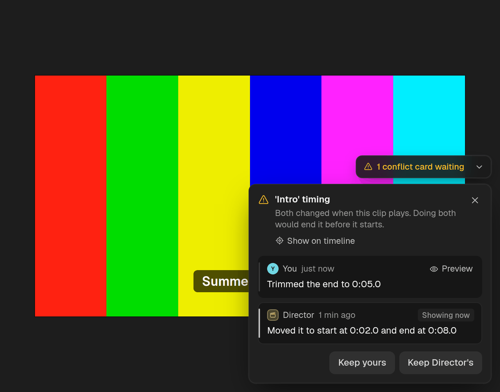 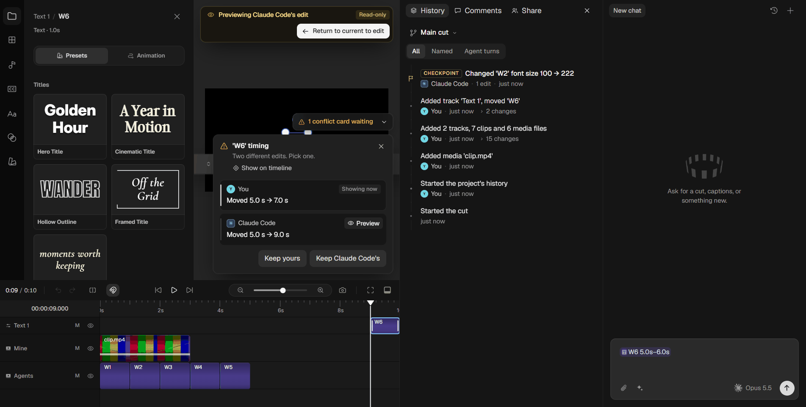

More shots: `before/gallery/stage-conflict-several.png`, `stage-conflict-self.png`, `stage-conflict-both.png`,
`stage-conflict-preview.png`, `stage-conflict-aside.png`, `stage-conflict-pill.png`,
`stage-conflict-panel-open-384.png`, `before/real/40b-agent-card-crop.png`, `42-card-notnow.png`.

| # | Sev | Problem |
|---|---|---|
| X1 | P2 | **Two equal grey buttons**, "Keep yours" and "Keep Director's", with no sign of which is safe and nothing tying a button to its side. |
| X2 | P2 | **"Preview" swaps the whole editor** and brings the banner over the card's own stage (laptop shot: the banner sits above the card). |
| X3 | P2 | Engineer phrasing: the header "1 conflict card waiting" above a card called "'Intro' timing"; "Showing now"; "Set aside (1)" / "Show again"; a ✕ whose label is "Not now". |
| X4 | P3 | The stack of peeking cards suggests a deck you can flip, but only the top card acts. |

## 10. Toasts: 5/10

Shots: `before/gallery/stage-toast-restore.png`, `stage-toast-confirm.png`, `stage-toast-warning.png`;
`before/real/43-after-keep.png` (older build, before toasts existed).

| # | Sev | Problem |
|---|---|---|
| T1 | P2 | There's no **Undo** on any toast, though every action they confirm can be undone. |
| T2 | P2 | Switching cuts, making a cut, and Ctrl+Z of a restore or fold say nothing. |

## 11. Share (side-panel tab): 5/10

Shots: `before/gallery/share-empty-384.png`, `share-empty-submitted-384.png`, `share-invite-code-384.png`,
`share-unreachable-384.png`, `share-owner-384.png`, `share-owner-invite-384.png`, `share-peers-384.png`,
`share-offline-384.png`, `share-update-server-384.png`, `window-share-384.png`. The older build:
`before/real/23-share-empty.png`, `27-invite-link.png`, `34-A-share-offline.png`.

| # | Sev | Problem |
|---|---|---|
| S1 | P2 | Share is a **setup form in a narrow tab**. It's an occasional action that takes a permanent third tab, and pushes History and Comments to icons below 340 px. |
| S2 | P2 | Once shared, the order is "Live" (status), "Teammates see you as Vikas.", the people, then "Invite to edit". The thing you came to do (invite) is last. |
| S3 | P3 | The explanation paragraph is long ("…preview copies of your video, whose originals stay on this computer; audio and still images go as they are."). |
| S4 | — | Fixed since the first audit and keep: "Sharing server", the invite code only when asked, errors at their field in words. |

## 12. Join (Dashboard): 6/10

Shots: `before/gallery/join-form.png`, `join-errors.png`, `join-joined.png`.
- P3: "Join" then a separate "Open". One button, "Join and open", would do both.

## 13. Stage status (offline, footage arriving): 6/10

Shots: `before/gallery/stage-live-offline.png`, `stage-live-syncing.png`, `stage-media-waiting-one.png`,
`stage-media-waiting-many.png`, `stage-media-arrived.png`, `stage-media-copies.png`.
- P3: the footage notice is a 3-line paragraph at the top of the stage.
- P3: "Syncing" shows whenever edits wait, which flickers on a good connection.

## 14. Title bar: 6/10

Shots: `before/gallery/titlebar-normal.png`, `titlebar-history-pressed.png`, `titlebar-share-pressed.png`,
`titlebar-peers.png`, `titlebar-offline.png`, `titlebar-syncing.png`, `titlebar-narrow.png`.
- Good: the History icon is distinct from the chat's clock; the Share icon carries avatars and a status dot.
- P1: no cut.
- P2: below 1180 px Share disappears, and is reachable only from the History panel's tab.

## 15. Comments: 6/10

Shots: `before/gallery/comments-empty-384.png`, `comments-some-384.png`, `before/real/19-comments-empty-after.png`.
- P3: a "Comments" heading under the Comments tab.
- P3: the time chip is in Geist Mono with a tenth of a second ("0:00.0").
- P3: a note whose moment changed says so only through its placement status.

## 16. Agent turns holding your edits: 1/10

- P1: while an in-app agent works, your edits are kept from what it reads until the turn ends. **Nothing shows this.**
  The person can't tell why their edit isn't in the agent's view, or that it is safe.

## 17. Built but not mounted: 0/10

`CreditsPopover` (who made which clip), `UndoTurnButton`, `PublishedStatus`, `PresenceAvatars`, `SyncStatusWords` and
`GhostLayer` (teammates' drags on your timeline) are in `@carton/react` and its gallery, but `scripts/carton/ui.js`
doesn't mount them. In the app, credits and teammates' cursors don't exist (P2). The title bar draws its own avatars.

## The ten problems that matter most

1. **Watch the changes doesn't say what changed** (W1, W4). It's coloured blocks and counters, never sentences.
2. **The editor is taken over without being asked** (B1, W3): row Enter, every Watch side, and a card's Preview all lock
   the editor.
3. **The read-only card covers the video and says "Read-only"** (B2, B3) instead of what's shown and that your work is
   safe.
4. **No sign of the current cut outside History** (P1a, K1), though agents follow it too.
5. **Compare answers with a spec sheet** and squeezes the list (C1, C2).
6. **Restore and New cut from here act without saying what they'll do** (A1, A2): one undoes later edits silently, the
   other switches the editor to an older state silently.
7. **History reads like a log** (H1–H4): no "you are here", no sessions, engineer badges, system rows.
8. **Agent-turn holds are invisible** (16).
9. **Conflict cards: equal buttons, and "Preview" brings the banner** (X1, X2).
10. **Confirmations without Undo, and silent cut switches** (T1, T2).
