# Carton v2: compare in the editor, find any version, roll back what you meant

An addendum to `../DESIGN.md` (the first design, mostly built on `feat/carton-ux`), and to the design QA in
`../qa/QA.md`. Where this file says nothing, DESIGN.md still holds: its word rules, the cut chip, viewing, the change
row, conflict cards and toasts. Docs only. Nothing here is built yet.

Mockups are HTML/CSS in `mockups/`, rendered to `after/` with `mockups/render.mjs`. They reuse the first design's skin
and builders (`../mockups/`), so they match the built UI. Editor shots are 1522 × 810 CSS px (the laptop's window at
125 %); panel shots are 384 px (the default) and 300 px (the minimum).

## 0. What this answers

The person who uses it, tonight:

1. *"every change adds a new history record and hence tht cud get messy for a person to manually find nd
   rollback/fork a particular version."* → §2 (landmarks, pictures, search, peek) and §3 (rolling back).
2. *"how wud the diff b/w two arbitrary versions be shown (as in git)"* → §1 (Compare in the editor) and §4 (any two).
3. *"In compare why do we need to compare in that history section only, that feels conjested. Can't we hijack the
   actual preview area"* → §1.
4. *"make version stuff as much easy for the end user as possible"* → every section. The test is a video editor who
   has never used version control.

Two more asks, added during the work:
- **Compare across cuts:** any version of one cut against any version of another (§1.12).
- **The agent opens Compare on request:** "show me what changed since I sent it to the client" (§1.13, §5).

**The one change of stance.** DESIGN §4.4 kept every comparison in the panel. It set aside a second player because it
costs a second renderer. v2 changes exactly that. **Comparing two versions is the one time Carton takes over the
editor.** The stage shows both versions, Cardboard's own timeline shows the differences, and History shrinks to the
list of them. It happens only when the person asks to compare, and Esc puts everything back. The other rules stay:
no banners, the cut always visible, plain words, nothing that changes your edit without saying what it does.

---

## 1. Compare in the editor


*The default. “Sent to client” (yesterday at 4:10 pm) on the left, your edit on the right. The title change is
selected in the list, so both players are at 0:01 and its clip is ringed on the timeline. The thin strip above the
tracks is “Sent to client” on its own time.*

### 1.1 What it is

**Comparing** is a state, like viewing (DESIGN §4.2). It belongs to the same family: *the editor is showing you
something you can't edit*. It has the same blue frame round the stage and timeline, and the same chip, with its own
icon and words. Only one of viewing or comparing is on at a time.

While comparing, these change:

| Region | While comparing |
|---|---|
| **Title bar chip** | Second part: `⇆ Comparing “Sent to client” with your edit now ✕` (§1.7) |
| **Stage** | The **compare bar** at its top: the modes, the count ("7 changes") and **Done comparing**. Below it, two players (or a wipe, or a flip), each labelled under its picture, then **Play both** and its progress. Nothing sits over the picture |
| **Library** | Steps aside to give the stage its width, as when the person collapses it. It comes back on exit. The rail of icons stays |
| **Timeline** | Cardboard's own, showing the **right side**. Its clips carry the marks (§1.6); a 26 px strip on top shows the left side. Muted, framed, not editable |
| **History panel** | **The change list**: the range in words, the count, every change row in timeline order, and the footer action. It replaces the in-panel Changes view (§1.2) |
| **Chat** | Unchanged. An agent can still be asked anything, and an agent can open a comparison (§1.13) |

**Which side is which.** One rule, so nobody has to think about it:
- **The right side is what the timeline shows.** Your edit, or the cut you're on, is always the right side when it's
  in the comparison. The right player is Cardboard's own preview.
- **The left side is the other one:** the older version, or the other cut. The left player is the second player.
- Two older versions of one cut: the older one is on the left. Two cuts, neither of them the one you're on: the one
  you picked first is on the left.
- In words the left comes first: "Comparing *left* with *right*".

### 1.2 Ways in, and what replaces the Changes view

| From | Compares (left ↔ right) | Notes |
|---|---|---|
| A card's **Your edit has 7 changes since this · See them** | this version ↔ your edit now | The commonest way in |
| Row or card `⋯` **Compare with your edit** | this version ↔ your edit now | |
| Row or card `⋯` **Compare with…** | this version ↔ the version you click next, in any cut | Pick mode, §4.1 |
| **Shift+click** (or **Shift+↑↓**) a second row | the two rows, older on the left | As today, but it opens Compare |
| History's **⇆ Compare** button (cut bar), new | a landmark ↔ your edit now: *The version you sent*, *The last export*, *How it was this morning*, *Another cut ›*, *Pick a version…* | §4.2. The one-click answer to "what changed since I sent it?" |
| A card **while playing** an older version: **⇆ Side by side**, next to Before | the version before it ↔ this version, at the same spot, still playing | Before (hold) stays as it is: a quick flip with no change of layout |
| **Cuts menu:** **Compare** on another cut's row | that cut now ↔ the cut you're on now | §1.12 |
| **Fold in:** **See them side by side** | the from-cut now ↔ the into-cut now | The panel's footer gets **Back to Fold in…**, which reopens the dialog with the ticks kept |
| **An agent**, on request | what it was asked | §1.13 |

**The in-panel Changes view retires.** Every way that opened it now opens Compare. Its content moves into the panel
during Compare: the range in words, the count, the change rows and Restore. The change map goes; the marks on the
real timeline do its job, at full width. `ChangesView` stays in the gallery for one release, as PLAN 4.4 did for
`CompareCard`.

Nothing else enters Compare. A click on a row, opening a card, ▶ on one change and Play all on a card behave as in
DESIGN §5.

### 1.3 The modes: Side by side, Wipe, Flip

| Mode | What the stage shows | Best for |
|---|---|---|
| **Side by side** (default) | Two players in the project's aspect, left and right, the same size. Each has a label under it (**name** · when · its timecode, and "same shot" while in step) | Seeing what's different at a glance, and playing both |
| **Wipe** | One picture. Left of the line is the left side, right of it the right side. Drag the line, or ← → (Shift for fine). Double-click puts it back in the middle. Labels sit in the top corners | A look, a colour, a title's style: things in the same place on both sides |
| **Flip** | One picture, full size, showing the right side. **Hold B** (or hold the pill under the picture) to show the left; release to come back. A click latches it. Under the picture, "Showing" and the pill say which side is shown: its half is pressed, and turns blue while it's the left. Nothing sits over the picture (laptop: a tag at its top-left covered it) | Small windows, and spotting a change by flicking between the two |

 

- **Default:** Side by side, when each player gets at least 320 px (a stage of 682 px or more). Otherwise Flip.
- The mode a person picks is kept for next time, but the width rule wins.
- Flip uses the editor's one preview, swapping the version the way Before does today. The left side is loaded when
  Compare opens, so the first flip doesn't wait.
- Changing mode keeps the spot, and keeps playing if it was playing.

### 1.4 Play both, in step by shot


*At 0:13 your edit plays the added “Drone shot”. “Sent to client” has no such shot, so its side holds a slate. The
white playhead is your edit; the dotted one on the strip is “Sent to client”.*

- **Space** or **Play both** plays both sides from the selected spot.
- **In step by shot.** The two sides are matched clip by clip; the comparison knows which clip is which. Each shot
  starts on both sides together.
  - A side's shots are the clips its picture is built on: the footage on its lowest picture track, else the lowest
    title or graphic. Titles, captions, B-roll over an interview and sound don't cut it, so a music bed under the whole
    edit or a title over a shot never puts the two sides out of step.
  - Shots are matched by identity (the clip, which cuts share from the cut they were made from), in order: a trimmed
    clip, or one moved in time, is the same shot on both sides. Only where a clip has no partner by identity (deleted
    and added again) is the same footage, in-point and length the same shot.
  - A clip split on one side only (once or more) plays as the whole clip on the other.
  - Where Play both starts before the two timelines have loaded, it goes by core's content shot diff, and moves to the
    clips' alignment, at the same spot, once they have.
  - A gap where a clip was is no shot: that side shows the slate.
  - When a shot is longer on one side, the other side holds its last frame, and its label says "waiting", until the
    longer one ends.
  - A shot that only one side has plays on that side. The other side shows a slate: **“Drone shot” isn't in “Sent to
    client”** · "Its shot plays on the other side."
  - A clip moved past others is on both sides, in another order: where it plays on one side, the other's slate says
    where it is instead, **“Drone shot” is later in your edit now** (or "earlier"), never "isn't in".
  - So drift never builds up, and the two pictures always show the same moment of the story.
  - The timecodes never step back: when the editor's player takes a moment to start a shot, the story waits for it.
  - "In step by shot" has an ⓘ: "Both sides play the same shot together. A shot that's longer on one side waits for
    the other."
- **Sound** comes from the right side. In Flip it comes from the side shown. Each label has a speaker on hover to
  listen to that side instead.
- **To judge pace,** hover a label and press its ▶, **Play this side alone**. That side plays in its own time, and the
  other pauses.
- The progress bar and the timeline's white playhead follow the right side. The strip's dotted playhead follows the
  left.
- Wipe and Flip play the same way: one picture, both sides kept in step.

### 1.5 Clicking a change

- **In the list** (a click, or ↑↓): both players go to the change's spot, paused. The left side goes to where it is,
  or was, on the left; the right side to where it is on the right.
  - The timeline scrolls the clip into view and rings it in white.
  - The row opens its detail: **Then** / **Now** in words, and the one-clip action (§3.2).
  - A removed clip: the left player shows it, the right shows the moment where it was, where its mark is (§1.6): the
    list's jump and the timeline always agree. A clip only on the right: the left shows the slate.
- **Enter, or ▶ on the row:** plays that spot on both sides, with one second either side, in step.
- **On the timeline:** clicking a marked clip, a ghost or a seam selects its row in the list and scrolls the list to
  it. Clicking an unmarked clip only moves the playhead. Nothing can be dragged (§1.8).
- A change with no place in the edit (aspect ratio, frame rate) shows `—` and doesn't move anything.

### 1.6 The marks on Cardboard's timeline


| What happened (right side compared with left) | Mark on the clip |
|---|---|
| **Added** (only on the right) | Green 2 px outline inside the clip, and a **+** tag |
| **Removed, a gap left** | A **ghost** of its size where it was: red dashed outline, faint hatching, its name in red-tinted text. Drawn behind the real clips. "Where it was" is its old place carried through the clips' alignment (§1.4), so an earlier trim that moved the rest up moves the ghost with them. A gap was left when nothing on its track now covers most of that place |
| **Removed, the rest moved up** | A **seam**: a red dashed line at the join, with a **−** knob on top. Its tooltip: "Removed “B-roll pier” here (3 s)". Also where something else took its place |
| **Moved** | Amber outline and a tag with the direction and amount: **←4 s**, **2 s→**, or **new track**. On hover, its old place shows as a dotted amber outline |
| **Trimmed** | Amber outline. The old edge shows as a dotted amber extension when it was longer, or a short amber notch inside when it was shorter |
| **Changed** (text, look, volume, speed, effects) | Amber outline and a **•** tag. Its tooltip is the change's sentence |
| **Several changes on one clip** | One outline: green if it was added, otherwise amber. The tag shows the count (**3**) |
| **Selected** | A white 2 px ring outside the mark |
| **Unchanged** | Muted, as while viewing, so the marked clips stand out |

- **The strip** is a 26 px row above the tracks, labelled with the left side's name. It shows the left side's main
  video track on its own time, at the timeline's zoom and scroll. Each of its clips is drawn in the legend's colours
  for what happened to it on the right: unchanged as a plain bar, changed, trimmed or moved with an amber outline, gone
  with a red dashed outline; a gap is a faint neutral outline (laptop: every changed stretch was red, so the old
  version read as "everything removed"). The dotted playhead is the left player. It shows at a glance that the two
  edits differ in length and where things went.
- **The legend** ("added · removed · changed or moved") sits at the right of the timeline's toolbar, beside the
  optional cut label. It hides when the timeline is narrower than 900 px; the list carries the same.
- **Colour is never the only signal.** Every mark also has a shape: outline, dashed ghost, seam knob or tag.
- Clip names stay readable: the tag sits at the clip's top-right, and is dropped when the clip is under 36 px wide.
- **Built on the timeline hook** that the viewing frame uses (DESIGN §11, PLAN 1.5). It is an overlay placed from the
  timeline's clip elements. If a later Cardboard breaks the anchor, the marks don't draw, and the list, the players
  and the jumps still work.

### 1.7 The chip, and the ways out

- **The chip's second part:** `⇆ Comparing “Sent to client” with your edit now ✕`. Other examples:
  - `⇆ Comparing your edit from 12:41 pm with Director's “Add captions…”` (two older versions)
  - `⇆ Comparing “30s Instagram cut” with Main cut`
  - `⇆ Comparing Leo's Main cut with yours`
  - `⇆ Comparing “30s Instagram cut” at 12:20 pm with Main cut now`
- The label is built in one place, with the panel's range line, so the two never disagree.
- **One name per side, everywhere in Compare** (the chip, the frame's label, the list's head, the players' labels): your
  edit is "your edit now"; a version is its name or its time, said once ("your edit from 9:31 am", never "your edit
  from 9:31 am · 9:31 am"); a named or prompted version adds its time after its name ("Sent to client · yesterday at
  4:10 pm").
- **Narrow:** it shortens first to `⇆ Comparing “Sent to client”…`, then `⇆ Comparing` (below 1000 px). The ⇆ and the ✕
  always stay; the whole label is in the tooltip. The title bar's tabs keep room for one project tab whole (its ✕) and
  the New project "+" after it: the chip gives way first, and with more tabs than fit, the tab list scrolls with "+" at
  its end, never under it (laptop: at 960 px "+" sat on the project tab's ✕).
- **Ways out**, all to the same place:
  - Esc, unless a menu, a latched flip or a drag takes it first. A clip clicked on the timeline while comparing doesn't
    take it: Esc ends Compare and clears the selection with it;
  - the chip's ✕ ("Done comparing (Esc)");
  - **Done comparing** on the compare bar;
  - **← History** at the top of the panel;
  - the ✕ of the frame's own label, while History is closed (§1.9);
  - switching project tab;
  - opening Export, which says "Back to your edit to export it.", as with viewing.
- **Closing History isn't a way out.** Its title bar icon, Ctrl+Shift+H and the panel's ✕ close the panel and keep
  Compare on, for more room to look: the stage takes the panel's width, Side by side and Wipe grow to it, and the frame
  shows its own label (§1.9). The marks, Play both, Flip and the chip work as before. Comments in History's place does
  end Compare: its See it as it was is viewing, and viewing and comparing never stack (§1.11).
- **Where you land:** your edit, on the cut you were on.
  - If the right side was your edit, the playhead **stays where it is**, at the change you were looking at, so you
    can fix it right there.
  - Otherwise it goes back to where it was before you compared.
  - History shows its list again, with the card you came from still open, and the keyboard in it when nothing else
    had it, so the next Esc closes History.
- Screen readers hear "Back to your edit."

### 1.8 An edit tried while comparing


Comparing is for looking, even when the right side is your edit. A drag, a typed title, Delete or Ctrl+Z changes
nothing. The frame pulses once, and one line appears at the bottom of the stage, through Cardboard's own refusal path
(as DESIGN §4.3):

> ⇆ You're comparing “Sent to client” with your edit. **[Done comparing]** Esc

Between two older versions: "You're comparing two earlier versions. **[Back to my edit]** Esc".

Done comparing keeps the playhead where it is (§1.7), so the edit can be made on the spot.

**Three things do change your edit while comparing,** each on purpose and named for what it does:
- **Bring back** one clip (§3.2);
- **Restore your edit to “Sent to client”…** (§3.1);
- an agent's work.

Each leaves Compare open with the right side updated, and the list loses or gains rows, with a toast and Undo. The
right side, when it's your edit, is always **your edit now**: if an agent or a teammate changes it, the list and the
marks update within a second, and the selected row stays selected if it still exists.


### 1.9 Narrow windows and the drawer

| Width | Compare |
|---|---|
| Stage ≥ 682 px | All three modes; Side by side is the default |
| Stage < 682 px (e.g. a 1100 px window with History and the chat open; a 1444 px laptop window with History, the chat and Compare open gives 629 px) | **Flip** is the default. Side by side is greyed. When closing History would give the stage 682 px, a click on it closes History (Compare stays on) and shows Side by side; its tooltip: "Side by side needs a wider stage. Click to close History and make room." Otherwise its tooltip names the fewest to close, from what is open, or says to widen the window: "Side by side needs a wider stage. Close the chat or widen the window.", "… Close History and the chat, or widen the window.", "… Widen the window." |
| Stage < 600 px | The modes keep their icons and drop their words, except Flip; their tooltips keep the words. The count goes (the list has it). **Done comparing** becomes **Done** |
| Stage < 360 px | Flip only |
| Window < 1180 px | The chip shortens (§1.7); the panel is 300 px |
| **History closed, or in the drawer with the drawer hidden** | The list isn't on screen, so the frame's own label shows (DESIGN §4.2): `⇆ Comparing “Sent to client” with your edit now · 7 changes ✕`. A click on its words opens History (or the drawer) on the change list; ✕ ends Compare. Closing History or the drawer does **not** end Compare: the label stays |

 

### 1.10 When a second player isn't possible: Flip only

The second player can fail: it doesn't start within 2 s (counted while the window is on screen: a minimised window
stops the frames its start is checked on), the computer's graphics memory is short, the project is too
large, or a later Cardboard breaks the hook. Then:
- the mode switch shows **Flip**, with Side by side and Wipe greyed ("Couldn't show both sides here. Click to try
  again."): picking one tries the second player again, once per pick. Without a second player at all (a Cardboard
  that breaks the hook), Flip alone;
- if the person had picked Side by side or Wipe, one toast, once per session: "Couldn't show “Sent to client” side by
  side here. Showing it as a flip.";
- everything else works as usual: the list, the marks, the strip, the jumps, Play both (in Flip), and Bring back;
- **never** a black, frozen or half-loaded player.


### 1.11 How it relates to viewing, Play and conflict cards

- **Viewing and comparing** never stack. Opening Compare while viewing ends viewing first. If you were viewing a
  version and press its card's See them, that version becomes the left side.
- **Play and Before on a card** stay as DESIGN §5.3: one picture, quick. While an older version plays, the card adds
  **⇆ Side by side** beside Before, to open Compare at that spot (§1.2).
- **Conflict cards' See it** stays viewing: one side on the stage, while the card stays in view to decide. A conflict
  is about one clip, and See it already shows it. The card gets no Compare button.
  - A conflict that arrives while comparing waits as the pill **"⚠ 1 conflict to pick"**, as during viewing. The
    pill's click ends Compare and opens the card.
- **Comments' "See it as it was"** stays viewing.
- **A teammate's cut** (picked from the cuts menu) is still viewing. Its two actions gain a third: **Compare with
  Main cut**.

### 1.12 Compare across cuts


*“30s Instagram cut” (Leo's) against Main cut, both now. Shots are lined up by shot. “Interview A”, “Drone shot”,
“Jane Smith, Founder” and “Outro” are only in Main cut; “Logo sting” is only in the 30s cut.*

Any version of one cut against any version of another: Main cut now against “30s Instagram cut” now, or Leo's Main
cut against yours.

- **Ways in:**
  - the **cuts menu:** every other cut's row (your cuts and teammates') shows **⇆ Compare** on hover and on focus. It
    compares that cut now with the cut you're on now;
  - **Compare with…:** while picking (§4.1), the pick line's cut button switches History's list to another cut, only
    to pick. The editor stays on yours. Any version there can be the second side;
  - **Fold in:** **See them side by side** in the dialog's footer.
- **Sides:** the cut you're on is on the right (it's what the timeline shows). Two teammate cuts: the first picked is
  on the left. Each side is a cut at a moment, "now" unless picked otherwise.
- **Words:** they always name both cuts and both moments.
  - Chip: `⇆ Comparing “30s Instagram cut” with Main cut`. With moments: `⇆ Comparing “30s Instagram cut” at 12:20 pm
    with Main cut now`.
  - Player labels: `● 30s Instagram cut · now · Leo` and `✂ Main cut · your edit now`. Each carries the cut's own
    mark: scissors for Main cut, its colour dot otherwise.
  - Range line: "**“30s Instagram cut”** now / with **Main cut** · your edit now".
  - The count is **differences**, not changes: nobody made them; the cuts just differ. "7 differences · 0:30 and 0:36"
    gives each cut's length.
- **The sentences say where a clip is, not what someone did:**
  - "Only in Main cut: “Drone shot”" · "Only in the 30s cut: “Logo sting”"
  - "“Interview B” is 6 s shorter in the 30s cut"
  - "“Intro” ends at 0:05 here, 0:03 in the 30s cut"
  - "“Interview B” is 4 s earlier in the 30s cut"
  - "The title reads “Summer ’26” in the 30s cut"
  - Inside one cut, "Added", "Removed" and "Moved" stay: there someone did them.
- **Marks for two cuts that have drifted apart:**
  - lined up by shot: clips are matched by identity, which cuts share from the cut they were made from;
  - a clip only on the right is marked as added (green, **+**);
  - a clip only on the left is a ghost or a seam;
  - a clip on both that differs is amber.
  - The strip shows the left cut on its own time, so a 0:30 cut against a 0:36 one reads at once.
  - **Far apart** (more than 40 differences): runs of the same kind group in the list, e.g. "Only in Main cut: 9 clips
    from 0:12 to 0:31 ›", and open on click.
- **Actions:**
  - a selected row offers **Use the 30s cut's “Interview B” here**. It is one clip, onto the cut you're on, undoable
    (§3.2);
  - the footer offers **Fold in changes from “30s Instagram cut”…**, the existing dialog, instead of Restore;
  - between two cuts that aren't yours, there are no actions, only Done comparing.

 

### 1.13 The agent opens Compare on request


*The user asked Director in the chat. The comparison opened, the chip says so as usual, and one toast says who
opened it.*

When the user asks Director or Claude Code "show me what changed since I sent it to the client" or "compare the
Instagram cut with Main", the agent runs `cb compare <left> <right> --show`. The editor follows, as it does for `cb
cut switch`. Without `--show`, `cb compare` prints words, as today (§5).

**When it opens.** At once, if the person is **idle**. Idle means:
- no mouse button is held and nothing is being dragged;
- no key has been pressed in the last 2 s outside the chat box. Sending the request counts as idle: they just asked;
- no dialog or menu is open;
- nothing is playing;
- they are neither viewing nor comparing.

**Otherwise it never takes over.**
- **Mid-edit** (a drag, typing in a title, a dialog open): it waits up to 8 s for idle and opens then. If they are
  still busy, it offers a toast instead: **"Claude Code has a comparison ready: “30s Instagram cut” with Main cut.
  [Open] ✕"**. The toast stays until Open, ✕ or the agent's next action.
- **Already viewing or comparing:** it never replaces what the person is looking at. It offers the same toast. Open
  replaces the current view, and Esc then goes back to your edit, not to the earlier view.
- **Playing, or Export open:** the offer toast.

**When it opens:**
- the chip as usual;
- the History panel opens to the change list if it was closed, and closes again on exit if the agent opened it, unless
  the person closed it meanwhile (then a History they open again is theirs, and stays);
- one toast, for 6 s: **"⇆ Director opened a comparison. Esc to go back ✕"**. The ✕ hides only the toast; the chip,
  Done comparing and Esc end Compare. Who asked is named as History names authors: the person's own `cb`, typed in a
  terminal, is "You" ("You opened a comparison.", "You have a comparison ready: …"), never "Terminal";
- screen readers hear "Director opened a comparison: “Sent to client” with your edit. 7 changes. Esc to go back."

**Never:** during a drag, over a dialog, while the person is typing in the editor, or without the chip and Esc to go
back. An agent can't open Compare on a version that hasn't reached this computer yet ("Not sent yet" on a teammate's side); `cb` says so instead.

`cb` output, plain, is in §5.3.

### 1.14 Keyboard, screen readers and words

| Where | Key | Does |
|---|---|---|
| Anywhere while comparing | **Esc** | Done comparing (after a menu, a latched flip or a drag; a selected clip doesn't take it, and is deselected) |
| | **Space** | Play both / pause |
| | **B** (hold) | Flip mode: show the left side. Carton takes B only while comparing, when edits are refused anyway |
| | **Ctrl+Shift+H** | Close or open History. Compare stays on; with History closed the frame shows its own label |
| Change list | **↑ ↓ Home End** | Move between changes; both players and the timeline follow |
| | **Enter** | Play that change on both sides |
| | **→** / **←** | Open / close the row's detail; Tab reaches its Bring back |
| Mode switch | **Tab**, then **← →** | A radio group: Side by side, Wipe, Flip |
| Wipe line | **← →** (Shift: fine), **Home End** | Move the line |
| A player's label | **Enter** on ▶ | Play this side alone |

**Screen readers:**
- The stage is a labelled region: "Comparing “Sent to client” with your edit".
- The modes are a `radiogroup`.
- The wipe line is a `slider` ("Wipe between Sent to client and your edit", value "56 % your edit").
- Each player is labelled with its side, its moment and its timecode.
- Polite announcements:
  - on entering: "Comparing “Sent to client” with your edit. 7 changes. Esc to go back.";
  - on a change the person moves to: its sentence and "Both players are there.";
  - on leaving: "Back to your edit."
  - Playback announces nothing.
- The marks and the strip are `aria-hidden`; the list carries the same.
- Quotes are curly everywhere in Compare and History, also in what someone typed: a prompt `Make the title say
  "Summer launch"` reads Director's “Make the title say ‘Summer launch’”.
- Reduced motion: no pulse, no ring animation; jumps are instant.

**Words (new):**

| Place | Words |
|---|---|
| Chip | "Comparing “Sent to client” with your edit now" · "Comparing “30s Instagram cut” with Main cut" · "Comparing Leo's Main cut with yours" · "Comparing your edit from 12:41 pm with Director's “Add captions…”" · below 1000 px "Comparing" · ✕ "Done comparing (Esc)" |
| Compare bar | "Side by side" · "Wipe" · "Flip" · "7 changes" / "7 differences" · "Done comparing" / "Done" · greyed: "Side by side needs a wider stage. Close the chat or widen the window." · "… Click to close History and make room." · "… Close History and the chat, or widen the window." · "… Widen the window." · after a failed start: "Couldn't show both sides here. Click to try again." |
| Players | "Sent to client · yesterday at 4:10 pm" · "Your edit now" · "same shot" · "waiting" · slate: "“Drone shot” isn't in “Sent to client”" + "Its shot plays on the other side" · a moved clip's slate: "“Drone shot” is later in your edit now" / "… is earlier in …" · "Play this side alone" · "Listen to this side" |
| Wipe / Flip | "Drag the line, or ← →, to wipe between them" · under the picture: "Showing" [Sent to client \| Your edit now] · "Hold B to flip, or click" |
| Transport | "Play both" / "Pause" · "In step by shot" + "Both sides play the same shot together. A shot that's longer on one side waits for the other." |
| Timeline | legend "added · removed · changed or moved" · seam "Removed “B-roll pier” here (3 s)" · tags "+", "←4 s", "2 s→", "new track", "•", "3" |
| Panel | "← History" · "From “Sent to client” · yesterday at 4:10 pm / to your edit now" · "From your edit from 9:31 am / to your edit now" (its time once) · a mute: "Muted “Intro”" / "Unmuted “Intro”" (a mute undone by an unmute is no change: not listed, not counted) · "7 changes · 0:36" · "Then" / "Now" · "Restore your edit to “Sent to client”…" · "Back to Fold in…" · across cuts: "Only in Main cut: …", "Only in the 30s cut: …", "… is 6 s shorter in the 30s cut", "… ends at 0:05 here, 0:03 in the 30s cut", "Use the 30s cut's “Interview B” here", "Fold in changes from “30s Instagram cut”…" · History closed: the frame's own label "Comparing “Sent to client” with your edit · 7 changes", its words' tooltip "Show the changes in History" |
| History | "Compare" (cut bar, cuts menu rows) · its menu: "Compare your edit with…", "The version you sent", "The last export", "How it was this morning", "Another cut", "Pick a version…" · "⇆ Side by side" (card while playing) · "See them side by side" (Fold in) · "Compare with Main cut" (a teammate's cut) |
| Toasts | "You're comparing “Sent to client” with your edit now." + "Done comparing" · "You're comparing two earlier versions." + "Back to my edit" · "Director opened a comparison." + "Esc to go back" · "Claude Code has a comparison ready: “30s Instagram cut” with Main cut." + "Open" · the person's own: "You opened a comparison." / "You have a comparison ready: …" · "Couldn't show “Sent to client” side by side here. Showing it as a flip." · "Back to your edit to export it." |
| *Removed* | the in-panel Changes view's change map · "Changes since 12:20 pm" as a panel title (the range line replaces it) |

### 1.15 What Compare needs underneath (for N0 and N1)

- **`ui.align(a, b)`:** the clip-by-clip match between two versions, in one cut or across cuts. Each entry is
  `{ item, aStart?, aEnd?, bStart?, bEnd?, track }`. It drives in step by shot, the strip, the jumps and the cut
  sentences. It is cached per (a, b), like `ui.changes`. The page lines Play both, the jumps, the marks and the strip
  up from the two timelines it already loads for the players (`clipDiff`: each side's spine of clips matched by
  identity, §1.4); core's content shot diff is the fallback while they aren't known.
- **`ui.changes(a, b)` across cuts,** with a `between: "versions" | "cuts"` flag, so `describe` picks "Added …" or
  "Only in …".
- **The second player:** it renders the left side from its own copy of the version, at its display size, never
  larger, and seeks and plays on command. It must say *ready* or *failed* within 2 s; failed means Flip only (§1.10).
  N1 decides how: a second renderer, or an offscreen copy of the preview.
- **Moving Cardboard's preview into the right half,** and the Library's collapse, with the stage hook (the same layer
  the frame and toasts use).
- **The timeline overlay** for marks and the strip, on the viewing frame's hook (DESIGN §11.2).
- **`cb compare … --show`** sends `{ left, right }` to the editor over the same path as `cb cut switch`. The editor
  answers `opened`, `offered` or `refused` (§5.3). It is an ask, not a write: the app's lease holder passes it to the
  pages without the `cb`-call freeze of timeline.tsx and without handing the asker's notices away. While the lease
  says the app holds the project but its holder doesn't answer that moment (busy, or a helper holding the lease for a
  moment), `cb` asks again for up to 4 s (each ask again bounded by what is left and the page's own 10 s to answer),
  and never says "No editor window" for an editor that has the project open.
- Costs and their rules: §6.

---

## 2. Finding a version in a long history

Every change is a version, so a day's work is hundreds of rows. People don't remember rows; they remember
**moments**: "the one I sent", "before Claude Code's captions", "this morning". v2 makes those moments visible on
their own (**landmarks**), gives them pictures, makes the history searchable, and lets a row be peeked at without
leaving your edit.

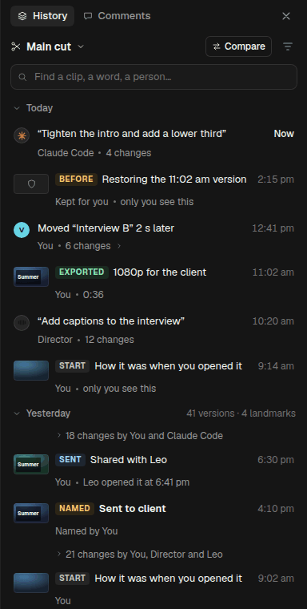 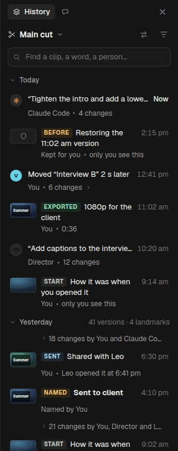

### 2.1 Landmarks, made automatically

| Landmark | Made when | Row | Who sees it |
|---|---|---|---|
| **Exported** | An export finishes (Cardboard's Export) | Picture · `EXPORTED` 1080p for the client · You · 0:36 | Everyone: "Leo exported 1080p" |
| **Sent** | A share link is made, a review link is sent, or a video is published from Cardboard | Picture · `SENT` Shared with Leo · You · Leo opened it at 6:41 pm | Everyone |
| **Named** | Someone names a version (as today) | Picture · `NAMED` **Sent to client** · Named by You | Everyone |
| **Agent turn** | An agent's turn ends (as today) | The agent's mark, its prompt in quotes, "Director · 12 changes" (unchanged) | Everyone |
| **Start** | The first change of a session: the project opened, or the first change after an hour away | Picture · `START` How it was when you opened it · You | **Only you.** A teammate's mornings are noise to you |
| **Before** | Just before a restore, a fold, an undo of a turn, or a Bring back | Picture · `BEFORE` Restoring the 11:02 am version · Kept for you | **Only the person who did it.** Teammates see the restore row itself, whose menu has *Go to just before this* |

- **The tag and the title read as one phrase:** "Before restoring the 11:02 am version", "Exported 1080p for the
  client", "Sent: shared with Leo". The tag is small capitals in its own colour: Exported green, Sent blue, Named and
  Before amber, Start grey.
- A row can be two landmarks (a named version that was exported). It shows the first in this order: Named, Sent,
  Exported, Before, Start. The rest go in its meta line ("also exported").
- "Only you see this" sits in the meta line of the personal ones, so nobody wonders where a teammate's went.
- Below 340 px a landmark's title wraps to two lines rather than losing its words to the tag.
- Agent turns keep the agent's mark instead of a picture, because who did it matters more there. They show their
  picture in their card and when peeked.
- **No setting, no "create checkpoint" button.** Naming a version stays the way to make your own landmark.

### 2.2 Pictures, on landmarks only

- **What:** the frame at the landmark's first change, or at 0:01 if it has none. A 44 × 25 px tile with the clip's
  look; rounded like Cardboard's media tiles.
- **When:** made the first time the row comes into view, then kept (§6). Never during playback or export. Made
  from the stage while it shows the landmark's version; when the stage has no picture to give yet (black while a
  project opens, a dropped canvas, two pictures while comparing), it is tried again while History is open (after 2 s,
  5 s, 15 s, then every 30 s, and as soon as Compare ends), never while History is closed.
- **Fallback:** the landmark's own icon on a dark tile (export arrow, send, bookmark, sun, shield), shown at once,
  and kept when the picture can't be made (footage offline, a version still arriving). Never a spinner, never a
  black tile.
- Ordinary rows get no picture: a 56 px row with a 44 px tile on every change would double the list's height and
  make it look the same everywhere.

### 2.3 Search

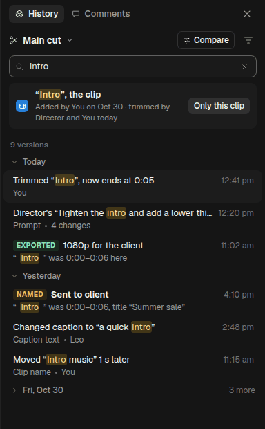 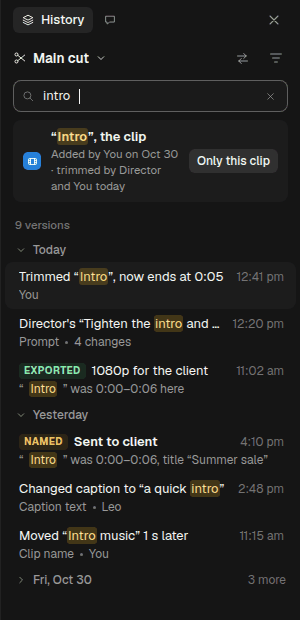 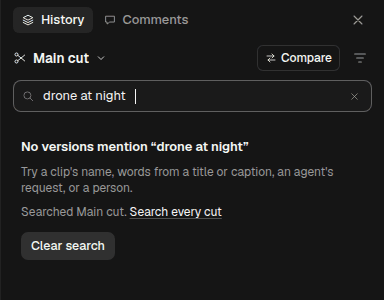

- **Where:** a field under the cut bar, always shown, placeholder **"Find a clip, a word, a person…"**. Ctrl+F while
  History has focus; `/` as well.
- **What it matches**, in this order of weight:
  1. **clip names** ("Intro", "interview-b.mp4");
  2. **title and caption text**, then and now ("in half");
  3. **agents' requests** (the prompt);
  4. **version names** and landmark words ("exported", "sent", "start");
  5. **people:** You, Leo, Director, Claude Code;
  6. **days:** "yesterday", "Monday", "Oct 30".
  - Words match from their start, any order, case and accents ignored: "intr cap" finds "Add captions… the intro".
- **Results:**
  - **A clip first,** when the words name one: "“Intro”, the clip", its credits line ("Added by You on Oct 30 ·
    trimmed by Director and You today") and **Only this clip**, which turns on the clip filter (DESIGN §6.1).
  - Then **"9 versions"**, newest first, under day headers, as rows: the title with the match highlighted, and a
    meta line that says **why it matched** ("“Intro” was 0:00–0:06 here", "Caption text · Leo", "Prompt · 4
    changes").
  - Older days fold after 20 results ("3 more").
  - Results are ordinary rows: a click opens the card, hold peeks, `⋯` has every action, Shift+click compares.
- **As you type:** from the second letter; the list updates within a frame of the last key (§6).
- **Empty:** "No versions mention “drone at night”" · "Try a clip's name, words from a title or caption, an agent's
  request, or a person." · "Searched Main cut. **Search every cut**" · **[Clear search]**.
- **Clear:** the field's ✕, or Esc in the field. A second Esc closes History, as before.
- **Search and filters combine:** a filter chip stays visible above the results, so a filtered search never passes
  for the whole history.
- **Across cuts:** "Search every cut" adds the cut's dot and name to each result's meta line. A click opens that
  version as a teammate's cut does (viewing).

### 2.4 Hold a row to peek

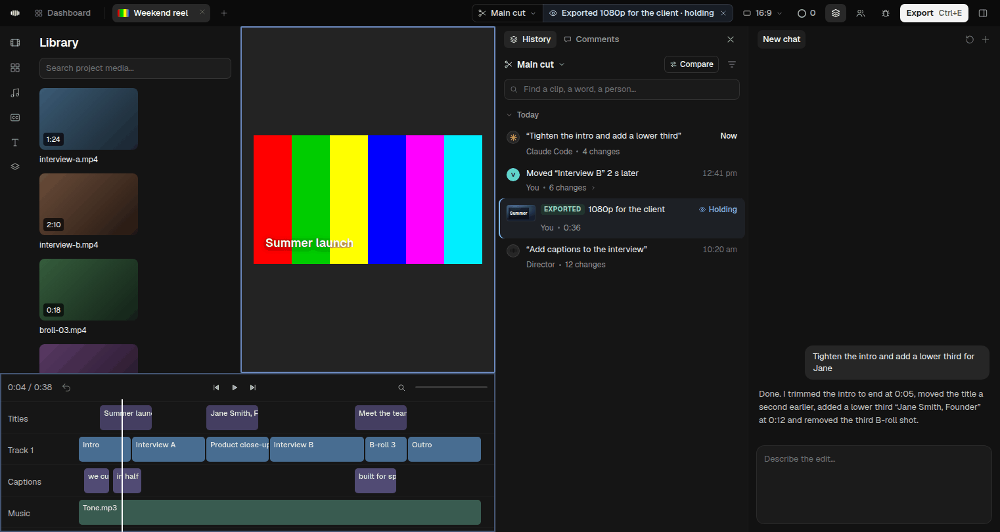
*Holding the Exported row: the stage shows that version at the playhead's moment. Release, and your edit is back.*

- **Press and hold a row** (300 ms, the pointer not moving) or its 👁 button on hover: the stage shows that version
  at the playhead's moment, paused. **Release** to come back. A click shorter than 300 ms opens the card, as today.
- **Keyboard:** hold **V** while the row has focus.
- **While held** it is viewing, with every mark (DESIGN §4.2): the chip's second part reads `👁 Exported 1080p for
  the client · holding`, the frame shows, and the row's time column says **Holding**. No toast, no announcement but
  one: "Showing Exported 1080p for the client. Release to go back."
- **Fast:** the version is fetched when the pointer has rested on a row for 150 ms, one at a time, so the hold
  shows at once (§6). If it isn't ready in 300 ms, the row's picture (or a dark frame with its name) shows until it
  is.
- **Hint:** the row's tooltip, after a second of hovering, says "Click to open · hold to peek".

### 2.5 Filters and folded days, with landmarks

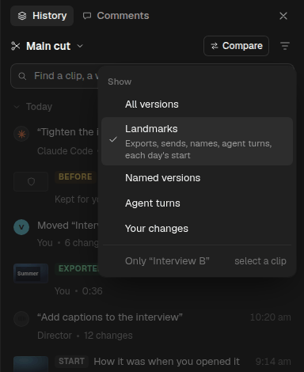

- **The filter menu** gains **Landmarks** ("Exports, sends, names, agent turns, each day's start"), second after All
  versions. With it on, the list is the story of the project in a screenful.
- **Folded days keep their landmarks visible** (DESIGN kept named versions and agent turns; v2 keeps every
  landmark). The header counts both: "41 versions · 4 landmarks".
- **Past days, open, read as a story:** their landmarks, and between two landmarks one line for the rest: "› 18
  changes by You and Claude Code". A click opens that run in place. Today is never folded this way.

### 2.6 Grouping, so the list reads like a story

The rules of DESIGN §6.1 stay (a person's changes in a row form one group; agent turns are one row). v2 adds:
- **A group never crosses a landmark.** "You · 6 changes" stops at an export, so "what I changed after exporting"
  is its own row.
- **A day reads top to bottom as a story:** Start → your changes → Director's turn → Exported → Sent.
- **Restores, folds and Bring backs** sit right after their `BEFORE` landmark, so the pair reads "Before restoring
  the 11:02 am version" → "Restored the 11:02 am version".

---

## 3. Rolling back, for someone who has never used version control

There are four ways back, and today they sit in different menus with similar words. v2 puts them in **one place,
side by side, each with what it will do**, so nobody restores a whole edit when they meant to fix one clip.

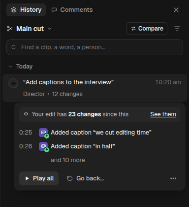

### 3.1 One button, four choices: **Go back…**

On any version that isn't the newest, the card's Restore… becomes **Go back…**. It opens the choices inside the
card:

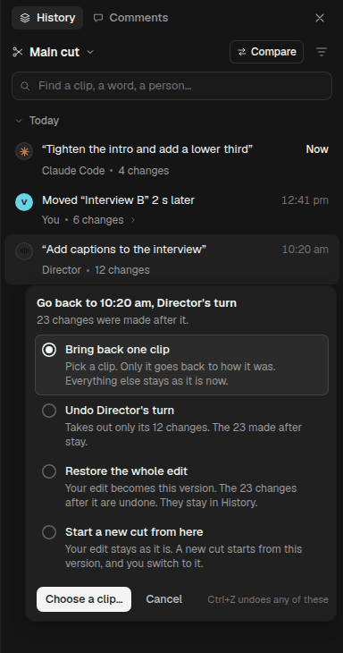 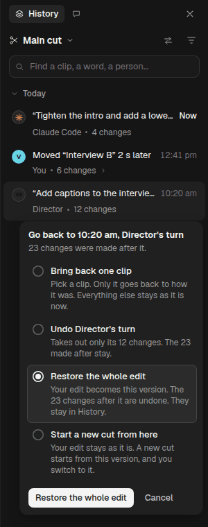
*After a click on a choice: at 384 px Bring back one clip is picked; at 300 px, Restore the whole edit. Nothing is picked when the chooser opens.*

| Choice | Its line (what will happen) | Its button | After it |
|---|---|---|---|
| **Bring back one clip** | "Pick a clip. Only it goes back to how it was. Everything else stays as it is now." | **Choose a clip…** | §3.2 |
| **Undo Director's turn** (agent turns only) | "Takes out only its 12 changes. The 23 made after stay." | **Undo Director's turn** | Toast "Took out Director's “Add captions…”. [Undo]" |
| **Restore the whole edit** | "Your edit becomes this version. The 23 changes after it are undone. They stay in History." | **Restore the whole edit** | Toast "Restored your edit from 10:20 am. Later changes are in History. [Undo]" |
| **Start a new cut from here** | "Your edit stays as it is. A new cut starts from this version, and you switch to it." | **Name the new cut…** | The name field, then the toast DESIGN §6.2 gives |

- **The head says where to:** "Go back to 10:20 am, Director's turn" and "23 changes were made after it."
- **Order:** the smallest change first. One clip, one turn, everything, then the one that changes nothing on this cut.
- **Nothing is picked at first,** and the button reads **Choose one** (disabled) until something is. The exception
  is a clip selected on the timeline: then **Bring back one clip** is picked, and its button reads **Bring back
  “Intro” as it was**.
- **The button always names the action**, as conflict cards do. No two choices share a button word.
- The footer's quiet line: "Ctrl+Z undoes any of these."
- `⋯` keeps its direct entries (Restore…, Undo this turn, New cut from this version…). They open this chooser with
  that choice picked, so the consequence is always read before it happens.
- **Words retired:** "Restore…" as the card's button (its confirmation text in DESIGN §6.2 is kept for **Restore the
  whole edit**).

### 3.2 Bring back one clip

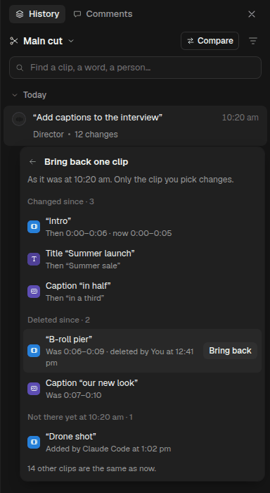 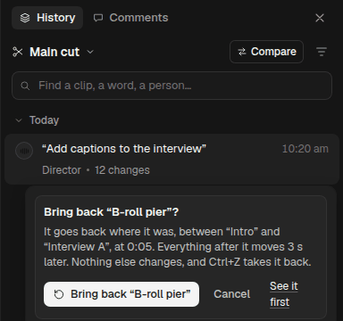

**Choose a clip…** lists the clips that differ between that version and now, in three plain groups:

| Group | Its rows | Button | What happens |
|---|---|---|---|
| **Changed since** | "“Intro”" · "Then 0:00–0:06 · now 0:00–0:05"; "Title “Summer launch”" · "Then “Summer sale”" | **Bring back** | The clip gets its old timing, text, look and settings. Its place in the edit stays if only its content changed |
| **Deleted since** | "“B-roll pier”" · "Was 0:06–0:09 · deleted by You at 12:41 pm" | **Bring back** | It goes back where it was. If the rest moved up when it was deleted, the rest moves back ("Everything after it moves 3 s later"). If its place is now taken, it goes on a new track above, at the same time ("Its place is taken by “Drone shot”, so it goes on a new track above, at 0:06") |
| **Not there yet at 10:20 am** | "“Drone shot”" · "Added by Claude Code at 1:02 pm" | **Take out** | "As it was" means not there. The button says so, and its line: "It wasn't in this version. Everything after it moves 4 s earlier." |

- **"14 other clips are the same as now."** closes the list. Past 8 rows, a filter field appears at the top.
- **A pick confirms in place** with where it goes and what moves, then **Bring back “B-roll pier”** / **Take out
  “Drone shot”** and **Cancel**, plus **See it first**, which opens Compare at that clip (§1).
- **After:** the toast "Brought back “B-roll pier” as it was at 10:20 am. [Undo]". History gets a row: "Brought back
  “B-roll pier” from 10:20 am", after its `BEFORE` landmark.
- **The other ways in:**
  - the clip filter's card (*Only “Intro”*): "“Intro” then: 0:00–0:06, title “Summer launch”." with **Bring back
    “Intro” as it was** and **Hold to see**;
  - Compare's row detail (§1.5);
  - the agent: `cb restore <version> --clip <name>` (§5.3).
- **Conflicts:** if the clip changed again while the confirmation was open (an agent, a teammate), the confirmation
  says "“Intro” just changed again. Bring back the 10:20 am one anyway?" and asks again.

### 3.3 The words, side by side

| The person wants | They press | It says before | It says after |
|---|---|---|---|
| One shot back as it was | Go back… → Bring back one clip | "Only it goes back to how it was." | "Brought back “Intro” as it was at 10:20 am." |
| A deleted shot back | … → Bring back (Deleted since) | "It goes back where it was… Everything after it moves 3 s later." | "Brought back “B-roll pier” as it was at 10:20 am." |
| An agent's work gone | Undo Director's turn | "Takes out only its 12 changes. The 23 made after stay." | "Took out Director's “Add captions…”." |
| Everything back to then | Restore the whole edit | "Your edit becomes this version. The 23 changes after it are undone. They stay in History." | "Restored your edit from 10:20 am. Later changes are in History." |
| Try another direction, keep this | Start a new cut from here | "Your edit stays as it is. A new cut starts from this version, and you switch to it." | "You're on “Old intro” now. Main cut is unchanged." |

Every one has Undo in its toast and in Ctrl+Z.

---

## 4. Compare any two

### 4.1 "Compare with…": pick mode

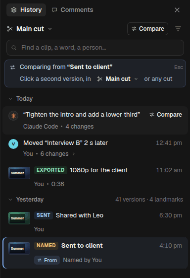

- `⋯` → **Compare with…** on a row starts pick mode. The row gets a **⇆ From** pill. One line sits above the list:
  "⇆ Comparing from **“Sent to client”**. Click a second version. `[✂ Main cut ⌄]` Esc".
- **Every row** then shows **⇆ Compare** in its time column on hover and on focus. A click opens Compare (§1), with
  the older on the left, or your cut on the right.
- **Search, filters and folded days all work while picking.** Finding the second version is the same as finding
  any version (§2).
- **The cut button in the line** switches the list to another cut, only for picking, for Compare across cuts
  (§1.12). The editor stays on yours.
- **Esc,** or a click on the From row again, leaves pick mode. Shift+click stays the quick way for two rows on
  screen.
- **Keyboard:** Enter on the second row. Screen readers hear "Pick a second version to compare with “Sent to
  client”".

### 4.2 The Compare button: the questions people actually ask

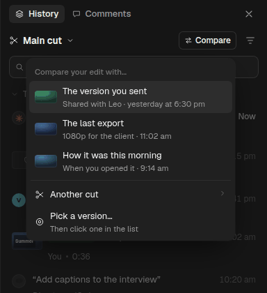

The cut bar gets **⇆ Compare** (an icon alone at 300 px). Its menu, **"Compare your edit with…"**:
- **The version you sent:** the newest `SENT` landmark, or the newest named version if nothing was sent. Sub-line:
  "Shared with Leo · yesterday at 6:30 pm";
- **The last export:** "1080p for the client · 11:02 am";
- **How it was this morning:** today's `START`, "When you opened it · 9:14 am";
- **Another cut ›:** the cuts, as in the cuts menu, for §1.12;
- **Pick a version…:** pick mode, with your edit as the right side.

Each entry shows only when it exists, with its picture. If none exists (a new project), the button opens pick mode
directly.

---

## 5. The agent's words

The agent works through `cb`. Its output is plain, so the agent can repeat it to the person in their own words. Each
line ends with the reference the agent passes back to `cb` (`main@41`). The agent never shows those references to the
person, as DESIGN's word rules say. The person sees names, times and "your edit".

`cb` runs as the person's agent, so it sees their personal landmarks (Start, Before) as well as the shared ones.

### 5.1 `cb history --find <text>`

```
$ cb history --find intro
The clip “Intro”: added by You on Oct 30, trimmed by Director today at 12:20 pm, trimmed by You at 12:41 pm.
9 versions on Main cut mention “intro” (newest first):
  today 12:41 pm       You          Trimmed “Intro”, now ends at 0:05                          main@88
  today 12:20 pm       Director     “Tighten the intro and add a lower third” · 4 changes      main@81
  today 11:02 am       Exported     1080p for the client · “Intro” was 0:00–0:06 here          main@74
  yesterday 4:10 pm    Named        “Sent to client” · “Intro” was 0:00–0:06                   main@41
  yesterday 2:48 pm    Leo          Changed caption to “a quick intro”                         main@37
  … 4 more: cb history --find intro --all
```

Nothing found:
```
$ cb history --find "drone at night"
No versions on Main cut mention “drone at night”.
Try a clip's name, words from a title or caption, an agent's request, or a person. Other cuts: --all-cuts
```

### 5.2 `cb history --landmarks`

```
$ cb history --landmarks
Landmarks on Main cut (newest first):
  today 2:15 pm        Before       Restoring the 11:02 am version (only you see this)         main@92
  today 11:02 am       Exported     1080p for the client · 0:36                                main@74
  today 10:20 am       Director     “Add captions to the interview” · 12 changes               main@70
  today 9:14 am        Start        How it was when you opened it (only you see this)          main@63
  yesterday 6:30 pm    Sent         Shared with Leo · Leo opened it at 6:41 pm                 main@44
  yesterday 4:10 pm    Named        “Sent to client”                                           main@41
  yesterday 9:02 am    Start        How it was when you opened it (only you see this)          main@12
Words that work in place of a reference: sent, exported, today, now, a version's name, a cut's name.
```

### 5.3 `cb restore <version> --clip <name>`, and `cb compare --show`

```
$ cb restore sent --clip Intro
Brought back “Intro” as it was in “Sent to client” (yesterday at 4:10 pm): now 0:00–0:06, was 0:00–0:05.
Nothing else changed. The user can undo it with Ctrl+Z; you can with: cb undo
```
```
$ cb restore main@70 --clip "B-roll pier"
Brought back “B-roll pier” (deleted by the user today at 12:41 pm) where it was: 0:05 on Track 1, between “Intro”
and “Interview A”. Everything after it moved 3 s later. Nothing else changed.
```
```
$ cb restore sent --clip "Drone shot"
“Drone shot” wasn't in “Sent to client”, so bringing that version back means taking it out (0:12–0:16; everything
after would move 4 s earlier). Nothing changed. To take it out: cb restore sent --clip "Drone shot" --remove
```
```
$ cb restore sent --clip Interview
Two clips match “Interview”: “Interview A” (0:05) and “Interview B” (0:16). Nothing changed. Name one.
```
```
$ cb compare sent now --show
Opened in the editor: “Sent to client” (yesterday at 4:10 pm) with the user's edit now. 7 changes:
  0:00  Trimmed “Intro”, now ends at 0:05
  0:01  Changed title “Summer sale” to “Summer launch”
  0:03  Changed caption to “in half”
  0:05  Removed “B-roll pier”
  0:07  Removed caption “our new look”
  0:12  Added “Drone shot”
  0:16  Moved “Interview B” 4 s earlier
The user can press Esc to go back to their edit.
```
```
$ cb compare "30s Instagram cut" "Main cut" --show
The user is busy editing, so the comparison didn't open. They have a note in the editor with Open.
“30s Instagram cut” (now) with Main cut (now): 7 differences.
  0:05  Only in Main cut: “Interview A”
  …
```
```
$ cb compare sent now --show
The user is already comparing two versions. They have a note in the editor with Open; nothing was replaced.
```

```
$ cb compare sent now --show
The editor didn't answer in time, so nothing opened. Here is the comparison:
“Sent to client” (yesterday at 4:10 pm) with the user's edit now: 7 changes:
  …
```

`--show` exits 0 in all these cases (opened, offered, already busy, no answer). The first line says which, so the
agent tells the person the truth ("I've put it on your screen" or "There's a note with Open in the editor"). "No
editor window has this project open" is said only when no app holds the project.

---

## 6. Performance: what costs, and the rule for each

Nothing here may slow down editing when it isn't in use. Every cost below is **lazy** (made only when needed),
**cached** (made once), or **gated** (only when the computer can afford it), and most are all three. The targets are
for the builders to measure on the Windows laptop against the current build, with before/after medians. None of them
is a measured claim yet.

| Part | What it costs | Rule |
|---|---|---|
| **The second player** (Side by side, Wipe) | A second render of the edit: decoding, GPU memory | **Gated and lazy.** It's made when Compare opens in a mode that needs it, never before. It renders at its display size, never larger. It draws nothing while paused except on a seek. It must say *ready* within 2 s, or Compare falls back to Flip (§1.10). It is kept 30 s after Done comparing for a quick return, then freed. Zero cost when not comparing |
| **The left side's version** | Loading one version's document | **Cached and prefetched.** Fetched when the pointer rests 150 ms on See them, Compare or a pick row. The last 3 are kept |
| **`ui.align` and `ui.changes`** | A diff of two versions | **Cached** per (left, right), as `shotDiff` is today. Computed off the UI thread. Across cuts that differ a lot, the list groups runs (§1.12) rather than drawing 300 rows |
| **Timeline marks and the strip** | Laying out an overlay on the clips | **Lazy:** only clips in view. Re-laid on zoom and scroll, once per frame at most. While playing, only the playheads move, by transform. No work at all outside Compare |
| **Play both in step** | Seeks at each shot start | Precomputed from `ui.align` when Compare opens. The left player seeks only at shot starts, never every frame |
| **Pictures on landmarks** | Rendering a frame per landmark | **Lazy, cached and gated:** landmarks only, made when the row comes into view, one at a time, when the editor is idle. Never during playback or export. 88 × 50 px JPEG, kept on disk by (version, time). The icon shows at once while it's made |
| **The search index** | Words from clip names, text, prompts, names and people, per version | **Built at save time,** a few words per version, in the same place as the per-version clip index (PLAN 0.8). Searching runs off the UI thread; results are a virtual list. Target for builders: results within a frame at 10,000 versions |
| **Landmarks** | Marking a version | **Free to read:** a flag written when the version is saved (export done, link made, turn end, first change of a session, before a restore). No scan of history |
| **Hold to peek** | Loading a version for the stage | **Prefetched** after 150 ms of hover, one at a time, cancelled when the pointer leaves. It shares the left-side cache |
| **The agent's `--show`** | An idle check | **Event-driven:** pointer and key events already seen by the editor. No polling, no timers while nothing is waiting |

**What must not regress:** with History closed and nothing compared, the editor does no extra work, and edits, playback
and exports are as fast as today. PLAN's benchmarks run with Carton on and off to prove it, before and after.

---

## 7. Open questions for the user

1. **Edit while comparing?** v2 makes Compare look-only, even when the right side is your edit. Done comparing keeps
   the playhead on the spot, so fixing it is one key away. Editing live inside Compare, with the list updating as you
   go, is possible later. Is look-only right for now?
2. **Personal landmarks:** Start and Before are visible only to the person they belong to. Should a team see each
   other's Before points, for "what did Leo's restore throw away?"
3. **The agent opening Compare:** v2 opens it at once when the person is idle, and otherwise offers it as a note with
   Open. Would the user rather it always offer, and never open by itself?
4. **Pictures:** landmarks only, and agent turns keep their mark. Should agent turns get pictures too?
5. **Sent:** what counts as "sent" beyond Cardboard's share and publish? For example, an export saved to a folder
   named "client", or a file dragged out of the app. v2 only marks what Cardboard itself does.

## 8. Mockups

All in `after/`, made from `mockups/*.html` by `mockups/render.mjs`.

| File | Shows |
|---|---|
| `compare-side-by-side.png` | §1: the default, Side by side, a change selected |
| `compare-wipe.png`, `compare-flip.png` | §1.3: the other two modes (Flip with B held) |
| `compare-play-both.png` | §1.4: Play both in step; the slate; the two playheads |
| `compare-timeline-marks.png` | §1.6: every mark and the strip, close up |
| `compare-edit-attempt.png`, `compare-toasts.png` | §1.8, §1.13: the line for an edit tried, and every Compare toast |
| `compare-narrow.png`, `compare-drawer-hidden.png` | §1.9: 1100 px window; the drawer hidden |
| `compare-flip-only.png` | §1.10: the fallback |
| `compare-panel-384.png`, `compare-panel-300.png`, `compare-panel-added-384.png` | §1.5, §3.2: the change list; Bring back and Take out in a row's detail |
| `compare-cuts.png`, `compare-cuts-menu-384.png`, `compare-fold-entry.png` | §1.12: across cuts, and its ways in |
| `compare-agent.png` | §1.13: the agent opened it |
| `history-landmarks-384.png`, `history-landmarks-300.png` | §2.1, §2.2, §2.5, §2.6: landmarks, pictures, a past day as a story |
| `history-search-384.png`, `history-search-300.png`, `history-search-empty-384.png` | §2.3 |
| `editor-peek.png` | §2.4 |
| `history-filter-landmarks-384.png` | §2.5 |
| `history-card-v2-384.png`, `history-goback-384.png`, `history-goback-300.png` | §3.1 |
| `bring-back-384.png`, `bring-back-confirm-384.png` | §3.2 |
| `compare-pick-384.png`, `compare-menu-384.png` | §4 |
