# Carton v2: compare in the editor, find any version, roll back what you meant

An addendum to `../DESIGN.md` (the first design, mostly built on `feat/carton-ux`), and to the design QA in
`../qa/QA.md`. Where this file says nothing, DESIGN.md still holds: its word rules, the cut chip, viewing, the change
row, conflict cards and toasts. Docs only. Nothing here is built yet.

Mockups are HTML/CSS in `mockups/`, rendered to `after/` with `mockups/render.mjs`. They reuse the first design's skin
and builders (`../mockups/`), so they match the built UI. Editor shots are 1522 × 810 CSS px (the laptop's window at
125 %); panel shots are 384 px (the default) and 300 px (the minimum).

## 0. What this answers

The person who uses it, tonight:

1. *"every change adds a new history record and hence tht cud get messy for a person to manually find nd
   rollback/fork a particular version."* → §2 (landmarks, pictures, search, peek) and §3 (rolling back).
2. *"how wud the diff b/w two arbitrary versions be shown (as in git)"* → §1 (Compare in the editor) and §4 (any two).
3. *"In compare why do we need to compare in that history section only, that feels conjested. Can't we hijack the
   actual preview area"* → §1.
4. *"make version stuff as much easy for the end user as possible"* → every section. The test is a video editor who
   has never used version control.

Two more asks, added during the work:
- **Compare across cuts:** any version of one cut against any version of another (§1.12).
- **The agent opens Compare on request:** "show me what changed since I sent it to the client" (§1.13, §5).

**The one change of stance.** DESIGN §4.4 kept every comparison in the panel. It set aside a second player because it
costs a second renderer. v2 changes exactly that. **Comparing two versions is the one time Carton takes over the
editor.** The stage shows both versions, Cardboard's own timeline shows the differences, and History shrinks to the
list of them. It happens only when the person asks to compare, and Esc puts everything back. The other rules stay:
no banners, the cut always visible, plain words, nothing that changes your edit without saying what it does.

---

## 1. Compare in the editor

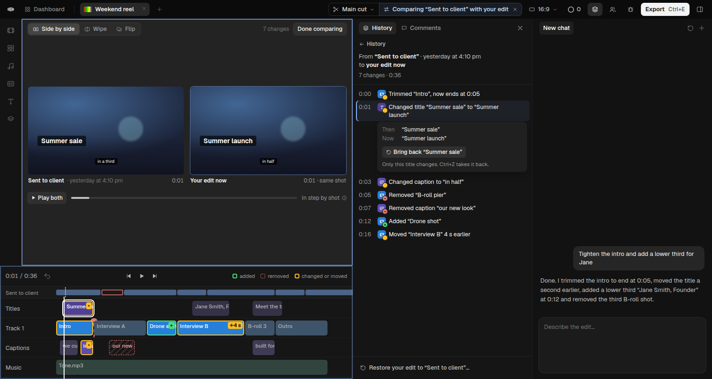
*The default. “Sent to client” (yesterday at 4:10 pm) on the left, your edit on the right. The title change is
selected in the list, so both players are at 0:01 and its clip is ringed on the timeline. The thin strip above the
tracks is “Sent to client” on its own time.*

### 1.1 What it is

**Comparing** is a state, like viewing (DESIGN §4.2). It belongs to the same family: *the editor is showing you
something you can't edit*. It has the same blue frame round the stage and timeline, and the same chip, with its own
icon and words. Only one of viewing or comparing is on at a time.

While comparing, these change:

| Region | While comparing |
|---|---|
| **Title bar chip** | Second part: `⇆ Comparing “Sent to client” with your edit ✕` (§1.7) |
| **Stage** | The **compare bar** at its top: the modes, the count ("7 changes") and **Done comparing**. Below it, two players (or a wipe, or a flip), each labelled under its picture, then **Play both** and its progress. Nothing sits over the picture |
| **Library** | Steps aside to give the stage its width, as when the person collapses it. It comes back on exit. The rail of icons stays |
| **Timeline** | Cardboard's own, showing the **right side**. Its clips carry the marks (§1.6); a 26 px strip on top shows the left side. Muted, framed, not editable |
| **History panel** | **The change list**: the range in words, the count, every change row in timeline order, and the footer action. It replaces the in-panel Changes view (§1.2) |
| **Chat** | Unchanged. An agent can still be asked anything, and an agent can open a comparison (§1.13) |

**Which side is which.** One rule, so nobody has to think about it:
- **The right side is what the timeline shows.** Your edit, or the cut you're on, is always the right side when it's
  in the comparison. The right player is Cardboard's own preview.
- **The left side is the other one:** the older version, or the other cut. The left player is the second player.
- Two older versions of one cut: the older one is on the left. Two cuts, neither of them the one you're on: the one
  you picked first is on the left.
- In words the left comes first: "Comparing *left* with *right*".

### 1.2 Ways in, and what replaces the Changes view

| From | Compares (left ↔ right) | Notes |
|---|---|---|
| A card's **Your edit has 7 changes since this · See them** | this version ↔ your edit now | The commonest way in |
| Row or card `⋯` **Compare with your edit** | this version ↔ your edit now | |
| Row or card `⋯` **Compare with…** | this version ↔ the version you click next, in any cut | Pick mode, §4.1 |
| **Shift+click** (or **Shift+↑↓**) a second row | the two rows, older on the left | As today, but it opens Compare |
| History's **⇆ Compare** button (cut bar), new | a landmark ↔ your edit now: *with the version you sent*, *with the last export*, *with the start of today*, *with another cut ›*, *with…* | §4.2. The one-click answer to "what changed since I sent it?" |
| A card **while playing** an older version: **⇆ Side by side**, next to Before | the version before it ↔ this version, at the same spot, still playing | Before (hold) stays as it is: a quick flip with no change of layout |
| **Cuts menu:** **Compare** on another cut's row | that cut now ↔ the cut you're on now | §1.12 |
| **Fold in:** **See them side by side** | the from-cut now ↔ the into-cut now | The panel's footer gets **Back to Fold in…**, which reopens the dialog with the ticks kept |
| **An agent**, on request | what it was asked | §1.13 |

**The in-panel Changes view retires.** Every way that opened it now opens Compare. Its content moves into the panel
during Compare: the range in words, the count, the change rows and Restore. The change map goes; the marks on the
real timeline do its job, at full width. `ChangesView` stays in the gallery for one release, as PLAN 4.4 did for
`CompareCard`.

Nothing else enters Compare. A click on a row, opening a card, ▶ on one change and Play all on a card behave as in
DESIGN §5.

### 1.3 The modes: Side by side, Wipe, Flip

| Mode | What the stage shows | Best for |
|---|---|---|
| **Side by side** (default) | Two players in the project's aspect, left and right, the same size. Each has a label under it (**name** · when · its timecode, and "same shot" while in step) | Seeing what's different at a glance, and playing both |
| **Wipe** | One picture. Left of the line is the left side, right of it the right side. Drag the line, or ← → (Shift for fine). Double-click puts it back in the middle. Labels sit in the top corners | A look, a colour, a title's style: things in the same place on both sides |
| **Flip** | One picture, full size, showing the right side. **Hold B** (or hold the pill under the picture) to show the left; release to come back. A click latches it. The tag at top-left says which side is shown, and turns blue while it's the left | Small windows, and spotting a change by flicking between the two |

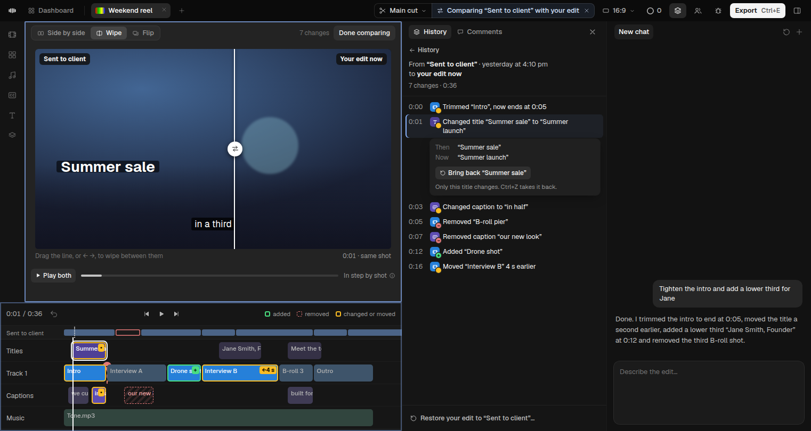 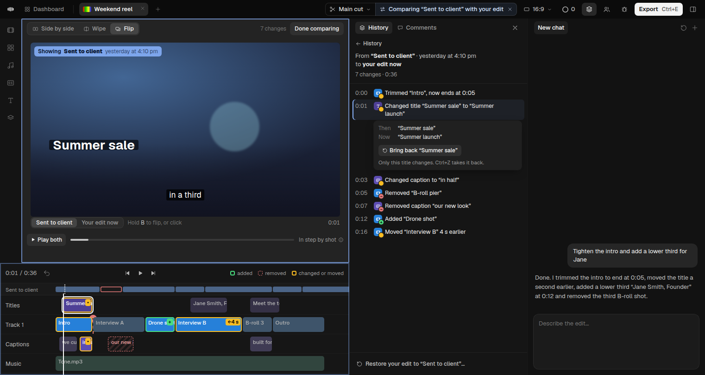

- **Default:** Side by side, when each player gets at least 320 px (a stage of 682 px or more). Otherwise Flip.
- The mode a person picks is kept for next time, but the width rule wins.
- Flip uses the editor's one preview, swapping the version the way Before does today. The left side is loaded when
  Compare opens, so the first flip doesn't wait.
- Changing mode keeps the spot, and keeps playing if it was playing.

### 1.4 Play both, in step by shot

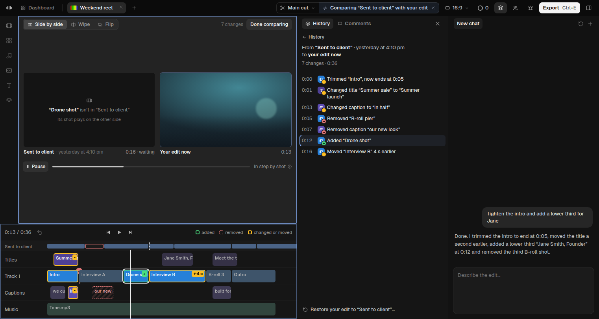
*At 0:13 your edit plays the added “Drone shot”. “Sent to client” has no such shot, so its side holds a slate. The
white playhead is your edit; the dotted one on the strip is “Sent to client”.*

- **Space** or **Play both** plays both sides from the selected spot.
- **In step by shot.** The two sides are matched clip by clip; the comparison knows which clip is which. Each shot
  starts on both sides together.
  - When a shot is longer on one side, the other side holds its last frame, and its label says "waiting", until the
    longer one ends.
  - A shot that only one side has plays on that side. The other side shows a slate: **“Drone shot” isn't in “Sent to
    client”** · "Its shot plays on the other side."
  - So drift never builds up, and the two pictures always show the same moment of the story.
  - "In step by shot" has an ⓘ: "Both sides play the same shot together. A shot that's longer on one side waits for
    the other."
- **Sound** comes from the right side. In Flip it comes from the side shown. Each label has a speaker on hover to
  listen to that side instead.
- **To judge pace,** hover a label and press its ▶, **Play this side alone**. That side plays in its own time, and the
  other pauses.
- The progress bar and the timeline's white playhead follow the right side. The strip's dotted playhead follows the
  left.
- Wipe and Flip play the same way: one picture, both sides kept in step.

### 1.5 Clicking a change

- **In the list** (a click, or ↑↓): both players go to the change's spot, paused. The left side goes to where it is,
  or was, on the left; the right side to where it is on the right.
  - The timeline scrolls the clip into view and rings it in white.
  - The row opens its detail: **Then** / **Now** in words, and the one-clip action (§3.2).
  - A removed clip: the left player shows it, the right shows the moment where it was. A clip only on the right: the
    left shows the slate.
- **Enter, or ▶ on the row:** plays that spot on both sides, with one second either side, in step.
- **On the timeline:** clicking a marked clip, a ghost or a seam selects its row in the list and scrolls the list to
  it. Clicking an unmarked clip only moves the playhead. Nothing can be dragged (§1.8).
- A change with no place in the edit (aspect ratio, frame rate) shows `—` and doesn't move anything.

### 1.6 The marks on Cardboard's timeline

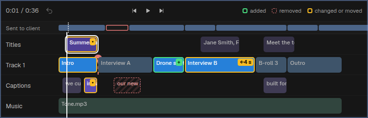

| What happened (right side compared with left) | Mark on the clip |
|---|---|
| **Added** (only on the right) | Green 2 px outline inside the clip, and a **+** tag |
| **Removed, a gap left** | A **ghost** of its size where it was: red dashed outline, faint hatching, its name in red-tinted text. Drawn behind the real clips |
| **Removed, the rest moved up** | A **seam**: a red dashed line at the join, with a **−** knob on top. Its tooltip: "Removed “B-roll pier” here (3 s)" |
| **Moved** | Amber outline and a tag with the direction and amount: **←4 s**, **2 s→**, or **new track**. On hover, its old place shows as a dotted amber outline |
| **Trimmed** | Amber outline. The old edge shows as a dotted amber extension when it was longer, or a short amber notch inside when it was shorter |
| **Changed** (text, look, volume, speed, effects) | Amber outline and a **•** tag. Its tooltip is the change's sentence |
| **Several changes on one clip** | One outline: green if it was added, otherwise amber. The tag shows the count (**3**) |
| **Selected** | A white 2 px ring outside the mark |
| **Unchanged** | Muted, as while viewing, so the marked clips stand out |

- **The strip** is a 26 px row above the tracks, labelled with the left side's name. It shows the left side's main
  video track on its own time, at the timeline's zoom and scroll. A clip that's gone on the right has a red outline;
  the dotted playhead is the left player. It shows at a glance that the two edits differ in length and where things
  went.
- **The legend** ("added · removed · changed or moved") sits at the right of the timeline's toolbar, beside the
  optional cut label. It hides when the timeline is narrower than 900 px; the list carries the same.
- **Colour is never the only signal.** Every mark also has a shape: outline, dashed ghost, seam knob or tag.
- Clip names stay readable: the tag sits at the clip's top-right, and is dropped when the clip is under 36 px wide.
- **Built on the timeline hook** that the viewing frame uses (DESIGN §11, PLAN 1.5). It is an overlay placed from the
  timeline's clip elements. If a later Cardboard breaks the anchor, the marks don't draw, and the list, the players
  and the jumps still work.

### 1.7 The chip, and the ways out

- **The chip's second part:** `⇆ Comparing “Sent to client” with your edit ✕`. Other examples:
  - `⇆ Comparing your edit from 12:41 pm with Director's “Add captions…”` (two older versions)
  - `⇆ Comparing “30s Instagram cut” with Main cut`
  - `⇆ Comparing Leo's Main cut with yours`
  - `⇆ Comparing “30s Instagram cut” at 12:20 pm with Main cut now`
- The label is built in one place, with the panel's range line, so the two never disagree.
- **Narrow:** it shortens first to `⇆ Comparing “Sent to client”…`, then `⇆ Comparing`. The ⇆ and the ✕ always stay;
  the whole label is in the tooltip.
- **Ways out**, all to the same place:
  - Esc, unless a menu, a latched flip or a drag takes it first;
  - the chip's ✕ ("Done comparing (Esc)");
  - **Done comparing** on the compare bar;
  - **← History** at the top of the panel;
  - closing History;
  - switching project tab;
  - opening Export, which says "Back to your edit to export it.", as with viewing.
- **Where you land:** your edit, on the cut you were on.
  - If the right side was your edit, the playhead **stays where it is**, at the change you were looking at, so you
    can fix it right there.
  - Otherwise it goes back to where it was before you compared.
  - History shows its list again, with the card you came from still open.
- Screen readers hear "Back to your edit."

### 1.8 An edit tried while comparing

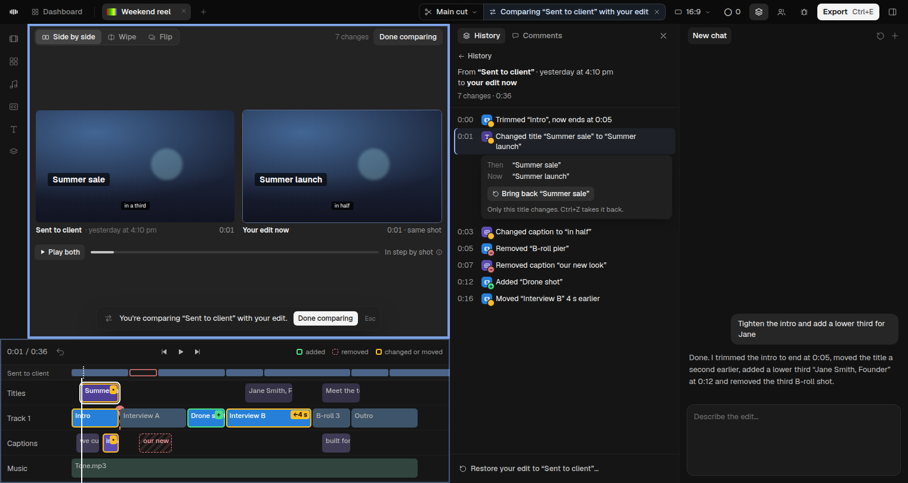

Comparing is for looking, even when the right side is your edit. A drag, a typed title, Delete or Ctrl+Z changes
nothing. The frame pulses once, and one line appears at the bottom of the stage, through Cardboard's own refusal path
(as DESIGN §4.3):

> ⇆ You're comparing “Sent to client” with your edit. **[Done comparing]** Esc

Between two older versions: "You're comparing two earlier versions. **[Back to my edit]** Esc".

Done comparing keeps the playhead where it is (§1.7), so the edit can be made on the spot.

**Three things do change your edit while comparing,** each on purpose and named for what it does:
- **Bring back** one clip (§3.2);
- **Restore your edit to “Sent to client”…** (§3.1);
- an agent's work.

Each leaves Compare open with the right side updated, and the list loses or gains rows, with a toast and Undo. The
right side, when it's your edit, is always **your edit now**: if an agent or a teammate changes it, the list and the
marks update within a second, and the selected row stays selected if it still exists.

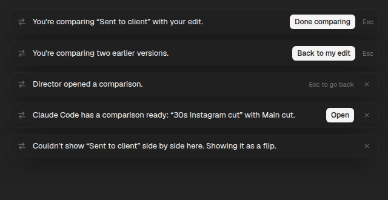

### 1.9 Narrow windows and the drawer

| Width | Compare |
|---|---|
| Stage ≥ 682 px | All three modes; Side by side is the default |
| Stage < 682 px (e.g. a 1100 px window with History and the chat open) | **Flip** is the default. Side by side is greyed, with its tooltip "Side by side needs a wider stage. Close the chat or widen the window." |
| Stage < 600 px | The modes keep their icons and drop their words, except Flip; their tooltips keep the words. The count goes (the list has it). **Done comparing** becomes **Done** |
| Stage < 360 px | Flip only |
| Window < 1180 px | The chip shortens (§1.7); the panel is 300 px |
| **History in the drawer, drawer hidden** | The list isn't on screen, so the frame's own label shows (DESIGN §4.2): `⇆ Comparing “Sent to client” with your edit · 7 changes ✕`. A click on its words opens the drawer; ✕ ends Compare. Closing the drawer does **not** end Compare: the label stays |

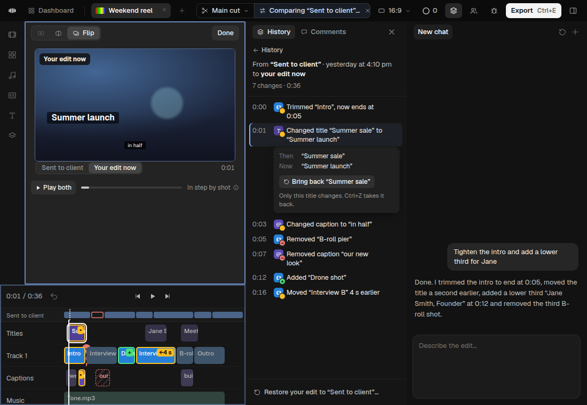 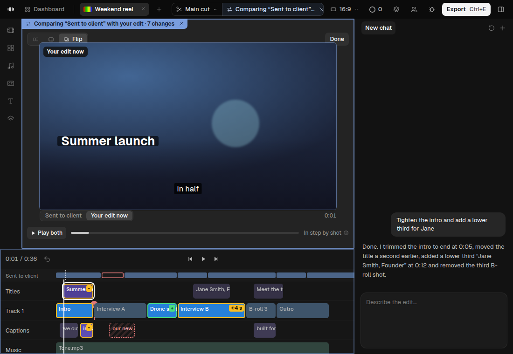

### 1.10 When a second player isn't possible: Flip only

The second player can fail: it doesn't start within 2 s, the computer's graphics memory is short, the project is too
large, or a later Cardboard breaks the hook. Then:
- the mode switch shows **Flip** alone;
- if the person had picked Side by side or Wipe, one toast, once per session: "Couldn't show “Sent to client” side by
  side here. Showing it as a flip.";
- everything else works as usual: the list, the marks, the strip, the jumps, Play both (in Flip), and Bring back;
- **never** a black, frozen or half-loaded player.

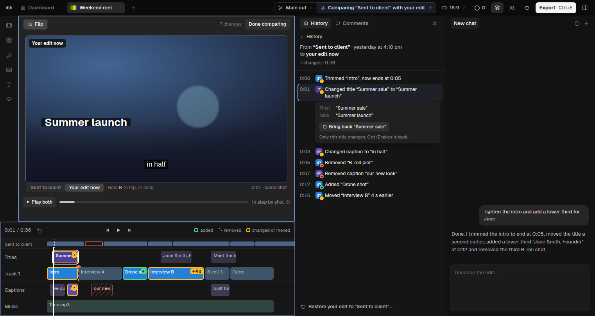

### 1.11 How it relates to viewing, Play and conflict cards

- **Viewing and comparing** never stack. Opening Compare while viewing ends viewing first. If you were viewing a
  version and press its card's See them, that version becomes the left side.
- **Play and Before on a card** stay as DESIGN §5.3: one picture, quick. While an older version plays, the card adds
  **⇆ Side by side** beside Before, to open Compare at that spot (§1.2).
- **Conflict cards' See it** stays viewing: one side on the stage, while the card stays in view to decide. A conflict
  is about one clip, and See it already shows it. The card gets no Compare button.
  - A conflict that arrives while comparing waits as the pill **"⚠ 1 conflict to pick"**, as during viewing. The
    pill's click ends Compare and opens the card.
- **Comments' "See it as it was"** stays viewing.
- **A teammate's cut** (picked from the cuts menu) is still viewing. Its two actions gain a third: **Compare with
  Main cut**.

### 1.12 Compare across cuts

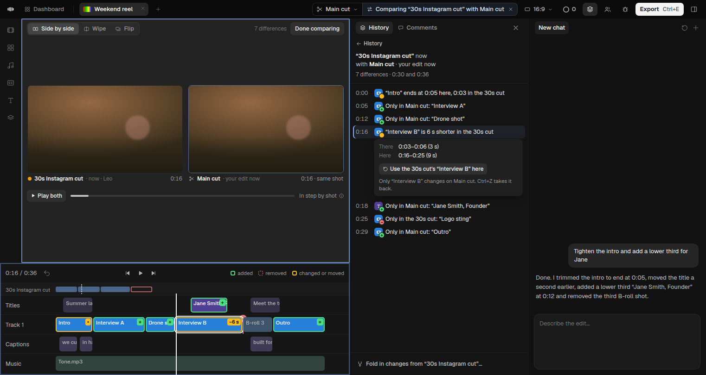
*“30s Instagram cut” (Leo's) against Main cut, both now. Shots are lined up by shot. “Interview A”, “Drone shot”,
“Jane Smith, Founder” and “Outro” are only in Main cut; “Logo sting” is only in the 30s cut.*

Any version of one cut against any version of another: Main cut now against “30s Instagram cut” now, or Leo's Main
cut against yours.

- **Ways in:**
  - the **cuts menu:** every other cut's row (your cuts and teammates') shows **⇆ Compare** on hover and on focus. It
    compares that cut now with the cut you're on now;
  - **Compare with…:** while picking (§4.1), the pick line's cut button switches History's list to another cut, only
    to pick. The editor stays on yours. Any version there can be the second side;
  - **Fold in:** **See them side by side** in the dialog's footer.
- **Sides:** the cut you're on is on the right (it's what the timeline shows). Two teammate cuts: the first picked is
  on the left. Each side is a cut at a moment, "now" unless picked otherwise.
- **Words:** they always name both cuts and both moments.
  - Chip: `⇆ Comparing “30s Instagram cut” with Main cut`. With moments: `⇆ Comparing “30s Instagram cut” at 12:20 pm
    with Main cut now`.
  - Player labels: `● 30s Instagram cut · now · Leo` and `✂ Main cut · your edit now`. Each carries the cut's own
    mark: scissors for Main cut, its colour dot otherwise.
  - Range line: "**“30s Instagram cut”** now / with **Main cut** · your edit now".
  - The count is **differences**, not changes: nobody made them; the cuts just differ. "7 differences · 0:30 and 0:36"
    gives each cut's length.
- **The sentences say where a clip is, not what someone did:**
  - "Only in Main cut: “Drone shot”" · "Only in the 30s cut: “Logo sting”"
  - "“Interview B” is 6 s shorter in the 30s cut"
  - "“Intro” ends at 0:05 here, 0:03 in the 30s cut"
  - "“Interview B” is 4 s earlier in the 30s cut"
  - "The title reads “Summer ’26” in the 30s cut"
  - Inside one cut, "Added", "Removed" and "Moved" stay: there someone did them.
- **Marks for two cuts that have drifted apart:**
  - lined up by shot: clips are matched by identity, which cuts share from the cut they were made from;
  - a clip only on the right is marked as added (green, **+**);
  - a clip only on the left is a ghost or a seam;
  - a clip on both that differs is amber.
  - The strip shows the left cut on its own time, so a 0:30 cut against a 0:36 one reads at once.
  - **Far apart** (more than 40 differences): runs of the same kind group in the list, e.g. "Only in Main cut: 9 clips
    from 0:12 to 0:31 ›", and open on click.
- **Actions:**
  - a selected row offers **Use the 30s cut's “Interview B” here**. It is one clip, onto the cut you're on, undoable
    (§3.2);
  - the footer offers **Fold in changes from “30s Instagram cut”…**, the existing dialog, instead of Restore;
  - between two cuts that aren't yours, there are no actions, only Done comparing.

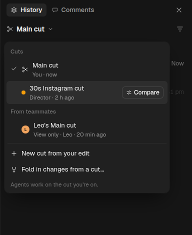 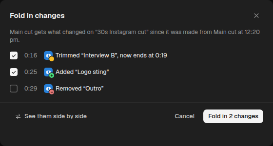

### 1.13 The agent opens Compare on request

*The user asked Director in the chat. The comparison opened, the chip says so as usual, and one toast says who
opened it.*

When the user asks Director or Claude Code "show me what changed since I sent it to the client" or "compare the
Instagram cut with Main", the agent runs `cb compare <left> <right> --show`. The editor follows, as it does for `cb
cut switch`. Without `--show`, `cb compare` prints words, as today (§5).

**When it opens.** At once, if the person is **idle**. Idle means:
- no mouse button is held and nothing is being dragged;
- no key has been pressed in the last 2 s outside the chat box. Sending the request counts as idle: they just asked;
- no dialog or menu is open;
- nothing is playing;
- they are neither viewing nor comparing.

**Otherwise it never takes over.**
- **Mid-edit** (a drag, typing in a title, a dialog open): it waits up to 8 s for idle and opens then. If they are
  still busy, it offers a toast instead: **"Claude Code has a comparison ready: “30s Instagram cut” with Main cut.
  [Open] ✕"**. The toast stays until Open, ✕ or the agent's next action.
- **Already viewing or comparing:** it never replaces what the person is looking at. It offers the same toast. Open
  replaces the current view, and Esc then goes back to your edit, not to the earlier view.
- **Playing, or Export open:** the offer toast.

**When it opens:**
- the chip as usual;
- the History panel opens to the change list if it was closed, and closes again on exit if the agent opened it;
- one toast, for 6 s: **"⇆ Director opened a comparison. Esc to go back ✕"**. The ✕ hides only the toast; the chip,
  Done comparing and Esc end Compare;
- screen readers hear "Director opened a comparison: “Sent to client” with your edit. 7 changes. Esc to go back."

**Never:** during a drag, over a dialog, while the person is typing in the editor, or without the chip and Esc to go
back. An agent can't open Compare for a version the person can't see (another person's private cut).

`cb` output, plain, is in §5.3.

### 1.14 Keyboard, screen readers and words

| Where | Key | Does |
|---|---|---|
| Anywhere while comparing | **Esc** | Done comparing (after a menu, a latched flip or a drag) |
| | **Space** | Play both / pause |
| | **B** (hold) | Flip mode: show the left side. Carton takes B only while comparing, when edits are refused anyway |
| | **Ctrl+Shift+H** | Close History, which ends Compare |
| Change list | **↑ ↓ Home End** | Move between changes; both players and the timeline follow |
| | **Enter** | Play that change on both sides |
| | **→** / **←** | Open / close the row's detail; Tab reaches its Bring back |
| Mode switch | **Tab**, then **← →** | A radio group: Side by side, Wipe, Flip |
| Wipe line | **← →** (Shift: fine), **Home End** | Move the line |
| A player's label | **Enter** on ▶ | Play this side alone |

**Screen readers:**
- The stage is a labelled region: "Comparing “Sent to client” with your edit".
- The modes are a `radiogroup`.
- The wipe line is a `slider` ("Wipe between Sent to client and your edit", value "56 % your edit").
- Each player is labelled with its side, its moment and its timecode.
- Polite announcements:
  - on entering: "Comparing “Sent to client” with your edit. 7 changes. Esc to go back.";
  - on a change the person moves to: its sentence and "Both players are there.";
  - on leaving: "Back to your edit."
  - Playback announces nothing.
- The marks and the strip are `aria-hidden`; the list carries the same.
- Reduced motion: no pulse, no ring animation; jumps are instant.

**Words (new):**

| Place | Words |
|---|---|
| Chip | "Comparing “Sent to client” with your edit" · "Comparing “30s Instagram cut” with Main cut" · "Comparing Leo's Main cut with yours" · "Comparing your edit from 12:41 pm with Director's “Add captions…”" · ✕ "Done comparing (Esc)" |
| Compare bar | "Side by side" · "Wipe" · "Flip" · "7 changes" / "7 differences" · "Done comparing" / "Done" · greyed: "Side by side needs a wider stage. Close the chat or widen the window." |
| Players | "Sent to client · yesterday at 4:10 pm" · "Your edit now" · "same shot" · "waiting" · slate: "“Drone shot” isn't in “Sent to client”" + "Its shot plays on the other side" · "Play this side alone" · "Listen to this side" |
| Wipe / Flip | "Drag the line, or ← →, to wipe between them" · "Showing Sent to client" · "Hold B to flip, or click" |
| Transport | "Play both" / "Pause" · "In step by shot" + "Both sides play the same shot together. A shot that's longer on one side waits for the other." |
| Timeline | legend "added · removed · changed or moved" · seam "Removed “B-roll pier” here (3 s)" · tags "+", "←4 s", "2 s→", "new track", "•", "3" |
| Panel | "← History" · "From “Sent to client” · yesterday at 4:10 pm / to your edit now" · "7 changes · 0:36" · "Then" / "Now" · "Restore your edit to “Sent to client”…" · "Back to Fold in…" · across cuts: "Only in Main cut: …", "Only in the 30s cut: …", "… is 6 s shorter in the 30s cut", "… ends at 0:05 here, 0:03 in the 30s cut", "Use the 30s cut's “Interview B” here", "Fold in changes from “30s Instagram cut”…" |
| History | "Compare" (cut bar, cuts menu rows) · "⇆ Side by side" (card while playing) · "See them side by side" (Fold in) · "Compare with Main cut" (a teammate's cut) |
| Toasts | "You're comparing “Sent to client” with your edit." + "Done comparing" · "You're comparing two earlier versions." + "Back to my edit" · "Director opened a comparison." + "Esc to go back" · "Claude Code has a comparison ready: “30s Instagram cut” with Main cut." + "Open" · "Couldn't show “Sent to client” side by side here. Showing it as a flip." · "Back to your edit to export it." |
| *Removed* | the in-panel Changes view's change map · "Changes since 12:20 pm" as a panel title (the range line replaces it) |

### 1.15 What Compare needs underneath (for N0 and N1)

- **`ui.align(a, b)`:** the clip-by-clip match between two versions, in one cut or across cuts. Each entry is
  `{ item, aStart?, aEnd?, bStart?, bEnd?, track }`. It drives in step by shot, the strip, the jumps and the cut
  sentences. It is cached per (a, b), like `ui.changes`.
- **`ui.changes(a, b)` across cuts,** with a `between: "versions" | "cuts"` flag, so `describe` picks "Added …" or
  "Only in …".
- **The second player:** it renders the left side from its own copy of the version, at its display size, never
  larger, and seeks and plays on command. It must say *ready* or *failed* within 2 s; failed means Flip only (§1.10).
  N1 decides how: a second renderer, or an offscreen copy of the preview.
- **Moving Cardboard's preview into the right half,** and the Library's collapse, with the stage hook (the same layer
  the frame and toasts use).
- **The timeline overlay** for marks and the strip, on the viewing frame's hook (DESIGN §11.2).
- **`cb compare … --show`** sends `{ left, right }` to the editor over the same path as `cb cut switch`. The editor
  answers `opened`, `offered` or `refused` (§5.3).
- Costs and their rules: §6.

---

*§2 to §6 follow in the next commit.*
