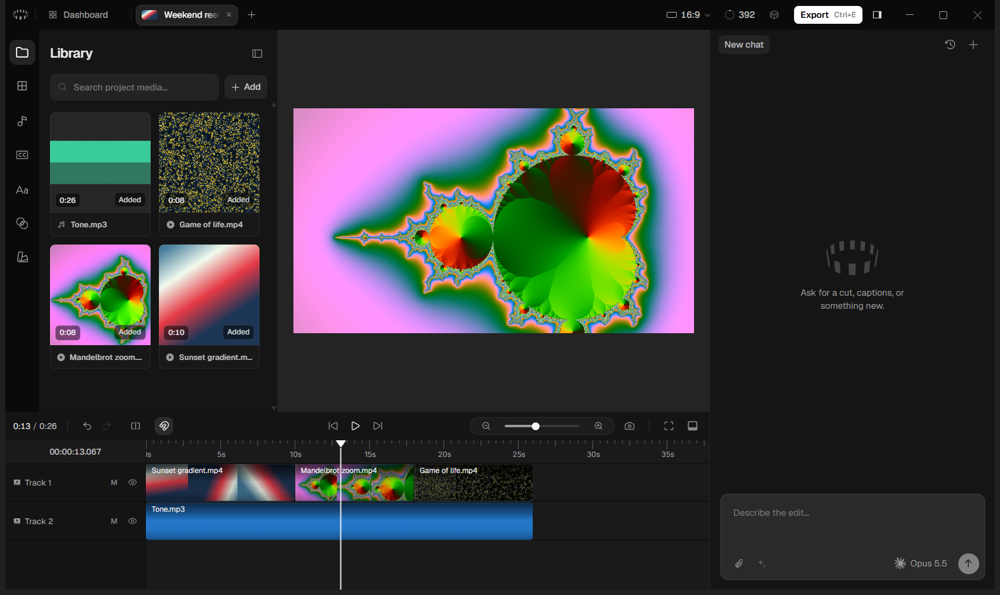

# Cardboard 1.5.0 (macOS) on Windows

[README](../README.md) · [Windows port](windows-port.md) · [Carton in the app](carton-in-the-app.md) · [Benchmarks](benchmarks.md)

The reference for the Windows port: what each patch changes and why, how saves, the activity log and the
keyboard tests work, what isn't ported, and how to rebuild. These sections were the README until 2026-11-10.

Cardboard only ships an Apple Silicon Mac build. This folder repackages that build's app code
(`app.asar`) onto the Windows build of the same Electron version (43.7.0), with Windows
replacements for its bundled macOS binaries.



Run it from the `Cardboard` shortcut (Desktop or Start Menu), or `Cardboard-win\Cardboard.exe`.
If you launch it from a terminal that has `ELECTRON_RUN_AS_NODE=1` set (some Electron-based IDEs
set this), unset that variable first.

Git tracks only our own work: `scripts\`, `carton\`, `docs\`, `examples\`, `assets\`, `.github\`, the package
files in `tools\`, the READMEs, `AGENTS.md`, `CLAUDE.md` and `.gitignore`. The app,
the downloads and Cardboard's unpacked code are ignored (see `.gitignore`): they are large, and
they are Cardboard's software, not ours to redistribute.

## Cardboard 1.5.0

The patches now target Cardboard 1.5.0, the newest Mac release (they were written for 1.4.0). What's new in 1.5.0
(Cardboard's changelog, "Premiere Projects, Cleaner Audio, Smoother Playback"): Open Project takes a Premiere Pro
`.prproj` (and `cb project import-premiere`), right-click audio cleanup (voice, music removal, vocal split, processed
in Cardboard's cloud), web search and media from links for the Director, and lighter playback, scrubbing and graphics.
Porting it took:
- **Premiere paths on Windows.** The import tries the absolute paths Premiere saved for each media file, then paths
  relative to the `.prproj`, but it skipped absolute Windows paths (`C:\…`), which a Mac can't open. On Windows those
  are the paths Premiere saves, so only media next to the project (by a relative path) came in and the rest was "not
  found". Now they're kept on Windows, in the app and in `cb` (patch-worker 7, patch-cli-media 7;
  `scripts\test-premiere-paths.js` checks both on sample paths).
- **Proxies.** 1.5.0 asks the hardware encoder for 1.5 times the source's bitrate, kept between a third of 12 Mb/s
  and 12 Mb/s (6 Mb/s for cloud proxies), instead of a fixed 12 Mb/s. NVENC's constant quality keeps that as its
  cap, and its buffer follows the new rate's unit.
- **Graphics.** Cardboard reworked the frame pump that feeds a graphic its video frames after 1.4.0 (in 1.4.1, refined in 1.5.0). The fix that waits for a slow
  frame instead of rebuilding the graphic (patch-renderer 13) is ported. The speed change that drew with the newest
  ready frame while playing (14) is left out: it doesn't fit 1.5.0's pump (see patch-renderer.js), so graphics play
  through Cardboard's own pump in both builds.
- Everything else only needed the minified names it matches renamed to 1.5.0's.

Measurements below were taken on 1.4.0-based builds unless they say otherwise.

## Layout

- `Cardboard-win\` — the runnable app. Only this folder is needed to run Cardboard.
  - `resources\app.asar` — Cardboard's code, with the patches below.
  - `resources\bin\` — ffmpeg, ffprobe 8.1 (BtbN win64 gpl build), uv 0.13.6. Stay on 8.1:
    the 9.0 and nightly builds need NVIDIA driver 610+ for NVENC, and this laptop has 581.
  - `resources\director\claude.exe` — Claude Code 2.1.309 for win32-x64, the version the Mac build bundles.
  - `resources\cli\` — the `cardboard`/`cb` CLI, patched.
- `dl\`, `extracted\`, `asar-src\` — downloads and unpacked sources, kept for rebuilding.
- `main.orig.js`, `library-worker.orig.js`, `cardboard.orig.mjs`, `tabs.orig.js`, `index.orig.js`, `EditorRoute.orig.js`, `installErrorTelemetry.orig.js` — unpatched bundles the patch scripts start from.
- `scripts\` — patch and helper scripts.
- `tools\` — 7-Zip, `@electron/asar`, rcedit and the generated `Cardboard.ico`.

## Patches

`scripts\patch-main.js` (applied to `asar-src\dist\main.js`):
1. Use `.exe` names for the bundled ffmpeg, ffprobe, uv and claude.
2. Allow Desktop Director (the local Claude Code agent) on Windows; it was gated to darwin-arm64.
3. Replace the Director's tool setup (symlinks and `/bin/sh` wrappers) with shims that work
   from Git Bash, cmd and PowerShell. Python 3.12 with numpy, OpenCV, Pillow and SciPy goes in
   `%APPDATA%\ai.cardboard.desktop\director-python`. The folder with the real `ffmpeg.exe` and
   `ffprobe.exe` (`resources\bin`, which also has `uv.exe`) goes on the agent's PATH after the shims.
   Windows starts a bare `ffmpeg` only as an `.exe`, so agent code such as Python's
   `subprocess.run(["ffmpeg", …])` failed with "file not found". On macOS the shims are symlinks to the
   binaries, so the same code works there.
4. Run the control socket on a named pipe, since Windows can't listen on a socket file.
5. "Install agent tools" writes `cardboard`/`cb` shims to `%USERPROFILE%\.local\bin` and adds that folder to the user PATH.
   The `.cmd` shims keep `ELECTRON_RUN_AS_NODE` to themselves (`setlocal`). Before, one `cb` command left it
   set in the console, and every Electron app started from there (Cardboard, VS Code…) then ran as plain
   Node, with no window. On start, shims an earlier build installed for this exe are brought up to date
   (not while a `cb` command runs, since cmd would go on reading the batch file it is in the middle of).
   The folder goes on the user Path in the registry as it is: `%USERPROFILE%\…` entries stay unexpanded and
   the value stays `REG_EXPAND_SZ`. `[Environment]::SetEnvironmentVariable`, used before, wrote it back
   expanded, as a plain string. Paths with non-ASCII characters (`C:\Users\José\…`) are written into
   `.cmd` files as `%LOCALAPPDATA%`, `%APPDATA%` or `%USERPROFILE%` plus the rest, since cmd reads a batch
   file in the console's code page, not UTF-8. That goes for the Director's tool shims (patch 3) too.
   Cardboard also writes `cb`/`cardboard` shims for your own agents (Settings → Agents) in
   `%APPDATA%\ai.cardboard.desktop\agent-bin`, first on their PATH. On Windows it wrote only `.cmd` files,
   which Git Bash (Claude Code's shell) can't run by name, so unless agent tools were installed, Claude Code
   got `cb: command not found`. Now that folder gets the sh shim too, as on macOS.
6. Find your own Claude Code and Codex (Settings → Agents). On Windows Cardboard only looked for
   `claude.cmd`/`codex.cmd` on PATH, so it missed `codex.exe`. It also failed to start an npm
   `claude.cmd`, because Node won't run a `.cmd` directly. Now it takes `.exe` files on PATH,
   follows npm `.cmd` shims to the `.exe` they run, and also checks `%USERPROFILE%\.local\bin\claude.exe`
   and `%LOCALAPPDATA%\Programs\OpenAI\Codex\bin\codex.exe`. npm's shim for a JavaScript package runs
   the `node.exe` next to it when there is one (nvm-windows, fnm, a prefix in Node's folder). That is
   Node, not the agent, and it passes the `--version` check, so those shims are skipped.
   It also fixes the environment agents are found and started with. Cardboard copied it and read
   `PATH`, but started from the Start Menu or Explorer, Windows names that variable `Path`. So the
   PATH search found nothing, and agents were started with only Cardboard's own shim folder on PATH.
7. Make notifications show (for example when an agent asks you something while the window is in
   the background). Windows only shows notifications from an app with an AppUserModelID that
   its Start Menu shortcut also carries. Cardboard set none. On start it now sets
   `ai.cardboard.desktop` and writes that ID into the Cardboard shortcuts (Start Menu, Desktop,
   taskbar pin) that point to this exe. It also creates the Start Menu one if it's missing. It
   flashes the taskbar button where macOS bounces the Dock icon.
8. Fewer animations in Cardboard only. Cardboard has no setting for this. It follows the system's
   reduced-motion preference, and the `force-prefers-reduced-motion` switch turns that on for
   Cardboard alone, leaving Windows' "Animation effects" setting as it is. Some fades remain. To
   bring the animations back, delete this replacement and rebuild.
9. Cardboard's tab strip is the title bar, as on macOS. The window asked for macOS's `hiddenInset`
   title bar, which Windows ignores, so Windows drew its own title bar and a File/Edit/… menu bar
   above the strip. Now the window has no native title bar. Minimize, maximize and close stay native
   (Snap Layouts, the red close hover), drawn over the strip's right end on a clear background with
   neutral-400 glyphs. The empty parts of the strip drag the window, double-click maximizes and
   right-click opens the window menu. The app menu moves into the strip (see `patch-strip.js`): main
   describes `Menu.getApplicationMenu()` to the strip and runs the item picked, so the strip's menu
   is always the real one, and the menu's shortcuts still work. Alt pressed and released on its own,
   or F10, opens the menu from anywhere in the window, as a menu bar would. A click or another key
   while Alt is down cancels that (Alt+drag duplicates clips, Shift+F10 opens the timeline's context
   menu). So does Alt pressed with a mouse button held: Alt in the middle of a drag, let go after the
   drop, even with a scroll or another button on the way. And so does any key let go while Alt is down,
   even one whose press Windows keeps for itself (Alt+PrintScreen). The About window loses its title bar and menu bar too: its page already has a drag region,
   and its fixed size had cut off the copyright line under them.
10. File → Import Folder… (Ctrl+Shift+I) imports the video, audio and image files in a folder and its
    subfolders into the open project, in path order (`clip 2` before `clip 10`). The folder picker runs
    in the editor, which gets the files through the event its own Import button uses, so the usual
    checks and progress apply. A folder with no media says so. File pickers only open from a user
    gesture, which a menu click doesn't give the page, so this one runs with a gesture. Import Media…
    from a menu now does too: it pressed Cardboard's own Ctrl+I in the page, whose picker only opened
    if the editor had been clicked in the last few seconds. Dropped folders are `patch-renderer.js`.
11. An activity log, for looking back at how an editing session went (see [Activity log](#activity-log)).
    Main writes it. Menu items say whether they ran from the strip's menu or their accelerator, agent
    answers say how long their question waited, Ctrl+Tab (which main handles itself) and Alt/F10 are
    logged, and main's own warnings and errors and the library worker's output go in too. Before, those
    only reached a console nobody sees when Cardboard starts from the Start Menu. It also says which GPU
    draws the app, and when a GPU or page process dies.
12. Windows wording where main names the Mac: "this PC" for "this Mac" in the sign-out and quit dialogs
    and when an agent isn't installed, and File Explorer for Finder in the agent's reveal step.
13. On a laptop with two GPUs, Cardboard draws on the fast one when the PC is plugged in. Windows gives
    an app the power-saving GPU unless the app asks for the other, so on a laptop with an RTX 3050
    everything Cardboard draws (preview, timeline, graphics) and its own video decoding ran on the
    integrated Intel GPU, which borrows system RAM, while the RTX sat idle. Started on battery it stays on
    the default GPU: the RTX, powered off otherwise, draws 3.3 W while Cardboard idles on it and about 9 W
    while a graphic plays. The choice is made when Cardboard starts, from the
    power state then; plugging in or out while it runs takes effect at the next start. An NVIDIA
    GPU is powered off when idle, and waiting for it to power up made startup slower, so `nvidia-smi -L`
    (installed with the driver) starts waking it as Cardboard starts. To keep Cardboard on the
    power-saving GPU, choose "Power saving" for it in Windows Settings → System → Display → Graphics;
    that wins over Cardboard's request (checked). Left out of `--baseline`. Measured in
    [Benchmarks](benchmarks.md).
14. The "[telemetry] sentry delivery failed" warning says why: Cardboard's own message for the failed upload,
    an HTTP status or a network error ("Telemetry relay failed (429)", "fetch failed"). Cardboard reports
    its own problems, and a failed analytics upload is one, to cardboard.ai; when that report can't be sent
    either, main warned without the reason (145 times in an hour of test exports, from both builds and from
    a normal session, so not from these changes).
15. The window opens at the size it was closed at. Cardboard saves the window's size when it closes and
    opens the next one at that size. Without the native title bar (patch 9), Electron on Windows makes a
    window slightly bigger than asked, so each launch saved a bigger size and opened bigger still. On the
    test laptop (125% scaling) it went 1440 → 1446 → 1452 → 1458 points wide over three launches, and
    would go on until the screen's width, where Cardboard caps it. The default window is as tall as the
    screen, so only its width grew. A window dragged smaller, or quit maximized, grew both ways. Now main
    notes how much bigger the window came out when it was made, and takes that off the size it saves.
    Over repeated launches, a resize, and quitting maximized then restoring down, the window kept its
    size. How much bigger Windows makes it depends on the size and position. So the first launch after a
    resize can open it a few pixels off the size it was dragged to, and it keeps that size afterwards.
16. Cardboard no longer leaves copies of its own files in `%TEMP%` (`scripts\asar-assets.js`). Every launch left
    57 files, about 9 MB, named `<uuid>.tmp.js` (and `.tmp.css`, `.tmp.woff2`…), and they stayed after a clean quit:
    200 test launches left 11,634 of them, about 1.7 GB. They were copies of the pages' code, styles, fonts and
    images. These are packed in `app.asar`, and Cardboard serves them (`app://cardboard/…`) by streaming each file.
    Electron can stream a file packed in an archive only by copying it out to a temp file first, and it never
    deletes that copy. macOS empties its temp folder; Windows keeps `%TEMP%` unless Storage Sense is on. On Windows
    such a file is now read straight from the archive, with no copy. The answer is the same: the status, every
    header and the bytes (tested against Cardboard's own handler, and on the real Electron 43.7.0, where the old
    handler left one copy per file served and the new one leaves none). It isn't slower either. Measured in a test
    app around Cardboard's own handler, on Electron 43.7.0 for Linux, 57 of Cardboard's files (9.1 MB), 20 alternated
    rounds: fetching them all took 123 ms instead of 170 (medians), the handler's time for the first request
    (`index.html`) 10 ms instead of 18, and the page load was the same (264 ms). Files outside the archive, such as your
    media, the library and preview copies, are served as before (that is a different handler, which this
    doesn't touch). macOS is unchanged.
    The copies earlier builds left are deleted in the background, a few seconds after the window shows. Only files
    named `<uuid>.tmp` or `<uuid>.tmp.<ext>` that are byte for byte a file in this `app.asar`, with the same size and
    extension, are deleted, and only if they were made before Windows last started. Electron keeps reopening its
    copies, so an older Cardboard that's still running would lose a file it uses; no program still running was
    started before Windows was. Nothing else in `%TEMP%` is read beyond its name, size and date. Copies of a file an
    earlier build had patched differently (a few of the 57) don't match, so they stay. It stops after 20 seconds,
    and it gives way to the app between files. When nothing it should delete is left, `temp-sweep.json` in
    Cardboard's user data folder records that it's done, and it doesn't run again. A copy from since Windows started,
    one it couldn't delete (in use) or a stop at 20 seconds leave it for the next start, for at most 20 starts. The
    activity log says how many files went.
17. A naming call whose binary has gone no longer shows an error dialog. Cardboard names a new chat and a new project
    (and, with Carton, an agent's turn) by running your Claude Code or Codex once. If the binary it found was removed
    before the call (an update swapping it, an uninstall), the process failed to start with an error nothing caught,
    which in the main process shows Electron's error dialog, and the error carried your words. Now the call just ends
    with no name: the chat keeps its first words, the project its file names, the turn your message. Nothing is
    logged.

`scripts\patch-worker.js` (applied to `asar-src\dist\library-worker.js`) uses the NVIDIA GPU
(NVENC) for converting imported media and making preview copies, where macOS uses VideoToolbox.
It test-encodes a few frames once to check that NVENC works. If NVENC fails on that test or on a
particular file, Cardboard's existing fallback re-encodes in software (libx264/libx265).

It also makes imports finish much sooner. After a drop, Cardboard makes a timeline filmstrip and a
waveform for every clip, and a proxy for anything over 1920 px. It decoded every frame on the CPU for
both, so a 4K HEVC clip took about as long as it runs, twice. Now:
- Proxies decode on the GPU (NVDEC) and scale there (`scale_cuda`). Rotated sources (phone footage)
  decode on the GPU and scale on the CPU, since ffmpeg only applies the rotation to frames in system
  memory. If the GPU run fails, the NVENC run with CPU decoding follows, then libx264.
- Proxies are encoded at constant quality (NVENC CQ 30, capped at Cardboard's bitrate) and scaled with
  lanczos. Cardboard asks for a set bitrate, which VideoToolbox needs (1.4.0: a fixed 12 Mb/s; 1.5.0: 1.5 times
  the source's, up to 12 Mb/s), and `scale_cuda`'s default scaler is softer than the CPU's. With both, proxies were
  5 to 14 times the size of the CPU path's and looked worse. Scored against the 4K source (each proxy scaled back
  up, VMAF 4K model; measured with 1.4.0's fixed 12 Mb/s; not independently verified):

  | Proxy of | CPU path, libx264 CRF 20 (stock) | NVENC 12 Mb/s (before) | NVENC CQ 30, lanczos (now) |
  | --- | --- | --- | --- |
  | 40 s 4K HEVC phone clip | 10.7 MB, VMAF 92.4, 17.3 s | 54.8 MB, VMAF 85.5, 6.8 s | **5.8 MB, VMAF 95.3, 4.7 s** |
  | 20 s 4K60 H.264 clip | 1.9 MB, VMAF 91.1, 9.4 s | 27.7 MB, VMAF 82.8, 8.6 s | **1.6 MB, VMAF 94.9, 6.9 s** |
- Filmstrips decode only keyframes when, in the first 30 s, they come at least every 2 s. Otherwise
  every frame is decoded, on the GPU when there is one. ffmpeg's `fps` filter fills each slot with the
  last frame nearest to it, so even decoding every frame, Cardboard's thumbnails were up to half a slot
  late (0.25 s for half-second slots, 0.5 s for one-second slots). From keyframes about 1 s apart they
  land up to 0.57 s off for half-second slots and 0.07 s for one-second slots (measured on three
  clips). `eof_action=pass` keeps the last keyframe, which the filter otherwise dropped at the end.

On 1.5.0, against the baseline build (Cardboard's own pipeline, with the hardware encoder at its set bitrate), six
clips took 28.6 s instead of 52.0 s until every filmstrip, waveform and proxy was ready: about 1.7× faster,
re-run independently. The clips show up in the media list about 0.3 s later, though. Every run, and the check, in
[Import, on 1.5.0](benchmarks.md#import-on-150). (An earlier figure, 73.5 s to 11.9 s for four clips, was measured
on 1.4.0 against stock libx264, before the baseline build existed; an independent check couldn't back it from the
recorded runs, so it is withdrawn.)

It also fixes Cardboard staying alive with no window. Main waits for every import to be done before it
quits, and the worker said an import was done only if all of its background work succeeded. When one
background save failed (see [Saves on Windows](#saves-on-windows-scriptsrename-retryjs)), the worker never
said so, and main waited forever: closing the window left the process running with no window, until it
was ended in Task Manager. Now a clip whose background work fails gets Cardboard's usual "Could not import"
for that clip, and the import counts as done either way. The CLI's copy has the same change; there the
failure ended a recipe install with an unhandled rejection.

It also makes Premiere Pro imports (new in 1.5.0) find their media on Windows. For each media file the import
tries the absolute paths Premiere saved, then paths relative to the `.prproj`. It skipped absolute Windows paths
(`C:\…`, `\\?\C:\…`), which can't be opened on a Mac, so on Windows only media found by a relative path came in
and the rest was listed as "not found". On Windows they're kept now and tried first, as a Mac's own paths are there.
The CLI's copy (`cb project import-premiere`) has the same change. `node scripts/test-premiere-paths.js <patched
library-worker.js> <patched chunk-AEX5IIG7.mjs>` runs both resolvers on sample paths, patched and as Cardboard calls
them.

It also fixes clips left without a filmstrip when Cardboard quits during an import. Cardboard writes a
clip's poster first and, on reopening a project, counted any thumbnail as a finished filmstrip. Now a
video needs its filmstrip thumbnails to count as done.

The helpers both media patches add are in `scripts\media-helpers.js`. In the app's library worker they
also note in the activity log whether NVENC and CUDA work, and every fall back from the GPU to the CPU,
which was silent before. The CLI's copy stays quiet, since the agent reads what it prints.

`scripts\patch-strip.js` (applied to `asar-src\dist\renderer\assets\tabs-DauD2kkX.js`, the tab strip)
finishes the title bar from patch 9. Cardboard's logomark sits at the strip's leading edge, where macOS
has its traffic lights, and opens the app menu: File, Edit, Playback, View, Window and Help, each with
its items in a submenu. The menu is drawn the way Cardboard draws its own menus (the timeline's context
menu): the same raised surface, 30 px rows, separators, shortcut keycaps (`Ctrl+Shift+E`, as Cardboard
writes shortcuts on Windows) and open animation, using classes already in Cardboard's stylesheet. It
works from the keyboard: arrows, Enter, Escape, and a letter to jump to an item. While it is open, a
click outside it only closes it, and closing it returns the keyboard to the editor. The strip also
leaves room for the window controls on the right, except in full screen, where Windows hides them, as
macOS's strip does for the traffic lights on the left. The menu's code is in `scripts\strip-titlebar.js`.

`scripts\patch-renderer.js` (applied to `asar-src\dist\renderer\assets\index-CMWd3X51.js`, the renderer's
main bundle, `EditorRoute-fdkrSHAw.js`, the editor's, and `installErrorTelemetry-B0RfASW6.js`, which holds
the editor's state) does the rest of the renderer's changes.

It imports the media in a dropped folder and its subfolders: dropped on the editor (the media panel or
anywhere else) it goes into the project, and dropped on the Dashboard (its prompt box, or anywhere else
on it) its media is attached to the prompt, as dropped files are. The prompt box has its own drop target,
which took a dropped folder as one attachment named after the folder. Checked with real drags from File
Explorer. Dropping a
folder imported nothing. Chromium lists a dropped folder as one file with no type, which the media filter
threw away. Cardboard has a folder walker, but read the drop's folders only after an `await`, when
Chromium has already emptied them. Now they are read while the drop is still being handled. Non-media
files in the folder are skipped, files already in the project too, and plain file drops work as before.
On the Dashboard a folder without media still gets the "files were not added" note. The Report an Issue
attachments and other drop targets don't take folders.

It also fixes the keyboard on Windows, found by pressing every shortcut in the running app
(`scripts\test-shortcuts.js`, below):
- Recording a shortcut in Settings → Shortcuts stored Ctrl as `ctrl`, while every built-in Ctrl shortcut
  is stored as `meta` (Cardboard's Cmd/Ctrl). The conflict check told the two apart, so Ctrl+D for Split
  at Playhead was saved without a word although Duplicate has Ctrl+D, and Ctrl+D then split with nothing
  selected and duplicated with clips selected. Now Ctrl is recorded as `meta`, and shortcuts recorded
  before are compared as `meta` too. On a Mac the same recording said "already used by Duplicate".
- The Shortcuts page drew a Mac keyboard: ⌃ ⌥ ⌘ along the bottom, ⇧, ⌫, Return, and ⇧/⌘/⇧⌘ layers. Now
  it draws Ctrl, Win, Alt, Shift, Backspace and Enter, and Ctrl, Shift and Ctrl+Shift layers.
- Ctrl+Y redoes, as everywhere on Windows (Ctrl+Shift+Z still does). Only while Redo keeps its default
  and nothing else is set to Ctrl+Y.
- Answering the agent from the keyboard: Enter on a question's option that is already picked sends the
  answer. Clicking an option leaves the keyboard on it, and Enter clicked it again, which un-picked it,
  so "click an option, press Enter" sent nothing. Enter on an option not picked yet still picks it
  (Enter, Enter from the keyboard), and Space still toggles. A generation ("Generate this sound effect?
  0.27 credits") is approved with Ctrl+Enter and skipped with Esc, as the card's keycaps say, from the
  reply box or anywhere else; plain Enter doesn't spend credits. That is Cardboard's design (⌘↵ on a Mac)
  and is unchanged.
- The pages' part of the activity log: shortcuts, keys nothing handled, how each agent question was
  answered (a key or a click), page errors and error toasts.

The timeline and playback, found by playing real projects in a separate copy of the app and measuring:
- Previous/next frame (← →) keep the playhead in view. Jump to start/end scrolled the timeline to the
  playhead; the frame steps did not, so holding ← walked it off the edge, out of sight.
- Dragging the playhead, or scrubbing the ruler, past the edge of the timeline scrolls it, faster the
  further out, as in other editors. It only followed the pointer within the visible part, so a point off
  screen could only be reached by scrolling first. Rightward it stops once the project's end is in view.
- The timeline redraws when the GPU hands its canvases back. The ruler and the tracks are drawn on opaque
  canvases; when the GPU drops them (a driver reset, the GPU process restarting, memory running short)
  Chromium gives them back blank, which shows as black, and says so with a `contextrestored` event nothing
  listened to. They stayed black until something else redrew them: still 99% black 10 s after the GPU
  process restarted, against redrawn within 1.5 s now.
- A clip's name shows once on the timeline. Scrolled so that a clip started just off the left edge,
  Cardboard drew its name twice, overlapping: once at the clip's start, cut by the edge ("…verie (light
  score)"), and once stuck at the edge ("Arctic Reverie (light score)"). That is Cardboard's own drawing,
  on a Mac too, at any display scale, and still in 1.4.1. The names are drawn on two canvases: one scrolls
  with the clips and covers up to three screens' width around the view, the other stays at the view's edge.
  A clip that started off screen but inside that wide canvas had its name on both. Now the edge canvas
  shows a clip's name only once the clip's own name has left the view. Until then that name scrolls off
  with its clip, cut by the edge; then it reappears at the edge. The scrolling canvas is Cardboard's,
  untouched. The edge canvas, already redrawn on every scroll, only leaves out the names still in view, so
  the timeline's redraws do no more work than before and nothing extra is kept in memory. Drags, marquees
  and export draw as Cardboard does. Cardboard's wheel and touchpad scrolling also redrew the names a frame
  after the view moved. Each wheel notch showed one frame with the edge names of the old place: Cardboard's
  own edge names hid it, but at the switch it showed as a frame with no name, or two. The wheel's frame now
  redraws them, and the redraw the scroll event asks for next is skipped, so they are redrawn as often as
  before. `scripts/carton/test/browser/timeline-labels.js` checks it in Cardboard's real pages, at scales
  1, 1.25 and 2:
  - every scrolling frame, and with real wheel notches;
  - against a full redraw at the same place;
  - drags, a marquee, a moved keyframe, jumps and export, pixel for pixel against pristine 1.4.0;
  - and that pristine 1.4.0 shows the overlap.
- Play waits only for audio that will be heard. After a seek, Play holds ("Loading audio...", up to 8 s)
  until the sound of the clips ahead is loaded, and that included clips on muted tracks and muted,
  hidden or reversed clips, which are never played. With a slow disk (every extracted-audio read 3 s
  late): Play with the B-roll track muted started in 0.18–0.22 s, against 4.0–4.1 s.
- A second Play while it says "Loading audio..." plays at once, the sound joining as it loads (as after
  the 8 s limit). Pressing again did nothing, so it looked like Space didn't work: 0.82–0.83 s to playing
  with a second press at 0.6 s, against 3.9–4.1 s. Each audio load is numbered, and only the newest one
  may start playback when it ends, so a load overtaken by a pause, a seek and another Play can't start
  playback before the new spot's audio is in.
- A graphic (a `<code>` clip) is rebuilt only when its page stops answering. The preview asked a graphic's
  page for a frame with a 10 s timer that also covered fetching the frames of the videos inside it, so a
  slow video decode made Cardboard rebuild the page, which stays invisible until it draws: the preview
  went black for as long as that took. The page's timer now starts when the frame is sent. A slow fetch
  is waited for and its frame used when it comes; only one that hasn't answered in 30 s gets the old
  rebuild, so a hung decode still ends in Cardboard's "couldn't render" note.
- On 1.4.0, while playing, a graphic drew with the newest frame of its videos that was ready instead of
  waiting for the frame of that exact moment. Every frame of a graphic waited for its videos' frames, even with
  the video off screen, before the next could start, so a graphic with a video inside played at 26–41 frames/s
  on the test laptop (4–14 while it was busy) and froze for seconds when a decode was slow. Cardboard 1.5.0
  rewrote that pump: it fetches only the videos the graphic draws, at the size drawn, and the graphic's page
  asks for any it's missing. Reusing the last frames would answer that request with the same frames again, so
  this change isn't in the 1.5.0 build; it would have to be redone for the new pump and measured again.
- An open editor no longer wakes up on every screen refresh while nothing moves. Everything drawn over the
  preview (selection handles, a playing graphic, background removal, pending generations) is placed from where
  the preview's canvas is on screen, and Cardboard measured that on every refresh (up to 144 times a second on
  a 144 Hz screen) for as long as a project was open. Background project tabs did it too: they're stacked
  behind the front one, not hidden. Now it measures when something could have moved the canvas (the window or
  a panel resizing, a divider dragged, the preview zoomed, panned or given another aspect ratio, a scroll or
  transition around it, the pointer pressed or dragged), keeps measuring every frame while the canvas moves,
  and rests half a second after it stops. A check once a second catches anything else. On the test laptop an
  idle editor took about a fifth of a CPU core with one project open and about two thirds with four; now about
  1% and 2% (see "[An idle editor](benchmarks.md#an-idle-editor)" under Benchmarks). Left out of `--baseline`.
- Graphics stay on the picture in full screen. With the preview zoomed in or out (Ctrl+scroll or a pinch over it,
  undone by its "Reset" button), full screen drew a graphic (a `<code>` clip) scaled by one over the zoom from the
  frame's top-left corner, while the video under it was right: zoomed out to 90%, 1.11 times too large and cut off
  at its right and bottom; zoomed in to 110%, too small, its right and bottom edges inside the picture. At the
  preview's own zoom it was right. The background-removal shimmer, a pending item's placeholder and a clip's proxy
  progress ring were off the same way. They were scaled by the zoom setting, but full screen shows the preview on
  its own, without the zoom; now they're scaled by the size the preview is actually drawn at. This is Cardboard's
  own bug, on a Mac too and at any display scale, and Cardboard 1.4.1 still has it. The normal view, exports and
  frame renders were right. `scripts\carton\test\browser\fullscreen-graphic.js` checks it in Cardboard's editor.
- The activity log notes the waits: Play waiting on audio over half a second, a second press forcing it,
  slow video frames for a graphic, graphics rebuilt, canvases given back.
- Clicking the timeline, or a clip in the preview, takes the keyboard from the agent's prompt box (or any other
  field outside them), as a click anywhere else in the editor already did. Both cancel the click's default
  action so a drag doesn't select text, and that also left the keyboard where it was: with the prompt box
  focused, Space after clicking a clip typed a space into the prompt instead of playing, and Delete, S and the
  arrows edited the prompt instead of the timeline. Checked by clicking the ruler, a clip, empty track space,
  a track header and a selected clip in the preview: before, Space typed into the prompt box after each of the
  five; now it plays after each. A click on the tracks, the ruler or the track headers also takes the keyboard
  from the timeline's own controls: after the zoom slider was used, → and ← zoomed the timeline as well as
  stepping the playhead, and now they only step it. The preview's text editing keeps its own behaviour.
- The editor's left rail (Library, Layout, Audio, Captions, Text, Transitions, Effects) shows each icon's name
  in a tooltip. Cardboard wraps every icon in its tooltip, but the rail's button dropped what the tooltip
  hands it (its hover and focus handlers), so none ever opened.

Badges in the agent's prompt box (a clip or media file mentioned with @, an attached file, a pasted link, a
skill) are one unit, and a click on one opens it. A badge is text in the box with a chip drawn over it, and
the caret could go inside it: a click on a badge put the caret between its letters (or, on its icon, between
the two spaces it starts with), and typing there broke the badge into loose text (`clip-a.mxp4`). Now a click
on a badge opens what it stands for, the way a link does, and the caret and the text stay as they were, also
while the button is down:
- a clip: selected on the timeline, the playhead at its start and the timeline scrolled to it, as a click on
  the clip there would; the keyboard goes to the editor, so Space plays it;
- a media file: Cardboard's own Media preview of it (the one its tile's Preview opens in the Library), found by
  the file's id, so it works for a file scrolled out of the Library, hidden by a Library search, or sharing its
  name with another. What the left panel shows stays as it is (a collapsed panel opens), and a selected clip
  stays selected;
- a sound effect from Audio, which the Library doesn't list: its clip on the timeline, or the Audio panel;
- an attached file or a skill: its file, in the app that opens it (Cardboard's Preview for attachments);
- a link: the browser.

A clip deleted since it was mentioned says it isn't on the timeline anymore. Escape closes a Media preview
opened this way and nothing else (it also cleared the timeline's selection, and with it a selected clip's
reference in the prompt). Over a badge the pointer is a
hand. From the keyboard a badge is one character wide: ← and → step over it, Shift+←/→ select it whole,
Ctrl+← and Ctrl+→ (Option on a Mac) take it as one word, ↑ and ↓ stop at its edge, and the caret never passes
through it on the way (the word moves went into it before being put right); a drag that ends on it takes it
whole, and Ctrl+Backspace and Ctrl+Delete (Option on a Mac) remove it whole as
Backspace and Delete already did, where they used to leave part of its name behind. The same goes for the link
badges in Report an Issue, whose Backspace took a link apart a letter at a time. Typing anywhere else, and the
arrows and deletes in plain text, work as before. On a caret move by the mouse or another
key only the characters around the caret are looked at; the prompt's badges are found when the caret is next
to one, and on a word move, or ↑ ↓ with badges in the prompt.

And Windows wording where Cardboard names the Mac: "this PC" for "this Mac" (Settings → Library, Agents,
the plans note, the library drive error) and File Explorer for Finder (Show in File Explorer, the project's reveal button, the
agent's reveal step). Cardboard words some text per platform already ("Show in Folder", Ctrl for ⌘); these
it missed. Each text is chosen when it's shown, so the same bundle still reads right on a Mac.

`scripts\patch-cli.js` (applied to `resources\cli\cardboard.mjs`) connects the CLI to that named pipe.

## Saves on Windows (`scripts\rename-retry.js`)

Imports lost clips on Windows. Cardboard saves `project.json` by writing a temp file and renaming it over
the old one. Windows refuses to replace a file that anything has open (`EPERM`), where macOS just replaces
it. Cardboard's library worker reads `project.json` back after every save, to tell its own writes from
outside edits. During an import the worker saves in bursts, so a save often landed while the previous one
was being read, and that clip's import failed. The clip got no filmstrip or waveform, or a "Could not
import" dialog appeared, or after reopening, a "Missing Media Files" prompt asked for a file that was still
in place. The faster imports made it more likely: 3 of 5 nine-file imports lost one or two clips. The `cb`
CLI, the Director, antivirus, the search indexer or cloud sync reading `project.json` can cause the same.

Main retries its own writes on Windows (4 tries, 50 ms apart); the library worker and the CLI didn't.
Now the rename behind every save in the worker and the CLI retries on `EPERM`, `EBUSY` and `EACCES` for up
to about 1.3 s (10, 20, 40 … 320 ms), as graceful-fs does. It goes into the library worker
(`patch-worker.js`) and the CLI (`patch-cli.js`). The CLI imports `rename` as an ES module binding,
which only follows the change once `syncBuiltinESMExports()` runs. Main is left as it is, since the retry
would multiply its own.

Open Project (a folder or a `.cbproj`) can fail the same way. Cardboard copies the project into a staging folder
(`.opening-…` in the library), moves it into place, then removes the staging folder. On Windows a file that
anything holds open can't be moved or removed, and a removal that fails fails the whole Open Project. In CI's
Windows run with Carton on, Carton itself held the staged project's history open (`EBUSY` on its `carton.db`); it
now closes everything it opened there before Cardboard moves it (see "[Carton: live sync and sharing](carton-in-the-app.md#carton-live-sync-and-sharing)"). Defender or
the search indexer scanning a file the import has just written can hold one briefly too. The move is a rename, so
it was already retried; the removal now retries the same way (adding `ENOTEMPTY`), in the worker
(`patch-worker.js` 6) and the CLI (`patch-cli-media.js` 6).

**With Carton off** (see "[Carton](carton-in-the-app.md)"), every Carton hook runs Cardboard's own code, except for three changes that
apply whether Carton is on or off:
- The staging folder's removal retries on Windows, as above.
- Open Project of a `.cbproj` removes only what Carton itself wrote from the staged copy, before Cardboard reads it:
  the `.carton\` folder, where Carton keeps a project's history, and Carton's view files in `.scratch\views\`. A view
  file is Carton's when its name is a view's and its content is Carton's: a `.tsx` whose `// cardboard:rev` line has
  the form only Carton writes (`main@3~5e1f0c2a b:…`; Cardboard's own is a bare number), or a `.status` file in
  Carton's format. Anything else under `.scratch\views\`, a person's or an agent's own files, stays. It only acts on
  archives that contain Carton's data, so a stock `.cbproj` opens exactly as before. It stops someone else's
  `carton.db` and views from landing silently in a Carton-off library and surfacing as foreign history if Carton is
  switched on later. The `.cbproj` itself is untouched, so nothing is lost. Opening a project folder is never
  scrubbed: it is your own project, and keeps its history and every file. (`scripts\carton\sync\patches\cbproj.js`)
- Save As of a `.cbproj` leaves the same files out, so a file never carries this computer's history database (local
  paths, this device's pins) or Carton's view files. Everything else in `.scratch\views\` goes in, as in Cardboard
  1.4.0. (`scripts\carton\store-bridge.js`)

`scripts\patch-cli-media.js` (applied to `resources\cli\chunks\chunk-AEX5IIG7.mjs`) makes the same
media changes in the CLI's own copy of Cardboard's media code. `cb media add`, `cb media proxy` and
the Director's imports run that copy in the CLI process, not in the app. Unpatched, it encoded
proxies in software (libx264), since its hardware check only knew VideoToolbox. On 1.5.0 the six clips
took 44.5 s with `cb media add` instead of the baseline's 64.2 s ([Import, on 1.5.0](benchmarks.md#import-on-150);
the independent check recomputed this one but didn't re-run it). An earlier 57.7 s → 16.4 s, from 1.4.0 and the
same unverified run as above, is withdrawn.

`scripts\mac-scan.js` lists the macOS-specific calls in a bundle, for checking a new Cardboard version.

## Activity log

`%APPDATA%\ai.cardboard.desktop\logs\activity-<date>.jsonl`, one JSON object per line, kept 14 days. It
holds what the Director's transcripts (`<project>.cardboard\agent\chats\*.jsonl`) don't, and never text
typed into a field. Every line has `t` (local time) and `ev`; lines from a project have `project`.

| `ev` | What | Fields |
| --- | --- | --- |
| `app.start`, `app.quit` | Cardboard started or quit | `version`, `electron`, `os`, `displays` |
| `shortcut` | A shortcut ran | `id` (`split-at-playhead`, `next-tab`…), `combo`, `n` when pressed again and again |
| `menu` | A menu item ran | `item` (`File > New Project`), `via` (`accelerator` or `strip`), `combo` |
| `menu.open` | Alt or F10 opened the menu | `via` |
| `key` | A key with Ctrl/Alt/Win anywhere, or any key outside a text field, that ran no shortcut or menu item | `combo`, `handled` (`false`: nothing took it; `native`: it pressed a focused button, named in `on`), `field` (see below) |
| `director.answer` | An agent question was answered | `kind` (`generation`, `question`, `clone`), `outcome` (`approved`, `skipped`, `replied`, `answered`), `waitMs`, `via` (`key:Ctrl+Enter`, `pointer`…), `credits` |
| `toast` | An error or warning toast | `kind`, `msg`, `detail` |
| `error` | An uncaught error in a page; with Carton, also one its side panel, Share dialog or stage layer caught (the editor stays: the panel or dialog says so), and a teammate's presence the Share dialog skipped | `msg`, `src`, `rejection`, `panel` |
| `main.warn`, `main.error` | Main's warnings and errors (`[desktop] …`) | `msg` |
| `worker` | The library worker's output, with `[media]` notes on NVENC, CUDA and CPU fallbacks, and with Carton a `[carton] a cb write waited … ms for timeline.tsx` line for each `cb` write the app took 500 ms or more to show (where the time went: the look at the history, the wait behind the app's other work and its longest tasks, the rewrite, what answered it) | `msg` |
| `gpu` | Which GPU draws the app, 15 s after start | `vendor` (PCI id: `0x10de` NVIDIA, `0x8086` Intel, `0x1002` AMD), `device`, `gpus` (how many), `asked` (`high-performance` or `default`, see patch 13) |
| `process.gone` | A GPU, utility or page process died | `type`, `reason`, `exitCode` |
| `canvas.restored` | The GPU gave the timeline's canvases back blank and they were redrawn | `what` (`ruler`, `tracks`) |
| `playback.wait` | Play waited over half a second for audio | `ms`, `timedOut` (the 8 s limit), `started` |
| `playback.forced` | A second Play started playback without waiting for audio | |
| `preview.slow` | A graphic's video frames took over a second (at most one line per 10 s) | `kind`, `ms` |
| `preview.rebuild` | A graphic's page stopped answering and was rebuilt | `reason` |
| `badge.open` | A badge in a prompt box was clicked open | `kind` (`item`, `media`, `attachment`, `skill`, `link`) |

`on` and `field` name a control by one of the fixed labels written into Cardboard's code ("Play", "Add media
files"), else by its analytics id (`director-question-option`), else by its role or tag (`button`,
`textarea`). They never use its text or a label made at run time, since those can hold what the user typed
("Steer the turn with: <the prompt>", "Rename <project>").

Each kind is capped at 120 lines a minute (`log.dropped` counts the rest). Lines are written in batches
once a second, off the main thread. The page's key listener costs 0.3 to 0.5 µs a keystroke (measured in
the editor), plus a 0.7 µs `setTimeout` for the keys it checks after the page has handled them.

## Testing the keyboard

`scripts\test-shortcuts.js` presses the shortcuts in a running Cardboard and checks each one did what it
should: the playhead, panels, dialogs and tabs over the DevTools protocol (`scripts\cdp.js`), edits in the
saved timeline through the CLI. Run it against a throwaway profile and library, not your own:

```sh
set CARDBOARD_USER_DATA=%TEMP%\cb-kbtest\userdata
set CARDBOARD_HOME=%TEMP%\cb-kbtest\home
Cardboard-win\Cardboard.exe --remote-debugging-port=9334
:: open a project whose timeline has two clips on one track, as the second tab, then:
node scripts/test-shortcuts.js <project-id> <that timeline as a .tsx file>
node scripts/test-shortcuts.js <project-id> <timeline.tsx> --os
```

Keys sent over DevTools go through Electron's `before-input-event` and the page as a keyboard's do, but
not the window menu's accelerators. Those tests (`--os`) press real keys with `scripts\sendkeys.ps1`,
which brings the window to the front and stops if another window takes it. On the build before the
keyboard changes, 20 of the 25 page tests passed. The five failures were Ctrl+Y, the Mac keyboard, the
missed Ctrl+D conflict, and the activity log, which didn't exist yet. With them, all 25 pass, and all 9
accelerator tests.

## Not ported

- The auto-updater (Squirrel.Mac) is still macOS-only, so updates won't install themselves.
- Gemini Argon downloads a macOS-only harness, so it stays unavailable.
- Cardboard's own Install button for Claude Code and Codex runs their macOS/Linux install scripts.
  Install them yourself on Windows, then click "Check again" in Settings → Agents.

## Rebuild

The patches match strings in minified code, so a new Cardboard version probably needs them
updated. Each `replace()` fails loudly if its target is missing.

From scratch, on Windows: `cd tools && pnpm install --frozen-lockfile`, then `node scripts/build-windows.js`. It downloads into
`dl\` what the app is made from, from where each is published: Cardboard 1.5.0 for Mac
(`assets.cardboard.ai`), Electron 43.7.0 for Windows, ffmpeg 8.1 (BtbN's win64 GPL build), uv 0.13.6 and
Claude Code 2.1.309 for Windows (npm). It then builds `out\Cardboard-win` and checks the versions of what it
bundles. It needs 7-Zip, and pnpm: `corepack enable` once (Node 24 ships corepack), and the `packageManager` field
of `tools/package.json` and `carton/package.json` picks pnpm 12.18.0. The result is byte for byte the same as the
`Cardboard-win\` built step by step, plus a `build-info.json` that says which build it is (`--baseline` builds the benchmarks' baseline, see
[Benchmarks](benchmarks.md)).
On GitHub, the same build runs by hand: Actions → Build Windows app → Run workflow
(`.github/workflows/build-windows.yml`). It publishes the app as the release `windows-latest`, replacing the
previous build: `Cardboard-1.5.0-windows-x64.exe` (with the baseline beside it), about 306 MB (1.4.0's size), which unpacks the app into a folder on
Windows 10 or 11 with nothing installed (7-Zip's LZMA2 behind its self-extractor; a zip would be about
500 MB). It isn't code-signed, so Windows may warn before running it.

Step by step, into the `Cardboard-win\` that is already there:

```sh
node scripts/patch-main.js asar-src/dist/main.js
node scripts/patch-worker.js asar-src/dist/library-worker.js
node scripts/patch-strip.js asar-src/dist/renderer/assets/tabs-DauD2kkX.js
node scripts/patch-renderer.js asar-src/dist/renderer/assets/index-CMWd3X51.js asar-src/dist/renderer/assets/EditorRoute-fdkrSHAw.js asar-src/dist/renderer/assets/installErrorTelemetry-B0RfASW6.js
node tools/node_modules/@electron/asar/bin/asar.mjs pack asar-src Cardboard-win/resources/app.asar
node scripts/patch-cli.js Cardboard-win/resources/cli/cardboard.mjs cardboard.orig.mjs
node scripts/patch-cli-media.js Cardboard-win/resources/cli/chunks/chunk-AEX5IIG7.mjs cli-media.orig.mjs
```
